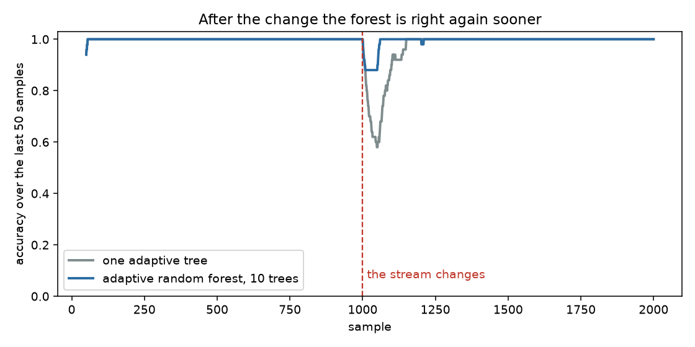

# AdaptiveRandomForestClassifier: replace the trees that go wrong

## A first example: payments whose rule changes

Half of the payments are fraud. At first a fraud is a large payment (around 400) and a normal one is small (around 60); after 750 payments they swap. A forest of 5 trees predicts each payment before it learns it. The first line is the accuracy on payments 500 to 750, on the 100 payments after the change and on the last 200; the second line is the number of warnings and of drifts that the detectors of the trees raised.

```python
import numpy as np
from dense_armor.core.online.forest import AdaptiveRandomForestClassifier

rng = np.random.default_rng(0)
forest = AdaptiveRandomForestClassifier(n_models=5, seed=1)
hits = []
for i in range(1500):
    fraud = int(rng.random() < 0.5)
    big = fraud if i < 750 else 1 - fraud
    amount = float(rng.normal(400 if big else 60, 40 if big else 15))
    hits.append(forest.predict_one({"amount": amount}) == fraud)
    forest.learn_one({"amount": amount}, fraud)
h = np.array(hits, float)
print(h[500:750].mean().round(3), h[750:850].mean().round(3), h[1300:].mean().round(3))
print(forest.n_warnings_, forest.n_drifts_)
```

```
1.0 0.92 1.0
14 4
```

Each tree has two detectors fed with its own mistakes: a warning starts a replacement tree in the background, and a drift puts the replacement in place of the old tree. The accuracy falls a little after the change (to the second number of the first line) and comes back, while the trees that went wrong are replaced.

## How it works

`AdaptiveRandomForestClassifier` is the forest of Gomes and colleagues (2017). It has four ideas, each one simple.

Every tree sees every sample, but with a random weight: a sample counts as many times as a Poisson draw with mean 6, so no two trees train on the same data. Every tree also looks at only a few randomly chosen features when it considers a split, which makes the trees differ from one another. Every tree has two small detectors fed with its own mistakes: a warning detector, which is easy to trigger, and a drift detector, which needs more evidence. A warning starts a second tree in the background that trains on the stream but does not vote. If the drift detector then fires, the background tree takes the place of the old one. Finally the forest votes, and each tree's vote is weighted by its recent accuracy.

```python
import numpy as np
from dense_armor.core.online.forest import AdaptiveRandomForestClassifier

rng = np.random.default_rng(0)
f = AdaptiveRandomForestClassifier(n_models=5, seed=1)
for i in range(1500):
    x = float(rng.normal(0.0 if rng.random() < 0.5 else 5.0, 0.4))
    y = int(x > 2.5) if i < 750 else int(x <= 2.5)
    f.learn_one({"x": x}, y)
print(f.predict_one({"x": 0.1}), f.predict_one({"x": 5.0}))
print(f.n_warnings_, f.n_drifts_)
```

```
1 0
11 3
```

The stream gives class 0 to small `x` for the first 750 samples and then swaps the two labels. After the swap the forest answers 1 for `x = 0.1` and 0 for `x = 5.0`, so it has followed the change. Along the way the detectors raised 11 warnings and 3 drifts.

### Following a sudden change

A longer test makes the effect visible. `DriftStream` produces four numbers per sample and changes its rule at sample 1000. The change of this generator does not always make an old rule wrong, so the five seeds are the first ones (2, 3, 6, 10 and 12) for which a tree that learns until the change and then stops is wrong after it, with an accuracy below 0.5 (`benchmarks/_drift_seeds.py`). The figure shows the accuracy over the last 50 samples, as the median of the five seeds, for one adaptive Hoeffding tree and for the forest of ten trees.



Both fall when the rule changes and both come back to 1.0. In the median of the five seeds the forest is right 0.94 of the time in the first 100 samples after the change and the single tree 0.74. Seed by seed the forest scores 0.94, 0.93, 0.93, 0.94 and 0.95 and the tree 0.94, 0.76, 0.74, 0.10 and 0.62: the forest is better on four seeds and equal on one, with a paired one-sided Wilcoxon p = 0.062, not below 0.05 (with five seeds the smallest value it can take is 0.031).

The detectors tell the same story from the inside. The next figure counts, for the first seed (2), how many warnings and drifts the ten trees raised.


Before the change there is no warning and no drift. After it the ten trees raised 10 warnings and no drift: a warning alone starts a background tree and replaces nothing, so on this seed no tree was replaced. Over the five seeds the totals are 10, 18, 18, 12 and 0 warnings and 0, 0, 7, 3 and 0 drifts; on the last seed the detectors raised nothing and the forest was right on 0.95 of the first 100 samples after the change. Slower detectors, passed as `drift_detector` and `warning_detector`, trade reaction time for fewer false replacements.

The forest costs about 0.97 ms per sample for ten trees against 0.11 ms for the single tree, roughly nine times more.

## The parameters

| Parameter | Meaning | Default |
|---|---|---|
| `n_models` | number of trees | 10 |
| `max_features` | features tried per split attempt; `None` takes `int(sqrt(M)) + 1` | `None` |
| `lambda_` | mean of the Poisson weight of a sample for a tree | 6.0 |
| `drift_detector` | template of the drift detector, cloned for every tree; `None` takes `ADWIN(delta=0.001)` | `None` |
| `warning_detector` | template of the warning detector; `None` takes `ADWIN(delta=0.01)` | `None` |
| `seed` | seed of the Poisson weights and of the feature subsets | `None` |
| `grace_period` | samples at a leaf before a split is attempted | 50 |

## API reference

::: dense_armor.core.online.forest.arf

---

## Details

The references, the choices the papers do not fix, the checks, the cost and the memory of the forests are in the Details of [Streaming forests](index.md#details).
