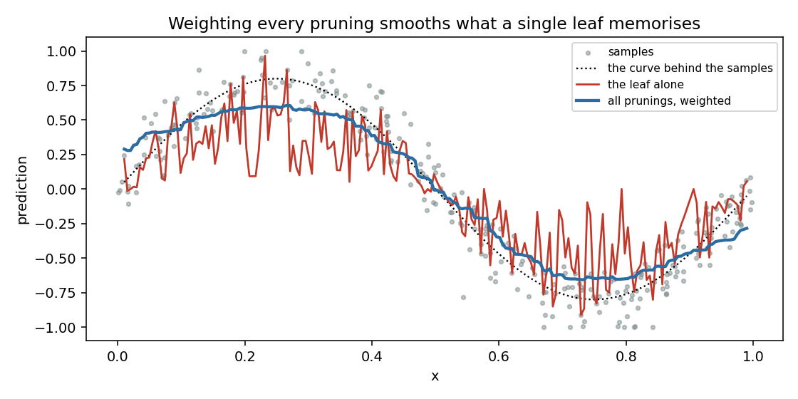
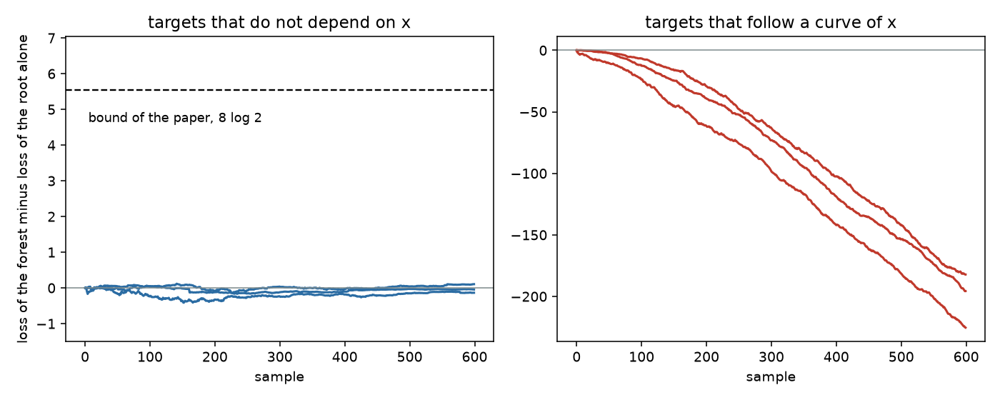

# AggregatedMondrianForest: average every depth

A tree has to decide how deep to go. A deep tree follows the data closely but memorises noise; a shallow one is steady but misses detail. `AggregatedMondrianForestClassifier` and `AggregatedMondrianForestRegressor` follow Mourtada, Gaiffas and Scornet and skip the decision: the answer is the average of the predictions of every pruning of the tree, each pruning weighted by how well it has predicted up to now. A pruning that has been predicting well counts more; a poor one fades.

There are exponentially many prunings, so the average sounds impossible. The paper shows that with a simple prior, a pruning with `n` nodes starting at weight `2^-n`, the whole sum can be kept as two numbers per node and read along a single path from the leaf to the root. The library implements exactly that, so a prediction costs one walk up the tree.

The library already has a Mondrian forest. It smooths each tree with a fixed prior over where a path leaves the tree, so a node weighs the same whatever it has predicted. The aggregated forest replaces that fixed prior with weights learned from the loss of every node.

```python
from dense_armor.core.online.forest import AggregatedMondrianForestRegressor

f = AggregatedMondrianForestRegressor(n_trees=10, seed=0)
for i in range(200):
    x = (i % 20) / 19.0
    f.learn_one({"x": x}, 1.0 if x > 0.5 else -1.0)
print(round(f.predict_one({"x": 0.9}), 2), round(f.predict_one({"x": 0.1}), 2))
```

```
0.99 -0.96
```

The target is -1 on the left half and +1 on the right half; the forest answers 0.99 and -0.96 at `x = 0.9` and `x = 0.1`.

### What the weighting does

The next figure uses a noisy curve. The red line is what the leaf alone predicts, which is the prediction of the deepest tree. The blue line is the weighted average of all prunings.



The leaf follows every wiggle of the noise. The aggregated line is smooth and follows the curve, at the cost of flattening the peaks: the average also includes shallow prunings, which predict the middle of a broad region. With a larger `step` the weights lean harder on the best pruning, and `predict_unaggregated_one` returns the leaf prediction for comparison.

### What the paper guarantees

The paper bounds how much worse the aggregate can be than any single pruning. For the quadratic loss and targets in `[-B, B]`, with `step = 1 / (8 B^2)`, the loss of the forest exceeds that of any pruning `T` by at most `4 B^2 (|T| + 1) log n`; for classification with the logarithmic loss and `step = 1`, by at most `|T| log 2 + (|T| + 1)(K - 1)/4 * log(4n)`. Against the smallest pruning, the root alone, the bound is just `log 2 / step`.



On the left the targets are independent of `x`, so the root is the best answer, and the forest stays within a fraction of a unit of it, far below the bound of 5.5. On the right the targets follow a curve of `x`, the aggregate beats the root by more and more, and after 600 samples the difference is between -180 and -225. The bound only limits the damage; it says nothing about how much better the forest can be.

## The parameters

| Parameter | Meaning | Classifier | Regressor |
|---|---|---|---|
| `n_trees` | number of trees | 10 | 10 |
| `step` | learning rate `eta` of the exponential weights | 1.0 | 0.125 |
| `dirichlet` | symmetric Dirichlet parameter of the forecaster of a node (classifier only) | 0.5 | |
| `low`, `high` | the two ends of every feature | 0.0, 1.0 | 0.0, 1.0 |
| `classes` | the label set, when known (classifier only); `None` grows it with the stream | `None` | |
| `seed` | seed of the partitions | `None` | `None` |
| `feature_keys` | names of the features; `None` takes the sorted keys of the first sample | `None` | `None` |
| `max_nodes` | largest number of nodes of one tree; `None` lifts the limit | 10000 | 10000 |

## API reference

::: dense_armor.core.online.forest.amf

---

## Details

The references, the choices the paper does not fix, the checks, the cost and the memory of the forests are in the Details of [Streaming forests](index.md#details).
