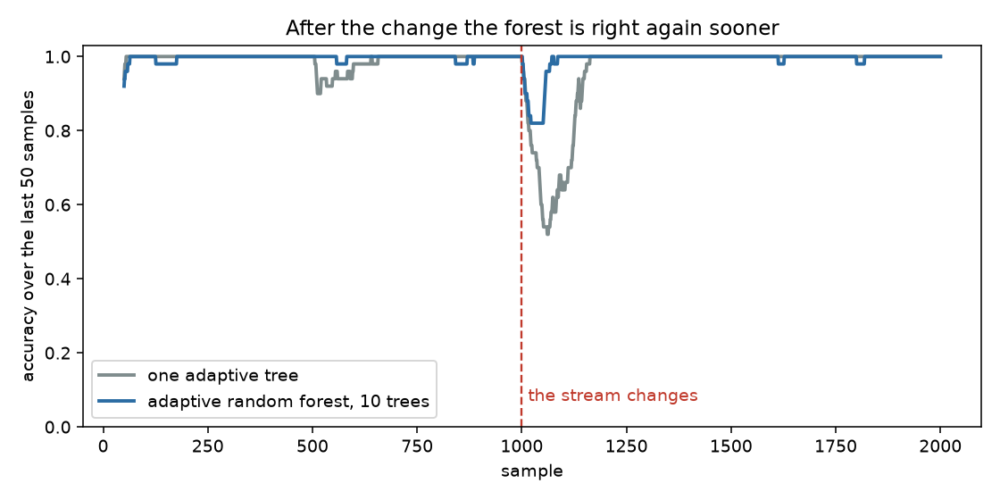
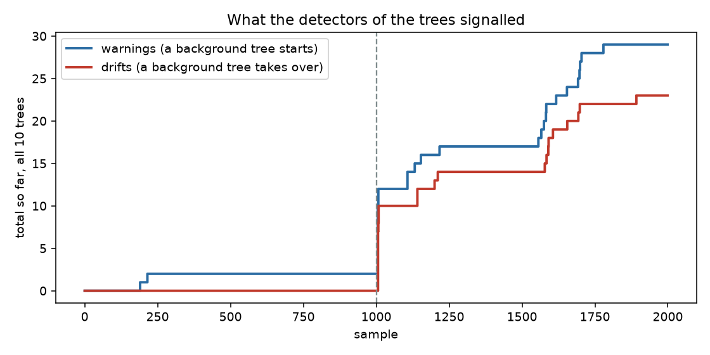
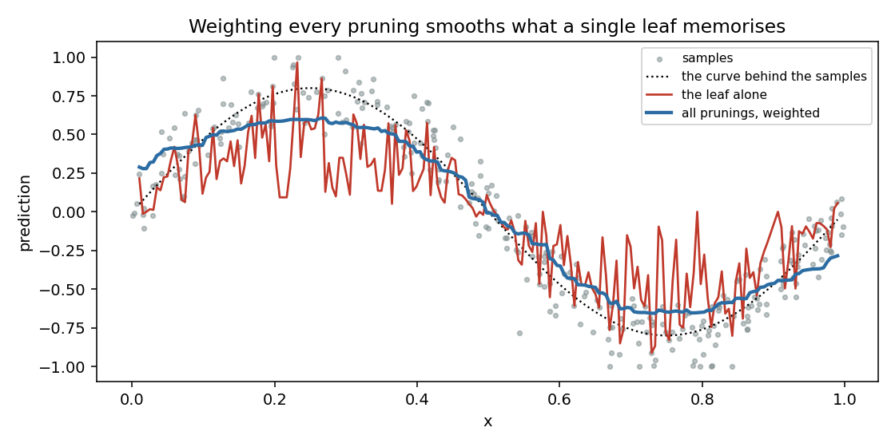
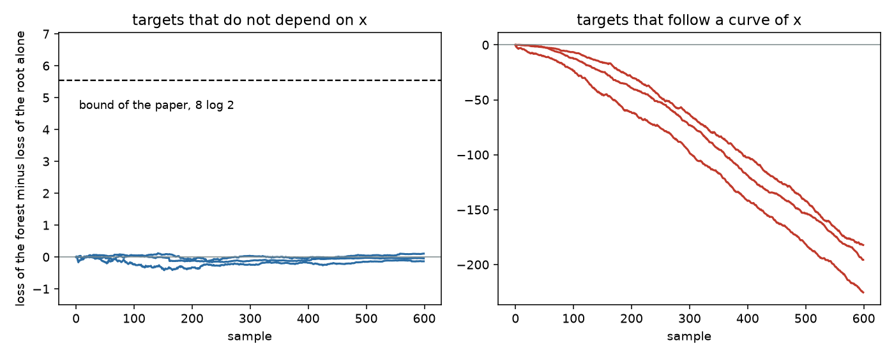

# Forests that follow a changing stream

**In plain words:** One decision tree answers with one opinion. A forest asks many trees and combines them, so the mistakes of a single tree are outvoted and the spread of the answers says how sure the forest is. This page has two forests: one that replaces its trees when the stream changes, and one that averages every tree depth, weighting each by how well it has predicted so far.

## 1. Why a forest

Picture an AI assistant that must decide, from a few numbers about each incoming request, which of two models should answer it. A decision tree learns that rule one request at a time. The trouble is the day the requests change: the old rule is wrong, and a single tree must notice it, forget, and relearn, with nobody else to lean on.

A forest spreads the risk. Each tree watches its own mistakes. When a tree starts failing it prepares a replacement in the background, and the forest keeps answering with the trees that still work. The two classes below do this in two different ways.

## 2. Adaptive random forest: replace the trees that go wrong

`AdaptiveRandomForestClassifier` is the forest of Gomes and colleagues (2017). It has four ideas, each one simple.

Every tree sees every sample, but with a random weight: a sample counts as many times as a Poisson draw with mean 6, so no two trees train on the same data. Every tree also looks at only a few randomly chosen features when it considers a split, which makes the trees differ from one another. Every tree has two small detectors fed with its own mistakes: a warning detector, which is easy to trigger, and a drift detector, which needs more evidence. A warning starts a second tree in the background that trains on the stream but does not vote. If the drift detector then fires, the background tree takes the place of the old one. Finally the forest votes, and each tree's vote is weighted by its recent accuracy.

```python
import numpy as np
from dense_armor.utility.forest import AdaptiveRandomForestClassifier

rng = np.random.default_rng(0)
f = AdaptiveRandomForestClassifier(n_models=5, seed=1)
for i in range(1500):
    x = float(rng.normal(0.0 if rng.random() < 0.5 else 5.0, 0.4))
    y = int(x > 2.5) if i < 750 else int(x <= 2.5)
    f.learn_one({"x": x}, y)
print(f.predict_one({"x": 0.1}), f.predict_one({"x": 5.0}))
print(f.n_warnings_, f.n_drifts_)
```

```
1 0
8 2
```

The stream gives class 0 to small `x` for the first 750 samples and then swaps the two labels. After the swap the forest answers 1 for `x = 0.1` and 0 for `x = 5.0`, so it has followed the change. Along the way the detectors raised 8 warnings and 2 drifts.

### Following a sudden change

A longer test makes the effect visible. `DriftStream` produces four numbers per sample and changes its rule at sample 1000. The figure shows the accuracy over the last 50 samples, as the median of five seeds, for one adaptive Hoeffding tree and for the forest of ten trees.



Both fall when the rule changes, and both come back to 1.0. In the median of the five seeds the forest falls less and returns sooner: in the first 100 samples after the change it is right 0.910 of the time and the single tree 0.540. Seed by seed the forest scores 0.90, 0.98, 0.96, 0.91 and 0.84 and the tree 0.12, 1.00, 0.98, 0.53 and 0.54, so the tree is the better one on two seeds and the difference is not significant (Section 4).

The detectors tell the same story from the inside. The next figure counts, for one seed, how many warnings and drifts the ten trees raised.



Before the change there are two warnings and no drift: a warning alone replaces nothing. At the change the drift line jumps as the trees are replaced one after another. The forest raised 29 warnings and 23 drifts in total on this stream, and a second burst appears between samples 1550 and 1700, when the rule is no longer changing. With the fast detector setting that is the price of reacting quickly: a tree may be replaced without need. Slower detectors, passed as `drift_detector` and `warning_detector`, trade reaction time for fewer false replacements.

The forest costs about 4.3 ms per sample for ten trees against 0.24 ms for the single tree, roughly eighteen times more.

## 3. Aggregated Mondrian forest: average every depth

A tree has to decide how deep to go. A deep tree follows the data closely but memorises noise; a shallow one is steady but misses detail. `AggregatedMondrianForestClassifier` and `AggregatedMondrianForestRegressor` follow Mourtada, Gaiffas and Scornet and skip the decision: the answer is the average of the predictions of every pruning of the tree, each pruning weighted by how well it has predicted up to now. A pruning that has been predicting well counts more; a poor one fades.

There are exponentially many prunings, so the average sounds impossible. The paper shows that with a simple prior, a pruning with `n` nodes starting at weight `2^-n`, the whole sum can be kept as two numbers per node and read along a single path from the leaf to the root. The library implements exactly that, so a prediction costs one walk up the tree.

The library already has a Mondrian forest. It smooths each tree with a fixed prior over where a path leaves the tree, so a node weighs the same whatever it has predicted. The aggregated forest replaces that fixed prior with weights learned from the loss of every node.

```python
from dense_armor.utility.forest import AggregatedMondrianForestRegressor

f = AggregatedMondrianForestRegressor(n_trees=10, seed=0)
for i in range(200):
    x = (i % 20) / 19.0
    f.learn_one({"x": x}, 1.0 if x > 0.5 else -1.0)
print(round(f.predict_one({"x": 0.9}), 2), round(f.predict_one({"x": 0.1}), 2))
```

```
0.99 -0.96
```

The target is -1 on the left half and +1 on the right half; the forest answers 0.99 and -0.96 at `x = 0.9` and `x = 0.1`.

### What the weighting does

The next figure uses a noisy curve. The red line is what the leaf alone predicts, which is the prediction of the deepest tree. The blue line is the weighted average of all prunings.



The leaf follows every wiggle of the noise. The aggregated line is smooth and follows the curve, at the cost of flattening the peaks: the average also includes shallow prunings, which predict the middle of a broad region. With a larger `step` the weights lean harder on the best pruning, and `predict_unaggregated_one` returns the leaf prediction for comparison.

### What the paper guarantees

The paper bounds how much worse the aggregate can be than any single pruning. For the quadratic loss and targets in `[-B, B]`, with `step = 1 / (8 B^2)`, the loss of the forest exceeds that of any pruning `T` by at most `4 B^2 (|T| + 1) log n`; for classification with the logarithmic loss and `step = 1`, by at most `|T| log 2 + (|T| + 1)(K - 1)/4 * log(4n)`. Against the smallest pruning, the root alone, the bound is just `log 2 / step`.



On the left the targets are independent of `x`, so the root is the best answer, and the forest stays within a fraction of a unit of it, far below the bound of 5.5. On the right the targets follow a curve of `x`, the aggregate beats the root by more and more, and after 600 samples the difference is between -180 and -225. The bound only limits the damage; it says nothing about how much better the forest can be.

## 4. Numbers

`DriftStream`, one sudden change at half, 2000 samples, four features, median of five seeds, test-then-train. Accuracy (mean squared error of the label for the regressors) on the 300 samples before the change, on the first 100 after it, and on 300 samples starting 200 after it.

| learner | before | first 100 | after + 200 | ms per sample |
|---|---|---|---|---|
| AdaptiveRandomForestClassifier | 0.993 | 0.910 | 1.000 | 4.31 |
| HoeffdingAdaptiveTreeClassifier | 1.000 | 0.540 | 1.000 | 0.24 |
| AggregatedMondrianForestClassifier | 1.000 | 0.980 | 1.000 | 3.78 |
| MondrianForestClassifier | 1.000 | 0.980 | 1.000 | 1.39 |
| AggregatedMondrianForestRegressor (MSE) | 0.002 | 0.084 | 0.009 | 3.26 |
| MondrianForestRegressor (MSE) | 0.000 | 0.029 | 0.001 | 1.41 |

The adaptive random forest has a higher median accuracy than the single adaptive tree in the first 100 samples after the change, but on five seeds the difference is not significant: the forest is better on three seeds and the tree on two (paired Wilcoxon signed-rank, one-sided, p = 0.156; A12 = 0.62, below the 0.71 of a large effect). The forest also has ten trees against one, which is part of the difference. On this stream the aggregated Mondrian forests score the same as or below the Mondrian forests already in the library and cost more per sample; the aggregation also needs a box around the inputs, taken here from the range of the whole stream.

## Details

### References

- Gomes, H. M., Bifet, A., Read, J., Barddal, J. P., Enembreck, F., Pfahringer, B., Holmes, G., Abdessalem, T. (2017). Adaptive random forests for evolving data stream classification. Machine Learning 106, 1469-1495. Algorithms 1 and 2 (pages 7 and 8 of the PDF), the detector settings on page 17.
- Mourtada, J., Gaiffas, S., Scornet, E. AMF: Aggregated Mondrian forests for online learning. arXiv:1906.10529v2, the manuscript version of the PDF used. Equations 1, 5, 6 and 7, Algorithms 2 and 3, Lemma 1, Corollaries 1 and 2.
- Lakshminarayanan, B., Roy, D. M., Teh, Y. W. (2014). Mondrian forests: efficient online random forests. NIPS.

### Choices the papers do not fix

- **Detector thresholds.** The paper compares a slow setting (`delta_w = 1e-4`, `delta_d = 1e-5`) and a fast one (`delta_w = 0.01`, `delta_d = 0.001`). The default here is the fast one, which reacts inside streams of a few thousand samples.
- **Feature subset.** The paper draws the subset when a node is created; here it is drawn at the first split attempt of the node, from the features seen there, and kept for the later attempts. The size is `int(sqrt(M)) + 1` unless `max_features` is given.
- **Drift without a warning.** The tree is replaced by a new empty tree, since there is no background tree to promote.
- **The vote.** It adds the class probabilities of each tree, weighted by `c / n`, and normalises. When every weight is zero the trees count equally.
- **Parameter names of the aggregated forest.** `step` is the learning rate `eta` of the paper and `dirichlet` is the parameter `a` of the Dirichlet prior of a node forecaster, `(n_y + a) / (n + K a)`; `a = 1/2` is the Krichevsky-Trofimov forecaster. The paper uses neither name.
- **Equation 5.** The paper prints `t - 1` in the denominator of the forecaster. The version that sums to one over the labels of a node uses the count of that node, which is what is implemented.
- **Labels and inputs.** The set of labels grows with the stream unless `classes` fixes it. Inputs are clipped to the box `[low, high]`.
- **Random predictions.** As in the paper, a prediction draws the splits that would separate the query from the sample in its cell and discards them, so `predict_one` is random and leaves the trees unchanged.

### What is implemented

The aggregated forests implement the version of Section 2 of the paper, on an unrestricted Mondrian partition (Algorithm 2). The restricted partition of Section 4, which the paper uses in its experiments and for which it states no guarantee, is not implemented. The regret bounds quoted above are those of the implemented version, for a tree below its `max_nodes` (default 10000 per tree); once a tree has that many nodes it stops splitting, and the bounds are not claimed for what it predicts after that.

`OnlineExtraTreesRegressor` and `AMRules` are left out of the package until their papers are available.

### Checks

- The collapsed weights equal the exponentially weighted sum of equation 6 taken over every pruning of a small tree, with a difference below 1e-9 for `step` from 0.125 to 200 (a leaf of the finished tree stands for all its refinements, which have the same loss, so its prior mass is 1).
- Lemma 1, Corollary 1 and Corollary 2 hold on the prequential streams of `test/forest/test_amf.py`.
- On a noiseless step function the aggregated prediction with `step = 1e4` equals the leaf prediction. On a noisy curve the two differ: with one tree, 300 training samples, queries at 100 of them, and a large `step`, the two differ by at most 0.19 (median 0.04). A large `step` selects the best pruning in hindsight, which is the deepest tree only when the data is clean.
- `check_estimator` passes for the three classes with no check skipped. They have no pure `init_state` / `step` form, since the state is a set of trees of changing shape.
- After `load_state_dict`, a pickle round trip and `clone(include_attributes=True)`, an aggregated classifier still accepts a label it has not seen and returns probabilities that sum to one.

### Cost and memory

p99 of one `learn_one` plus one `predict_one` over 3000 samples with four features, on a Kaggle CPU: 9.4 ms for the adaptive random forest of ten trees, 4.3 ms for the aggregated classifier and 4.0 ms for the aggregated regressor; `budget_s` is 0.1 s for the adaptive forest and 0.04 s for the two aggregated forests, about ten times the measured p99.

The trees of both forests are bounded by `max_nodes`, so the state is constant in the length of the stream. The aggregated trees keep two weights per node and, on uniform inputs with 1, 2 and 4 features, between 3.6 and 4.0 nodes per sample until they reach the limit. The depth of a tree on two features was 21, 30 and 43 after 100, 1000 and 4000 samples.

### Development diary

The first test of the collapsed weights against the sum over prunings differed by 0.77. The cause was in the test: the sum of the paper runs over the subtrees of the infinite Mondrian tree, so a leaf of the finished tree has to carry the weight of all its refinements. With that correction the two agree to about 4e-15.

The first test of the adaptive forest expected a drift after a plain label swap. None came: the trees relearn from the weighted samples within about 50 samples, before the drift detector at `delta = 0.001` collects enough errors. The warnings came, and the accuracy recovered.
