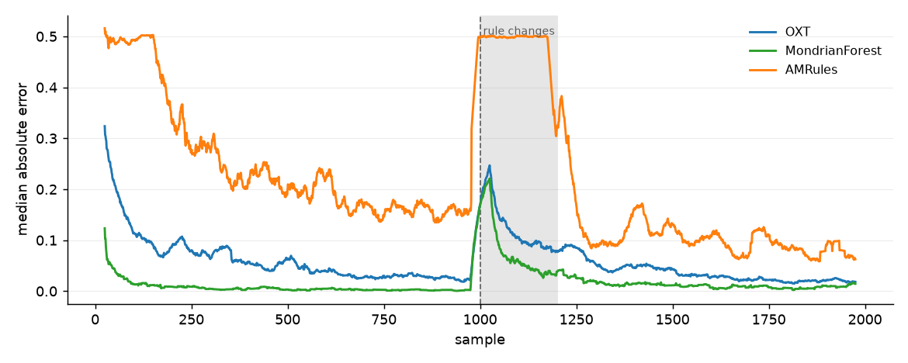

# OnlineExtraTreesRegressor: draw the split at random

## A first example: the cost of an insurance claim

A claim costs 400 more when the amount feature is positive and 100 more when the tenure feature is above 0.5, with a noise of 20; three other features (hour, weekday, channel) have nothing to do with the cost. The forest sees 1500 claims, one at a time, and is asked the cost of three claims, whose true costs are 400, 100 and 500.

```python
import numpy as np
from dense_armor.core.online.forest import OnlineExtraTreesRegressor

rng = np.random.default_rng(0)
forest = OnlineExtraTreesRegressor(n_models=5, seed=0)
names = ["amount", "tenure", "hour", "weekday", "channel"]
for _ in range(1500):
    x = {k: float(rng.uniform(-1.0, 1.0)) for k in names}
    cost = 400.0 * (x["amount"] > 0.0) + 100.0 * (x["tenure"] > 0.5)
    forest.learn_one(x, cost + float(rng.normal(0.0, 20.0)))
rest = {"hour": 0.3, "weekday": -0.2, "channel": 0.9}
print(round(forest.predict_one({"amount": 0.5, "tenure": 0.0, **rest})))
print(round(forest.predict_one({"amount": -0.5, "tenure": 0.8, **rest})))
print(round(forest.predict_one({"amount": 0.5, "tenure": 0.8, **rest})))
```

```
394
93
409
```

The three answers are 394, 93 and 409, for true costs of 400, 100 and 500: the first two are close and the third is 91 below the true cost. The forest never searched for a best split: every leaf drew its split point at random in the range of a small buffer of five observations.

## How it works

The random forest and the adaptive random forest ask, for every feature of every leaf,
where the best split would be. That is a search: every observed `(feature, target)` pair
is stored, sorted, and scanned. A tree with many leaves, on a stream with many samples,
pays for the search at every attempt.

`OnlineExtraTreesRegressor` (OXT) skips the search. Each leaf draws a small buffer of its
first `s = 5` observations per candidate feature, takes the minimum and the maximum of
that buffer, and picks the split point `phi` uniformly in that range. From that sample
onward, the leaf only keeps two small accumulators, one for the targets below `phi` and
one for the targets above it, and evaluates the variance reduction from those. One
candidate per feature, no sorting, no storage of the inputs.

The forest keeps the drift machinery of the adaptive random forest. Every tree sees
every sample with probability `p = 0.5` (sub-bagging, without replacement). Every tree
has two detectors on its own absolute error: a warning, easier to trigger, and a drift,
harder. A warning starts a background tree that trains on the same stream but does not
vote. If a drift fires, the background tree takes the place of the old one.

```python
import numpy as np
from dense_armor.core.online.forest import OnlineExtraTreesRegressor

rng = np.random.default_rng(0)
f = OnlineExtraTreesRegressor(n_models=5, seed=0)
for _ in range(1500):
    a = float(rng.uniform(-1.0, 1.0))
    b = float(rng.uniform(-1.0, 1.0))
    f.learn_one({"a": a, "b": b}, 4.0 * (a > 0.0))
print(round(f.predict_one({"a": 0.5, "b": 0.0}), 1),
      round(f.predict_one({"a": -0.5, "b": 0.0}), 1))
```

```
4.0 0.2
```

The target is `4` when `a > 0` and `0` when `a < 0`; the feature `b` never matters.
After 1500 samples the forest answers close to `4` on the positive side and close to
`0` on the negative side, using only random split points and a buffer of five samples
per candidate feature.

### What the random split costs and buys

The next figure uses the same `DriftStream` of the [adaptive random forest](adaptive_random_forest.md) page, one sudden change at sample
1000, 2000 samples, four features, median of five seeds. The seeds are those of the adaptive random forest page. The line is the median
absolute error, smoothed over 50 samples, for OXT, for `MondrianForestRegressor` with
ten trees, and for `AMRulesRegressor`.



All three fall when the rule changes. OXT recovers more slowly than the Mondrian forest,
and its error after the change stays above the Mondrian line. Against AMRules the OXT line stays below the AMRules line both before and after the change.

## The parameters

| Parameter | Meaning | Default |
|---|---|---|
| `n_models` | number of trees | 20 |
| `p` | chance that a tree trains on a sample (sub-bagging) | 0.5 |
| `max_features` | features tried per split attempt; `None` takes `max(1, int(sqrt(M)))` | `None` |
| `buffer_size` | size `s` of the buffer of the random splitter | 5 |
| `grace_period` | samples between split attempts of a leaf | 50 |
| `delta` | split significance of the Hoeffding bound | 0.05 |
| `tau` | tie threshold | 0.05 |
| `drift_detector`, `warning_detector` | templates of the two detectors, cloned for every tree; `None` takes `ADWIN(delta=0.001)` and `ADWIN(delta=0.01)` | `None` |
| `fading` | fading factor of the error that chooses between the target mean and the linear model | 0.95 |
| `learning_rate` | step of the delta rule of the linear models | 0.01 |
| `max_nodes`, `max_depth` | largest number of nodes and depth of a tree | 1000, `None` |
| `seed`, `feature_keys` | seed of the sampling and of the splits; names of the features | `None` |

## API reference

::: dense_armor.core.online.forest.oxt

---

## Details

The references, the choices the papers do not fix, the checks, the cost and the memory of the forests are in the Details of [Streaming forests](index.md#details).
