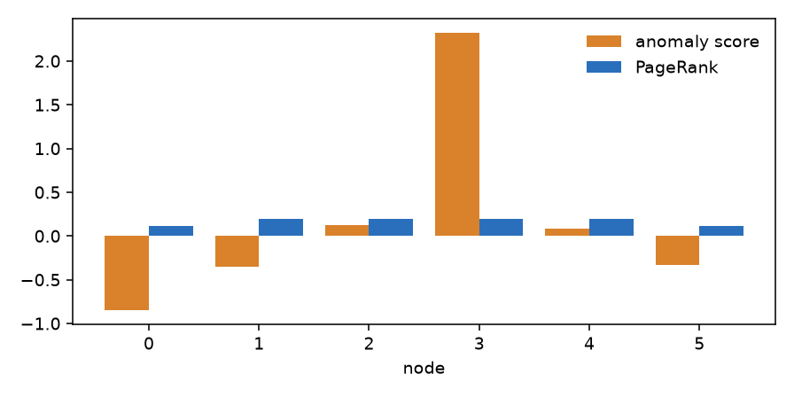

# Which node is wrong?

You have a graph and one number on each node, and one number is not right. This page ranks the nodes by how central they are, follows a walk from one node, and then scores each node by how far its value is from what its neighbours say.

## 1. How central is a node?

`page_rank(graph)` gives each node a share of 1, larger for a node that many others point to. It wraps `networkx.pagerank`, with the edge weights, and `alpha` is the damping, between 0 and 1.

```python
from dense_armor.core.graph import Graph, page_rank

g = Graph(6, [(0, i, 1.0) for i in range(1, 6)])
print({k: round(v, 4) for k, v in page_rank(g).items()})
```

```text
{0: 0.473, 1: 0.1054, 2: 0.1054, 3: 0.1054, 4: 0.1054, 5: 0.1054}
```

The graph is a star with node 0 at the centre. The centre holds almost half of the share and the five leaves hold the same, smaller share each.

## 2. A walk that starts at one node

`random_walk_restart(graph, seed)` is PageRank where, at every step, the walk goes back to `seed` with probability `1 - alpha`. The result says how close each node is to the seed. An unknown seed raises `ValueError`.

```python
from dense_armor.core.graph import Graph, random_walk_restart

g = Graph(6, [(i, i + 1, 1.0) for i in range(5)])
print({k: round(v, 4) for k, v in random_walk_restart(g, 0).items()})
```

```text
{0: 0.2864, 1: 0.3209, 2: 0.1823, 3: 0.108, 4: 0.0719, 5: 0.0305}
```

On a path the share falls with the distance from node 0. Node 1 has a little more than the seed itself, because it has two neighbours that send the walk back and forth.

## 3. A score for each node

`graph_anomaly_score(graph, signal)` takes a signal with one value per node. For each node it compares the value with the heat-kernel smoothing of the signal, `r = x - exp(-tau L) x`: a node that follows its neighbours has a small `r`, a node that does not has a large one. The score of node `i` is `zscore(|r|)` plus its PageRank.

```python
import numpy as np
from dense_armor.core.graph import Graph, graph_anomaly_score

g = Graph(6, [(i, i + 1, 1.0) for i in range(5)])
x = np.array([0.1, -0.1, 0.0, 6.0, 0.1, -0.1])
s = graph_anomaly_score(g, x)
print({k: round(v, 3) for k, v in s.items()}, max(s, key=s.get))
```

```text
{0: -0.852, 1: -0.352, 2: 0.122, 3: 2.326, 4: 0.087, 5: -0.331} 3
```

Node 3 holds 6.0 while the others hold values near 0, and it has the highest score. The Fourier magnitude of the signal is not used: it is a frequency and says nothing about which node is wrong.



*The score of each node of the path above and its PageRank. The score follows the spike; PageRank only follows the shape of the graph.*

If the signal is the same on every node, the residual is zero up to rounding, and the score of each node is its PageRank.

## Details

The score `zscore(|r|) + page_rank` is a choice of this module. The papers describe the heat kernel and PageRank, none of them defines a score per node. The two parts have different scales: the z-score has unit spread and PageRank sums to 1, so on a large graph the residual dominates. A different residual, for example the deviation from the median of the neighbours, would be another choice. A signal of the wrong length raises a NumPy error, and a negative `tau` is not refused.

In the first version the score used the Fourier magnitude, and for a signal with equal values the z-score of the rounding noise gave scores near 2 instead of the PageRank: the spread is now compared with the rounding before dividing by it.
