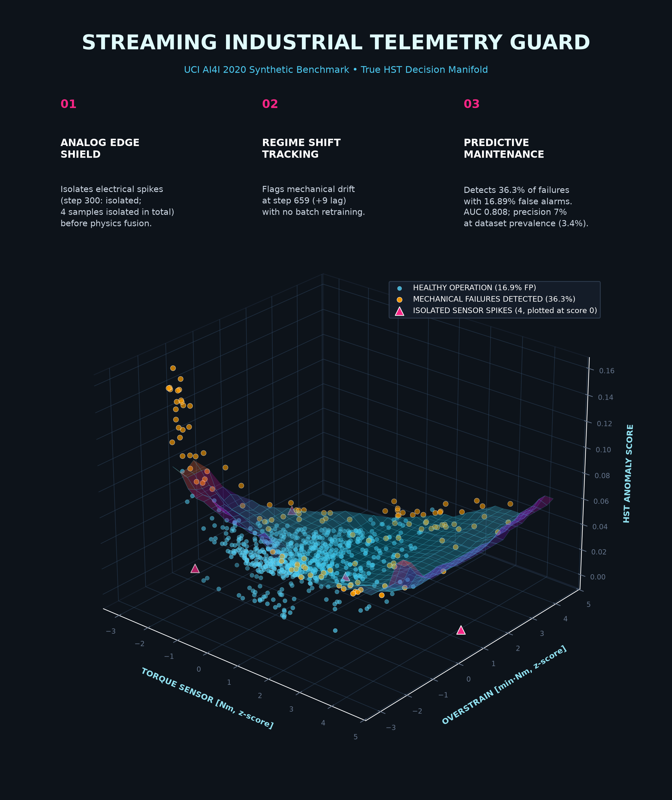

# Industrial telemetry guard

A machine sends five numbers every few seconds: two temperatures, the rotational speed, the torque and the tool wear. This page shows how to watch that stream in three steps: isolate a broken sensor reading, detect a change of regime, and flag the samples that look like a mechanical failure.

## The scene

The data is the UCI AI4I 2020 Predictive Maintenance dataset: 10 000 samples of a milling machine, each labelled with `Machine failure` (339 failures, 3.4%). The page builds a stream of 650 healthy samples followed by the 339 failures, so the change of regime is at sample 650. The stream is built from labelled data and is **synthetic**: it is not a recording of one machine over time.

Three tools of Dense-Armor watch it, one after the other:

| Tool | Its one job | In this page |
|---|---|---|
| `HampelScorer` | Isolates a single out-of-range reading | An electrical spike injected at sample 300 |
| `HalfSpaceTrees` | Scores how unusual a sample is | One score per sample, higher is more unusual |
| `PageHinkley` | Detects a sustained rise of the score | The change of regime at sample 650 |



*Left to right: the spike shield, the regime-shift tracker and the failure detector. The surface is the HST score over torque and overstrain; blue points are healthy samples, orange points are failures that raised an alarm, pink triangles are isolated sensor spikes.*

## 1. The stream

The five sensor columns are normalised with the mean and the standard deviation of the first 150 healthy samples. A reading of 9.5 standard deviations is written into the torque at sample 300: this is the electrical spike.

```python
import numpy as np
from ucimlrepo import fetch_ucirepo

d = fetch_ucirepo(id=601)
cols = ["Air temperature", "Process temperature", "Rotational speed", "Torque", "Tool wear"]
X = d.data.features[cols].to_numpy(dtype=float)
y = d.data.targets["Machine failure"].to_numpy(dtype=int)
print(X.shape, int(y.sum()), round(float(y.mean()) * 100, 1))
```

```
(10000, 5) 339 3.4
```

There are only 339 failures, so the stream has 650 + 339 = 989 samples.

## 2. Isolate the spike

A `HampelScorer` keeps the last 20 values of one sensor and scores a new value as `|x - median| / (1.4826 * MAD)`. A value above 7.5 is an outlier. The pipeline runs one scorer on air temperature, one on process temperature and one on torque. A sample flagged by any of them is skipped: it does not reach the next step.

A real fault does not look like a spike: it lasts. If a sensor is flagged for more than three samples in a row, the scorer starts learning the new values, so a lasting shift is not discarded forever.

## 3. Score the sample

The remaining samples go to `HalfSpaceTrees` (Tan, Ting and Liu, IJCAI 2011). Before scoring, three physical quantities are computed from the raw readings and normalised: power (torque times angular speed), overstrain (tool wear times torque) and the temperature difference. The six features are rpm, torque, wear, power, overstrain and temperature difference.

```python
from dense_armor.core.online.anomaly.hst import HalfSpaceTrees

hst = HalfSpaceTrees(n_trees=30, depth=6, window=100,
                     feature_keys=["delta_temp", "overstrain", "power", "rpm", "torque", "wear"],
                     feature_ranges=[(-4.0, 6.0)] * 6,
                     threshold_quantile=0.82, threshold_window=500,
                     threshold_warmup=100, seed=42)
```

The model scores a sample first and learns it afterwards, as in Algorithm 3 of the paper: every sample, anomalous or not, updates the model. The score is 0 until the first window of 100 samples is complete, and the alarm threshold is the 0.82 quantile of the last 500 scores, active after 100 more.

## 4. Detect the regime shift

`PageHinkley` receives the HST score, once the first window is complete, and raises an alarm when the score rises in a sustained way.

```python
from dense_armor.core.online.drift.page_hinkley import PageHinkley

drift = PageHinkley(delta=0.05, threshold=20.0, two_sided=False, warmup=150)
```

## 5. Run it

The script is `pipelines/iot/industrial_telemetry_guard.py`. It downloads the dataset, runs the stream and saves the figure of this page in the current folder.

```bash
pip install "dense-armor[iot]"
python pipelines/iot/industrial_telemetry_guard.py
```

```
Processed 989 UCI AI4I 2020 samples in 1153.07 ms (1165.9 us/sample)
Injected spike at step 300 isolated:          True (total isolated: 4)
Regime shift flagged at step:                 659 (onset step: 650)
Drift triggers before onset (false):  0
False alarm rate on healthy window:           16.89%
Mechanical failure detection rate:            36.3%
ROC AUC of HST score (healthy vs failure):    0.808 (n_pos=336, n_neg=449)
Precision on this stream (failure share 43.0%): 61.8%
Expected precision at dataset prevalence (3.4%): 7.0%
```

## 6. What the numbers mean

| Quantity | Value | How to read it |
|---|---|---|
| Spike at sample 300 | isolated | The injected reading never reaches the model |
| Regime shift | flagged at 659, onset 650 | 9 samples of delay, 0 false triggers before the onset |
| False alarm rate | 16.89% | Healthy samples 200 to 649 above the threshold |
| Detection rate | 36.3% | Failure samples above the threshold |
| ROC AUC | 0.808 | Probability that a failure scores higher than a healthy sample |
| Precision on this stream | 61.8% | Failures are 43% of the evaluated samples |
| Precision at dataset prevalence | 7.0% | The same detector if failures are 3.4% of the samples |

The false alarm rate is close to the 18% that the 0.82 quantile gives by construction: a fixed quantile flags about one healthy sample in six, whatever the data. The detection rate depends on the same choice, and also on the model learning the failures: after one window of 100 samples a lasting failure regime is no longer unusual for the model. The AUC does not depend on the threshold, so it is the number to compare with other detectors. At the real prevalence of 3.4%, 93 alarms in 100 would be false: this detector is a ranking tool, not an alarm to wire to a stop button without a higher threshold.

## Details

### References

- Tan, S. C., Ting, K. M., Liu, T. F. (2011). Fast anomaly detection for streaming data. IJCAI, 1511-1516. Algorithms 1 to 3 and the anomaly score `r * 2^k`.
- Hampel, F. R. (1974). The influence curve and its role in robust estimation. JASA 69(346), 383-393.
- Page, E. S. (1954). Continuous inspection schemes. Biometrika 41(1-2), 100-115.
- Dataset: UCI Machine Learning Repository, AI4I 2020 Predictive Maintenance Dataset, id 601.

### Choices stated explicitly

- **The stream is built from labels.** 650 healthy samples, then all 339 failures. The change of regime is by construction, and failures are 35% of the stream while they are 3.4% of the dataset. The page reports the precision at the dataset prevalence for this reason.
- **The spike is injected.** The value 9.5 standard deviations at sample 300 is a choice. Three other samples are also isolated by the Hampel scorers, so the total is four.
- **The parameters are chosen by hand** (quantile 0.82, 7.5 sigma, window 100, Page-Hinkley threshold 20) and were not tuned on a separate set.
- **The HST score is higher for more unusual samples.** The module returns `M / (M + S)` with `M = n_trees * window`, which turns the mass score of the paper (large for normal samples) into a score that grows for unusual ones.
- **The feature ranges are fixed** to `(-4, 6)` in standard-deviation units, so they do not depend on the first samples of the stream.
- **The surface is a slice.** For each point of the grid, torque and overstrain are the two axes; wear is deduced as overstrain divided by torque, power comes from torque and the median rpm, the temperature difference is 0. Points where the wear would be outside the range seen in the data are left blank.
- **The spike markers are drawn at score 0**, because a skipped sample has no score.
- **The Page-Hinkley detector is one-sided with threshold 20.** With the threshold at 2 it triggered 52 times before the onset.

### Measured cost

The 989 samples are processed in about 1.15 s on a Windows machine, about 1.2 ms per sample. The timing covers the stream loop only, not the 3D surface.

### Development diary

The first version learned only the samples the detector did not flag. The model then stayed frozen on healthy data and the detection rate looked high (83.8%) at the cost of 24.9% false alarms. Learning every sample, as the paper does, gives the numbers of this page. The windows were also shortened (from 450 to 100 samples) so the model and its threshold are active during the healthy part of the stream, where the false alarm rate is measured.
