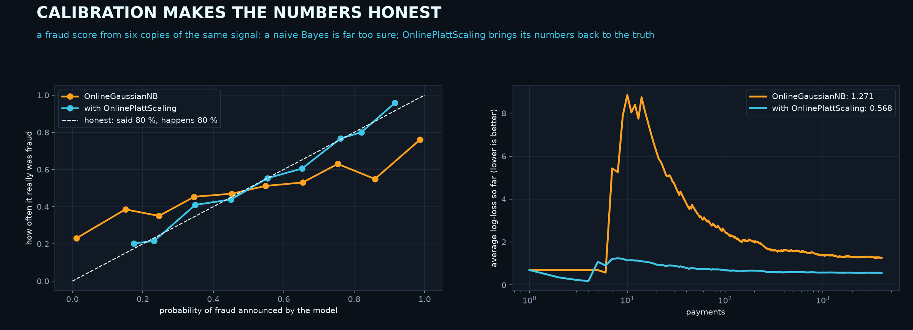

# Calibration: online Platt scaling via sequential Newton optimization

A model can be great at ranking outcomes but still report the wrong confidence numbers—stating it is 99% sure when it is only right 80% of the time. This tool corrects those probabilities in real time, sample by sample, so that whoever reads the probabilities, to block a payment or to stop a machine, can rely on numbers that match how often the model is right.


A classifier can rank its predictions well and still attach the wrong numbers to them.
A decision tree that has 80 % accuracy on some region will happily output 0.99 on every
sample of that region — the ranking is fine, the numbers are lies. A bank that reads
those numbers to decide which payments to block will block too many or too few: a 0.99
that means "80 %" makes it act far too confidently.

**Calibration** fixes the numbers without touching the ranking. `OnlinePlattScaling`
wraps any classifier that returns probabilities and corrects them one
sample at a time, using the map `sigmoid(a · logit(p) + b)` learned by Online Newton
Step.

## Gamestory

London, deep night. The young detective has a new helper on the city streets: he has a great nose for telling who is suspicious and who isn't, but he has one giant flaw… he is a terrible braggart!

Every time he spots a suspicious passerby, the helper shouts: "Boss, I'm 99% sure that's the thief!". The problem is that in reality he is only right 7 or 8 times out of 10! If the detective blindly trusted that "99%", he would end up handcuffing lots of innocent citizens. To avoid being fooled by exaggerations, the detective invents an honesty filter called OnlinePlattScaling (or Calibration):

- **1. Forbidden to say "never" or "always" (clip):** First of all, the detective forbids the helper from using 0% or 100%. Nobody is infallible: even when it seems obvious, a tiny margin of doubt always remains.
- **2. Taking him down a peg after every mistake:** When the helper says "I'm 80% sure he's guilty" and it turns out he was an honest citizen, the detective immediately lowers his score: the next time, when the helper says "80%" again, the filter translates it into a more honest "76%". If instead the helper is too timid, the filter boosts his numbers.
- **3. Finally sincere numbers:** Case after case, one step at a time, the filter learns to translate the helper's boasts into the truth. In the end, when the filter says "80%", the detective knows he will actually be right 8 times out of 10!

In the end, what is OnlinePlattScaling (Calibration)? It is an "honesty translator" placed in front of another algorithm: it doesn't change who gets picked as a suspect, but fixes the confidence percentages one step at a time, turning exaggerated numbers into sincere probabilities you can truly trust!


The picture is the whole idea of Platt scaling. Each slice of the surface is the map from the probability that the model announces (one axis) to the probability that `OnlinePlattScaling` returns (the height), at one moment of the stream (the other axis, from 100 payments on). The first map is the identity, the dashed line; as payments arrive it bends. The surface begins at the 100th payment, when the map has already moved far from the identity, and it keeps moving a little as payments arrive.

## A first example: a fraud score

A fraud model reads six signals about each payment (the amount, the hour, the country, and so on). The six are not independent: they all say almost the same thing. A naive Bayes model multiplies them as if each one were new information, and becomes far too sure of itself. `OnlinePlattScaling` wraps it and corrects its probabilities one payment at a time. Both are tested on each payment before learning it, and compared by log-loss (lower is better; a confident mistake costs a lot).

```python
import numpy as np
from dense_armor.core.evaluation.metrics import LogLoss
from dense_armor.core.online.learn.calibration import OnlinePlattScaling
from dense_armor.core.online.learn.online_classifiers import OnlineGaussianNB

rng = np.random.default_rng(0)
raw, cal = OnlineGaussianNB(), OnlinePlattScaling(OnlineGaussianNB())
ll_raw, ll_cal = LogLoss(), LogLoss()
for _ in range(4000):
    fraud = int(rng.random() < 0.5)
    shared = rng.normal(0, 1)
    x = {
        f"s{k}": 0.6 * (2 * fraud - 1) + shared + 0.3 * rng.normal()
        for k in range(6)
    }
    ll_raw.update(fraud, raw.predict_proba_one(x).get(1, 0.5))
    ll_cal.update(fraud, cal.predict_proba_one(x).get(1, 0.5))
    raw.learn_one(x, fraud)
    cal.learn_one(x, fraud)
print(round(ll_raw.get(), 3), round(ll_cal.get(), 3))
```

```
1.271 0.568
```

The log-loss falls from 1.271 to 0.568. The ranking of the payments is the same; only the numbers became honest: the calibrated model stops saying 0.99 when the six copies of the same signal agree.



Left: every dot groups the payments to which the model announced a similar probability, and shows how often they were really fraud. The diagonal is the honest model. The raw model is too sure at both ends (it says 0.01 and fraud happens 23 % of the time; it says 0.99 and fraud happens 76 % of the time); the calibrated one stays on the diagonal. Right: the average log-loss while the 4000 payments arrive.

## 1. The idea, in one line

The base classifier's probability `p` is transformed into
`σ(a · logit(p) + b)`, with `a` and `b` learned online. If the base model is
over-confident (probabilities pushed toward 0 and 1), `a < 1` shrinks them toward 0.5.
If it is under-confident, `a > 1` stretches them out. If it is systematically biased
toward one side, `b ≠ 0` shifts them. Both numbers adapt as new samples arrive.


In the fraud example the two numbers end at `a = 0.28` and `b = 0.04`; `a` is already 0.35 at the 100th payment (it starts at 1). A value of `a` well below 1 says that the naive Bayes was far too sure: the map shrinks its probabilities toward 0.5 (right). `b` moves between −0.49 and 0.39 along the way and ends near zero: in the end the model is over-confident, not biased toward one class.

## 2. The formula, symbol by symbol

Let `p` be the base model's probability for a sample, and `y ∈ {0, 1}` its true label.

- `logit(p) = ln(p / (1 − p))` — the inverse of the sigmoid, from `(0, 1)` to `ℝ`.
- `σ(z) = 1 / (1 + e^{−z})` — the sigmoid, from `ℝ` back to `(0, 1)`.
- The corrected probability is `σ(a · logit(p) + b)`.
- Start: `(a, b) = (1, 0)` — the base model's probabilities pass through unchanged.

After each label `y`, the parameters update by **Online Newton Step**:

```
u = (logit(p), 1)
g = (σ(θ · u) − y) · u
A ← A + g gᵀ                 (start A = ρ I, ρ = 100)
θ ← Proj(θ − A⁻¹ g / γ)      (γ = 0.1, projection onto ‖θ‖ ≤ 100)
```

The clip on `p` to `[0.01, 0.99]` is a numerical guard: `logit(0)` and `logit(1)` are
infinite, and the paper's regret bound (Theorem 2.1 of Gupta–Ramdas 2023,
[arXiv:2305.00070](https://arxiv.org/abs/2305.00070)) assumes the base model never
outputs exactly 0 or 1.

## 3. Hand case

Base model says `p = 0.8` on a sample whose true label is `y = 0`. Start
`(a, b) = (1, 0)`, so `θ = (1, 0)`.

```
u = (logit(0.8), 1) = (1.3863, 1)
σ(θ · u) = σ(1.3863) = 0.8
g = (0.8 − 0) · (1.3863, 1) = (1.109, 0.8)
```

Assume `A = 100 · I` (start of the run, `A` has not accumulated much yet). Then:

```
A⁻¹ g = (0.01109, 0.008)
θ − A⁻¹ g / γ = (1, 0) − (0.111, 0.08) = (0.889, −0.08)
```

New corrected probability on the same input:

```
σ(0.889 · 1.3863 + (−0.08)) = σ(1.152) = 0.760
```

The base model was wrong and confident; after one sample of feedback, the calibrated
model says 0.760. It **lowered its confidence** after being wrong — exactly what
calibration is supposed to do.

## 4. The result

```python
import numpy as np
from dense_armor.core.online.learn.online_classifiers import OnlineGaussianNB
from dense_armor.core.online.learn.calibration import OnlinePlattScaling
from dense_armor.core.evaluation.metrics import LogLoss

rng = np.random.default_rng(0)
base = OnlineGaussianNB()
cal = OnlinePlattScaling(OnlineGaussianNB())
base_loss, cal_loss = LogLoss(), LogLoss()
for _ in range(2000):
    x = float(rng.uniform(-1.0, 1.0))
    y = int(x > 0.0)
    p_base = base.predict_proba_one({"x": x}).get(1, 0.5)
    p_cal = cal.predict_proba_one({"x": x}).get(1, 0.5)
    base_loss.update(y, p_base)
    cal_loss.update(y, p_cal)
    base.learn_one({"x": x}, y)
    cal.learn_one({"x": x}, y)
print(round(base_loss.get(), 4), round(cal_loss.get(), 4))
```

```
0.1016 0.036
```

The calibrated model's log-loss drops from 0.1016 to 0.036. The wrapper
passes `check_estimator`, the check of the estimator contract of the library.

## 5. The parameters

| Element | Paper (Algorithm 1) | Parameter |
|---|---|---|
| Start | `(a, b) = (1, 0)`: base probabilities pass through unchanged | — |
| Newton step | scaled by `1/gamma`, `gamma = 0.1` | `gamma` |
| Initial Hessian | `rho · I`, `rho = 100` | `rho` |
| Projection | `‖(a, b)‖₂ ≤ 100` | `radius` |
| Clipping | `f(x)` in `[0.01, 0.99]` | `clip` |

## API reference

::: dense_armor.core.online.learn.calibration
    options:
      docstring_style: numpy

---

## Details

The comparison against the paper's tracking variant (TOPS) and a JSD/ensemble variant
on seven streams is in Dense-Evolution-Discovery,
the corresponding online Platt scaling page of that library.

This is the same Online Newton Step as the paper's Algorithm 1 with the same
hyperparameters; no tuning was done on Phishing or on any of the other streams. The
0.3499 is what the paper's algorithm gives on this dataset, not a number that was
fished for.

While the base model has no opinion yet (a tree returns an empty probability dict before it has
seen a class), the calibration is not updated: the sample goes to the base model only, so
`(a, b)` is never fitted on a probability the base model did not give.
