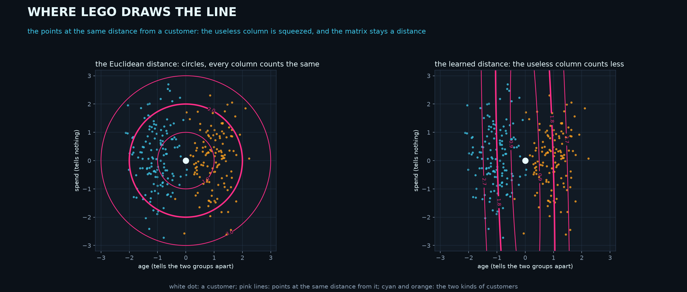

# LEGO: learn a distance from pairs with a target

LEGO (Jain, Kulis, Dhillon and Grauman, 2008) learns from **pairs of customers and the distance they
should have**: a small one for two customers of the same kind, a large one for two of different
kinds. Each pair nudges the distance of that pair toward its target, and the update is built so that
the learned matrix stays a proper distance without any repair. The other two learners are
[OASIS](oasis.md) and [POLA](pola.md); the overview is on [Metric learning](metric_learning.md).

## Gamestory

London, deep night. To frame the mysterious thief's gang, it is no longer enough for the young detective to say whether two people look alike: he has to decide how close or far apart they should be on his map.

So he draws two targets on the table: a super tight circle called "Friends" and a very distant one called "Strangers". Then he starts the LEGO training:

- **Choosing the right distances:** Before setting off, the detective looks at a small group of old, already-solved cases. He measures how close two real accomplices are (for example, 1 step) and how far apart two complete strangers are (for example, 20 steps). Those become his two targets.
- **Pushing to the right spot:** The informant puts two new suspects in front of him at a time and tells him: "These two are accomplices, bring them closer to 1 step!" or "These have nothing to do with each other, push them apart to 20 steps!".
- **Small steps without breaking the ruler:** The detective never moves the suspects all at once, because he would risk making a mess and throwing off all the measurements. He uses a special trick (called eta) to make only small, gentle adjustments, one tiny step at a time, keeping his ruler always perfect without ever having to fix it.
- **Discovering the real clue:** After trying thousands of pairs, the detective realizes that money in the bank, store spending, and museum visits are useless. The only clue that hits the targets is age: the accomplices are all the same age!


Pair after pair, LEGO moves the distances toward the targets. Left: the squared distance of 200 fresh pairs, on average, over 10 runs (line: median, band: quartiles). The pairs of the same kind come down from about 6.6 to about 3.2 (the target is 1.04) and the pairs of different kinds go up from about 11 to about 22 (the target is 21.16); the final medians over the 10 runs are 3.16 and 22.05. Right: the largest and the smallest eigenvalue of `A`. The smallest one goes down, because LEGO squeezes the useless directions, but it stays above zero in every step of every run (the lowest value is 0.023), with no projection.

## A first example: targets from the data

A bank has two kinds of customers, young and older. For each customer it knows four numbers, already put on the same scale: the age, which tells the two kinds apart, and the spending, the balance and the number of visits, which tell nothing about the group. With the plain Euclidean distance the three useless columns weigh three times as much as the useful one. LEGO needs a target distance for each pair; `LEGO.percentile_targets` computes them from 200
labelled customers: the 5th percentile of the distances between customers of the same kind, and the
95th percentile of the distances between customers of different kinds. Then LEGO sees 2000 pairs.

```python
import numpy as np
from dense_armor.core.online.learn.metric_learning import LEGO

rng = np.random.default_rng(0)
def customer(young):
    return {"age": rng.normal(-1.0 if young else 1.0, 0.5), "spend": rng.normal(0, 1), "balance": rng.normal(0, 1), "visits": rng.normal(0, 1)}
def euclid(u, v):
    return sum((u[k] - v[k]) ** 2 for k in u) ** 0.5

labels = rng.random(200) < 0.5
X = np.array([list(customer(g).values()) for g in labels])
near, far = LEGO.percentile_targets(X, labels)
print(round(near, 2), round(far, 2))
lego = LEGO(eta=0.1)
for _ in range(2000):
    young = rng.random() < 0.5
    if rng.random() < 0.5:
        lego.learn_pair(customer(young), customer(young), near)
    else:
        lego.learn_pair(customer(young), customer(not young), far)
print(np.round(np.diag(lego.A), 2))
hits = {"Euclidean": 0, "LEGO": 0}
for _ in range(600):
    young = rng.random() < 0.5
    a, same, other = customer(young), customer(young), customer(not young)
    hits["Euclidean"] += euclid(a, same) < euclid(a, other)
    hits["LEGO"] += lego.distance(a, same) < lego.distance(a, other)
print({k: round(v / 600, 3) for k, v in hits.items()})
```

```
0.95 21.08
[5.14 0.06 0.06 0.12]
{'Euclidean': 0.702, 'LEGO': 0.942}
```

The targets are 0.95 (same kind) and 21.08 (different kinds), squared distances. The second line is
the diagonal of the learned matrix `A` (columns in alphabetical order, the age first): the age weighs 5.14, the three useless columns 0.06 to 0.12.
The third line is the share of 600 test triplets in which the anchor is closer to the customer of its
own kind: 70.2 % with the Euclidean distance, 94.2 % with LEGO.



The pink lines join the points at the same distance from the white customer, in a version of the example with two columns only (the age and the spending). The circles of the Euclidean distance become stripes: LEGO has given a large weight to the age and a small one to the useless column.

## How it learns

LEGO takes two samples and a target squared distance `y`. It updates a PSD matrix `A`
toward that target using a LogDet-regularized gradient step.

### The formula, symbol by symbol

For a pair `(u, v)` with squared-distance target `y` and vector `z = u − v`:

```
ŷ = zᵀ A z                    (current squared distance)
a = η y ŷ − 1
ȳ = (a + √(a² + 4η ŷ²)) / (2η ŷ)
A ← A − η (ȳ − y) (A z)(A z)ᵀ / (1 + η (ȳ − y) ŷ)
```

`η` is the learning rate; `ȳ` is the *closed-form* optimal post-update distance, derived
in the paper (Section 2.1). Because `A` is updated through a LogDet-divergence step, it
stays positive definite by construction: no separate projection needed.

### Hand case

Start `A = I`, `z = (1, 0)`, target `y = 0.5`, learning rate `η = 0.1`.

```
ŷ = 1
a = 0.1 · 0.5 · 1 − 1 = −0.95
ȳ = (−0.95 + √(0.9025 + 0.4)) / 0.2 = 0.9564
A z = (1, 0)
(A z)(A z)ᵀ = [[1, 0], [0, 0]]
A ← I − 0.1 · (0.9564 − 0.5) · [[1, 0], [0, 0]] / (1 + 0.1 · (0.9564 − 0.5) · 1)
  = I − 0.04364 · [[1, 0], [0, 0]]
  = [[0.9564, 0], [0, 1]]
```

`A₀₀` moved from 1 to 0.9564 — toward the target 0.5, but only partway, because the
LogDet regularizer resists large single steps. This is what makes LEGO's parameter
updates stable without any tuning of a projection radius.

```python
from dense_armor.core.online.learn.metric_learning import LEGO

learner = LEGO(eta=0.1)
learner.learn_pair({"x0": 1.0, "x1": 0.0},
                   {"x0": 0.0, "x1": 0.0},
                   0.5)
```

LEGO needs a target squared distance per pair. `LEGO.percentile_targets` computes the
5th/95th percentiles of same-class / different-class distances, as in Section 4 of the
paper.

## What the paper says

These points are in Jain et al. (2008), Section 2; the formula and the hand case above were recomputed
with the code of the library:

- The regulariser is the **LogDet divergence**, `D(A, Aₜ) = tr(A Aₜ⁻¹) − log det(A Aₜ⁻¹) − d`, defined
  only for positive definite matrices. It does not change if all the features are rescaled, and it
  keeps the matrix positive definite by itself.
- Earlier methods approximated the gradient of the loss at the *old* matrix, which for LogDet can leave
  the positive definite matrices. LEGO solves the update exactly (with the Sherman-Morrison formula),
  which gives Eq. (2.2), and finds the post-update distance `ȳ` in closed form (Eq. 2.3).
- Because the update keeps `A` positive definite, the learning rate `η` does not have to be changed
  from one pair to the next. The bound of the earlier method depended on the regularisation parameter
  of each step, and so on the sequence of constraints; the paper presents this as a weakness that LEGO
  avoids.
- POLA, in the words of the paper, needs a projection onto the positive semi-definite cone through an
  eigendecomposition; LEGO does not.

We tested the update on 200 random positive definite matrices and pairs: after it, the squared distance
of the pair equals `ȳ` (to the float32 precision of the library) and `A` is positive definite every time.

## Results

On small dense data (30 % train, 70 % test, standardised features, k = 3; the targets are the 5th and 95th
percentiles of Section 4 of the paper; numbers taken from the page published in
[Dense-Evolution-Discovery](https://tatopenn-cell.github.io/Dense-Evolution-Discovery/river_metric_learning/), not re-run here):

| Dataset | Features | Euclidean | LEGO |
|---|---|---|---|
| Iris | 4 | 0.9333 | **0.9619 (+2.9)** |
| Wine | 13 | 0.9200 | 0.9360 (+1.6) |
| Digits | 64 | 0.9459 | 0.9372 (−0.9) |

LEGO wins on Iris and loses to the Euclidean distance on Digits. The differences on Iris and Wine are a
few test points (105 and 125 samples): indicative, not decisive.

## The parameter

| Parameter | Meaning | Default |
|---|---|---|
| `eta` | learning rate of the LogDet step; the paper uses 0.1 | 0.1 |

## API reference

::: dense_armor.core.online.learn.metric_learning.LEGO

---

## Details

- `learn_pair(x, x2, y)` takes two dicts and the **target squared distance** `y`. A boolean (same kind or
  not) is not a target: an earlier test passed one and pushed every same-kind pair toward a distance of 1.
- The largest eigenvalue of `A` is not bounded by the update. In 20 runs of the first example it reached between 54 and 697 at some step, and ended between 0.7 and 15; the matrix stays positive definite, but a single pair can move it a long way, so the distance of a fresh pair is noisy from one step to the next (the bands of the first figure).
- `LEGO.percentile_targets(X, y)` ignores the zero distance of a point with itself on the diagonal, and
  raises `ValueError` if there is no pair of the same kind or no pair of different kinds.
- Source: Jain, P., Kulis, B., Dhillon, I. S., Grauman, K. (2008), "Online metric learning and fast
  similarity search", NIPS.
