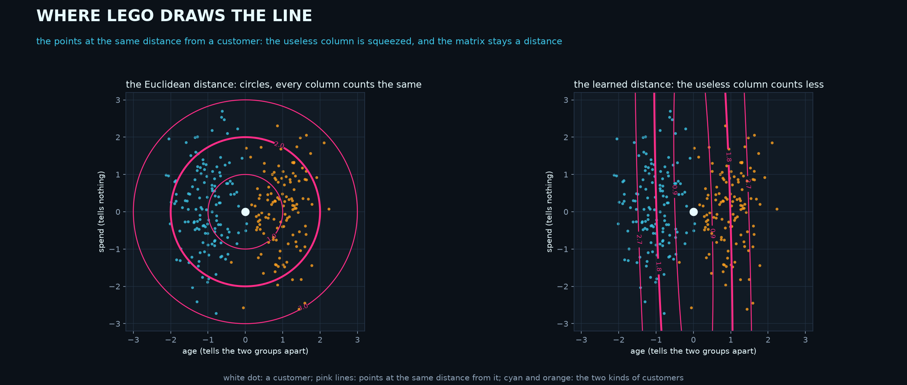

# The Mahalanobis distance: the ruler that the metric learners learn

[← Metric learning](metric_learning.md)

A bank wants to know which customers look alike. The first idea is to take the difference of each column and add them up, and that is the Euclidean distance. It has a flaw: it treats a year of age and a euro of balance as the same step, so a column with big numbers (the balance) decides everything and a column with small numbers (the age) counts for nothing. The **Mahalanobis distance** keeps the same idea and adds a matrix `A` that says how much each difference counts and how the columns go together. With the right matrix, a difference of 20 years of age is large and a difference of 2000 euros of balance is small. The three algorithms of this section, `OASIS`, `LEGO` and `POLA`, learn that matrix from examples of customers that look alike and customers that do not.

## 1. A first example: the balance against the age

Three customers: `a` is 30 years old with a balance of 3000, `b` is 50 years old with 3100 (an older customer with a similar balance), `c` is 31 years old with 5000 (a young customer with a very different balance). In the group of the young customers the age is what tells the groups apart, and the balance says nothing. `LEGO` learns the matrix from 90 pairs of customers: a small target distance for two customers of the same group and a large one for two customers of different groups.

```python
import numpy as np
from dense_armor.core.online.learn.metric_learning import LEGO

rng = np.random.default_rng(0)
young = [{"age": float(rng.normal(30, 4)), "balance": float(rng.normal(3000, 1000))} for _ in range(60)]
old = [{"age": float(rng.normal(50, 4)), "balance": float(rng.normal(3000, 1000))} for _ in range(60)]
lego = LEGO()
for i in range(0, 60, 2):
    lego.learn_pair(young[i], young[i + 1], 0.05)
    lego.learn_pair(old[i], old[i + 1], 0.05)
    lego.learn_pair(young[i], old[i], 4.0)

a = {"age": 30.0, "balance": 3000.0}
b = {"age": 50.0, "balance": 3100.0}
c = {"age": 31.0, "balance": 5000.0}
euclid = lambda p, q: float(np.sqrt((p["age"] - q["age"]) ** 2 + (p["balance"] - q["balance"]) ** 2))
print("Euclidean", round(euclid(a, b), 1), round(euclid(a, c), 1))
print("learned", round(lego.distance(a, b), 3), round(lego.distance(a, c), 3))
```

```
Euclidean 102.0 2000.0
learned 1.622 0.634
```

With the Euclidean distance `a` is 102 from `b` and 2000 from `c`: the balance dominates, so `c`, who is young like `a`, looks far, and `b`, who is 20 years older, looks near. With the learned matrix the order turns around: `a` is 1.622 from `b` and 0.634 from `c`. The learned distance counts the 20 years of age and almost ignores the 2000 euros of balance.

## 2. What the matrix is

The distance between two customers `x` and `y` is the square root of a product with the matrix `A`:

```
d(x, y) = sqrt( (x - y)^T A (x - y) )
```

- With `A` equal to the identity, it is the Euclidean distance: circles around a customer.
- With `A` diagonal, each column has its own weight: a large weight for a column that matters, a weight near zero for a column that says nothing.
- With numbers off the diagonal, the columns are tied together: a difference in one column can be forgiven if another column moves with it.

In `LEGO` and `POLA` the matrix is kept positive definite or positive semi-definite, so that the distance is never negative and is zero only for two customers that the matrix cannot tell apart. The code of the library returns the distance, the square root, and not its square. The same customers can be checked by hand: the product with the matrix of `LEGO` gives the number that `distance` returns.

```python
import numpy as np
from dense_armor.core.online.learn.metric_learning import LEGO

rng = np.random.default_rng(0)
young = [{"age": float(rng.normal(30, 4)), "balance": float(rng.normal(3000, 1000))} for _ in range(60)]
old = [{"age": float(rng.normal(50, 4)), "balance": float(rng.normal(3000, 1000))} for _ in range(60)]
lego = LEGO()
for i in range(0, 60, 2):
    lego.learn_pair(young[i], young[i + 1], 0.05)
    lego.learn_pair(old[i], old[i + 1], 0.05)
    lego.learn_pair(young[i], old[i], 4.0)

a = {"age": 30.0, "balance": 3000.0}
b = {"age": 50.0, "balance": 3100.0}
z = np.array([a["age"] - b["age"], a["balance"] - b["balance"]])
print(round(float(np.sqrt(z @ lego.A @ z)), 3), round(lego.distance(a, b), 3))
print(np.round(lego.A, 6).tolist())
```

```
1.622 1.622
[[0.006577, -1e-06], [-1e-06, 0.0]]
```

The two numbers are the same, and the matrix has a weight of about 0.0066 on the age and about zero on the balance: the learned ruler looks at the age only. The picture draws the same idea for a customer: on the left the circles of the Euclidean distance, on the right the stripes of the learned one.



## 3. What each algorithm learns

| Algorithm | Learns from | What it holds | How the distance comes out |
|---|---|---|---|
| [LEGO](lego.md) | pairs with a target squared distance | a Mahalanobis matrix `A`, kept positive definite by the LogDet step | `sqrt(z^T A z)` |
| [POLA](pola.md) | pairs labelled similar (+1) or different (-1) | a pseudo-metric `(A, b)`, projected onto the positive semi-definite cone | `sqrt(z^T A z)` |
| [OASIS](oasis.md) | triplets: an anchor, a similar sample, a different one | a bilinear similarity `W`, with no constraint | `sqrt(z^T (W^T W) z)` |

`OASIS` does not hold a matrix `A`: it holds `W`, which is not constrained to be symmetric or positive semi-definite, and the distance uses `M = W^T W`, which is always positive semi-definite. The same check, with the `W` of an `OASIS` that learned from triplets of the same customers:

```python
import numpy as np
from dense_armor.core.online.learn.metric_learning import OASIS

rng = np.random.default_rng(0)
young = [{"age": float(rng.normal(30, 4)), "balance": float(rng.normal(3000, 1000))} for _ in range(60)]
old = [{"age": float(rng.normal(50, 4)), "balance": float(rng.normal(3000, 1000))} for _ in range(60)]
oasis = OASIS(C=0.1)
for i in range(59):
    oasis.learn_triplet(young[i], young[i + 1], old[i])

a = {"age": 30.0, "balance": 3000.0}
b = {"age": 50.0, "balance": 3100.0}
z = np.array([a["age"] - b["age"], a["balance"] - b["balance"]])
M = oasis.W.T @ oasis.W
print(round(float(np.sqrt(z @ M @ z)), 3), round(oasis.distance(a, b), 3))
```

```
18.94 18.94
```

The distance that the class returns is the square root of the product with `M = W^T W`.

## 4. Not the same as the robust Mahalanobis of the anomaly detectors

[`OnlineRobustMahalanobis`](../anomaly/mahalanobis.md) also uses a Mahalanobis distance, but for another job. It is an anomaly detector in the Anomaly detection section: it estimates a robust centre and a covariance of the normal days and says how far a new day is from that centre, in the units of its spread. The metric learners of this section learn the matrix itself, from pairs or triplets, to measure the distance between two samples; they give no anomaly score.

## 5. The same on a robot

A robot has two columns for each run: the angle of a joint, in radians, and the torque, in newton-metres, with a much larger range. A run in free motion and a run in contact are told apart by the angle. `f` is a free run, `g` is a contact run (a different angle, a similar torque) and `h` is another free run with a high torque.

```python
import numpy as np
from dense_armor.core.online.learn.metric_learning import LEGO

rng = np.random.default_rng(1)
free = [{"angle": float(rng.normal(0.2, 0.05)), "torque": float(rng.normal(50, 20))} for _ in range(60)]
touch = [{"angle": float(rng.normal(0.9, 0.05)), "torque": float(rng.normal(50, 20))} for _ in range(60)]
lego = LEGO()
for i in range(0, 60, 2):
    lego.learn_pair(free[i], free[i + 1], 0.05)
    lego.learn_pair(touch[i], touch[i + 1], 0.05)
    lego.learn_pair(free[i], touch[i], 4.0)

f = {"angle": 0.2, "torque": 50.0}
g = {"angle": 0.9, "torque": 52.0}
h = {"angle": 0.21, "torque": 95.0}
euclid = lambda p, q: float(np.sqrt((p["angle"] - q["angle"]) ** 2 + (p["torque"] - q["torque"]) ** 2))
print("Euclidean", round(euclid(f, g), 3), round(euclid(f, h), 3))
print("learned", round(lego.distance(f, g), 3), round(lego.distance(f, h), 3))
```

```
Euclidean 2.119 45.0
learned 2.083 0.81
```

With the Euclidean distance `h`, which is free like `f`, is 45 away and `g`, which is in contact, is 2.1 away, so the torque hides the difference between the two states. With the learned matrix `g` is 2.083 away and `h` 0.81: the free run `h` is near `f` and the contact run `g` is far.

## Details

### Choices

- **The numbers** of every example are printed by the code, with the default parameters of `LEGO` and `OASIS` (and `C` = 0.1 for `OASIS`), 90 pairs for `LEGO` and 59 triplets for `OASIS`.
- **The papers** are the ones of the three algorithms: Jain, Kulis, Dhillon and Grauman (2008) for `LEGO`, Shalev-Shwartz, Singer and Ng (2004) for `POLA`, Chechik, Sharma, Shalit and Bengio (2009) for `OASIS`; their pages give the equations.
