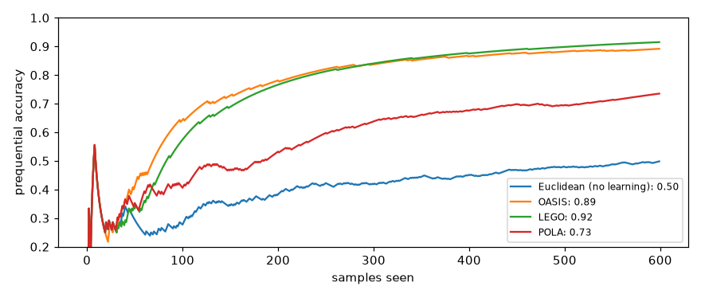

# MetricKNNClassifier: a k-NN that learns its distance

[← Metric learning](metric_learning.md)

A bank wants to tell, for each new customer, which group it belongs to, by looking at the most similar past customers. A k-NN does this with a distance, and the plain one is often wrong: a column with big numbers (a balance in euros) drowns a column with small ones (an age in years). `MetricKNNClassifier` keeps the latest customers in a window, classifies a new one by the vote of its nearest neighbours, and, while it works, teaches its distance to a metric learner (`OASIS`, `LEGO` or `POLA`): each new customer is paired with customers of the window, so the distance gets better as the stream goes on. It is the way a metric learner joins a stream of ordinary rows.

## 1. A first example: the same customers, with and without learning the distance

Two groups of customers, young (around 30 years old) and older (around 50), with three more columns that say nothing about the group but have big numbers. The k-NN predicts each customer first and learns it after. In the first run the distance is frozen (`learn_metric=False`), in the second it is learned.

```python
import numpy as np
from dense_armor.core.evaluation.metrics import Accuracy
from dense_armor.core.online.learn.metric_learning import OASIS, MetricKNNClassifier

for learn in (False, True):
    rng = np.random.default_rng(0)
    knn = MetricKNNClassifier(OASIS(C=0.1), n_neighbors=1, window_size=1000, learn_metric=learn)
    acc = Accuracy()
    for _ in range(600):
        young = int(rng.random() < 0.5)
        x = {
            "age": rng.normal(30 if young else 50, 4),
            "spend": rng.normal(500, 150),
            "balance": rng.normal(3000, 1000),
            "visits": rng.normal(20, 8),
        }
        acc.update(young, knn.predict_one(x))
        knn.learn_one(x, young)
    print("learn_metric", learn, round(acc.get(), 3))
```

```
learn_metric False 0.563
learn_metric True 0.806
```

With the frozen distance the neighbours are right 56 % of the time, little better than a coin; with the distance learned by `OASIS` while the k-NN classifies, 81 % of the 600 customers.

| class or function | what it does |
|---|---|
| `MetricKNNClassifier` | a k-NN over a window, whose distance is a metric learner trained inside `learn_one` |

## 2. What it does

A metric learner does not fit the `Classifier`, `Regressor` or `Transformer` roles of the library:
it learns from two or three samples at a time and outputs a distance. `MetricLearner` is
the base class; `MetricKNNClassifier` is a k-NN classifier that uses a metric learner as its
distance and, with `learn_metric=True` (the default), trains it online inside `learn_one`. Each new sample is paired with random samples from the window: a triplet
for OASIS, a similar / dissimilar pair for POLA, a pair with a target distance for LEGO.

**Source:** the class has no paper of its own: it puts the algorithms of [OASIS](oasis.md), [LEGO](lego.md) and [POLA](pola.md) behind a k-NN.

## 3. The parameters

| Parameter | Meaning | Default |
|---|---|---|
| `metric_learner` | a `MetricLearner` (`OASIS`, `LEGO` or `POLA`) | none |
| `n_neighbors` | number of nearest neighbours that vote | 5 |
| `window_size` | maximum number of stored samples (first in, first out) | 1000 |
| `learn_metric` | if true, `learn_one` also updates the metric learner; if false, the learner is used as it is | `True` |
| `seed` | seed of the random choice of window samples | 42 |
| `update_every` | update the metric once every this many calls of `learn_one` | 1 |

## 4. A toy stream

```pythonimport numpy as np
from dense_armor.core.online.learn.metric_learning import (
    MetricKNNClassifier,
    OASIS,
)

rng = np.random.default_rng(0)
y = rng.integers(0, 2, 400)
X = np.c_[y + 0.3 * rng.standard_normal(400), rng.standard_normal(400)]
knn = MetricKNNClassifier(OASIS(C=0.1), n_neighbors=1, window_size=1000)
hits = 0
for x, t in zip(X, y):
    hits += knn.predict_one({"x0": x[0], "x1": x[1]}) == t
    knn.learn_one({"x0": x[0], "x1": x[1]}, t)
print(hits / len(y))
```

```
0.9375
```

Two classes that differ only in the first feature; the k-NN learns its similarity with OASIS while it
classifies, and gets 93.75 % of the 400 samples right, each predicted before it is learned.

## 5. Results on streams from river

`progressive_val_score` (predict, then learn), `StandardScaler` in front, k = 5,
`window_size=1000`, metric learned online with the default parameters:

| Stream | `KNNClassifier` of river (Euclidean) | OASIS | LEGO | POLA |
|---|---|---|---|---|
| Phishing (1,250 samples) | 0.8823 | **0.8911 (+0.88)** | 0.8815 (−0.08) | 0.8871 (+0.48) |
| ImageSegments (2,310 samples) | 0.8705 | 0.9082 (+3.77) | 0.9112 (+4.07) | **0.9138 (+4.33)** |

On ImageSegments (7 classes, 18 features) all three learned metrics beat the Euclidean
k-NN by about 4 points; on Phishing the gains are under one point and LEGO is level with
the baseline.

## 6. The same on a robot

The same advantage on robot data: three robot states told apart by two joint features, plus three
noisy features with a much larger range that dominate the plain Euclidean distance.



With the Euclidean distance the k-NN is right half of the time (0.50); learning the metric while
classifying lifts it to 0.89 (OASIS), 0.92 (LEGO) and 0.74 (POLA) after 600 samples: the learned
metric learns to ignore the noisy features. In the original paper OASIS already beat LEGO and the
Euclidean metric on image retrieval (Chechik et al. 2009, Figure 2).

## API reference

::: dense_armor.core.online.learn.metric_learning.MetricKNNClassifier

---

## Details

### Choices

- **The first example** is the one of the index of the section, with the metric frozen in one run: the numbers are printed by the code.
- **The results on river** and **the robot figure** were on the page of the section and are kept here as they were.
