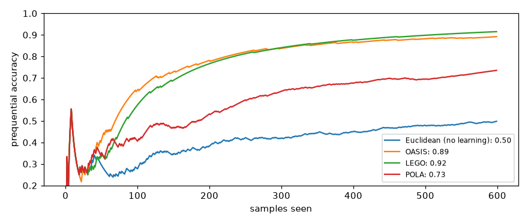

# Online metric learning: sequential Mahalanobis distance optimization

To find which past situations look like the current one, you need a way to measure the distance between them. Instead of assuming standard Euclidean formulas that get confused by noise, this tool learns a custom distance metric in real time from examples, so that situations that behave the same stay close together.


A bank has seen thousands of customers: some bought a product, some did not.
When a new customer arrives, the first thing any recommendation or fraud check needs to
answer is **"which past customers look like this one?"**

"Look like" is a distance. The default answer is Euclidean distance on the raw feature
vector. It is often the wrong answer: a column with big numbers (a balance in euros) drowns a
column with small ones (an age in years), and two customers can have very different numbers and
still be the *same* kind of customer. The
distance has to be **learned from data**, not assumed.

`MetricKNNClassifier` learns that distance online, one triplet or pair at a time, while
the data arrive. It uses one of three algorithms ported from their papers:

- **OASIS** (Chechik et al. 2009) — bilinear similarity from triplets `(anchor, similar, different)`.
- **LEGO** (Jain et al. 2008) — LogDet-regularized Mahalanobis matrix from pairs with a target distance.
- **POLA** (Shalev-Shwartz et al. 2004) — pseudo-metric from similar / dissimilar pairs, kept positive semi-definite.

## Gamestory

London, deep night. The police archive is full of thousands of old cases, and the young detective must figure out which ones look most like tonight's investigation.

While comparing the files, he discovers that using a normal mathematical ruler is a disaster: giant numbers (like thousands of stolen pounds) hide small but decisive clues (like the suspect's age). To not be fooled by noise, the detective decides to build a custom-made ruler that adapts in real time as new clues arrive, choosing among three special techniques:

- **The triplet method (OASIS):** The detective compares three files at a time: a main suspect, an accomplice of his, and an innocent citizen. He learns to adjust his ruler so that the accomplice always turns out much "closer" than the innocent person.
- **The target distance method (LEGO):** Here the detective works in pairs and sets himself a precise goal: if two suspects are part of the same gang, their distance must become tiny; if they are strangers, it must become huge.
- **The threshold method (POLA):** The detective observes two files at a time receiving only a "same" or "different". Every time he makes a wrong prediction, he recalibrates the ruler and moves a safety threshold to separate accomplices from innocents.
- **The window memory (MetricKNNClassifier):** As the investigation goes on, the detective keeps on his desk only the latest most recent cases. When a new suspect pops up, he measures him with his freshly updated ruler, looks at the most similar "neighbors," and immediately discovers which gang he belongs to!

## A first example: which customers look alike?

A bank has customers of two groups, young (around 30 years old) and older (around 50). Besides the age it knows three columns that tell nothing about the group but have big numbers: the monthly spending (about 500), the balance (about 3000) and the number of visits (about 20). With the plain Euclidean distance these numbers drown the age. `MetricKNNClassifier` learns a better distance while it classifies: each customer is first predicted from the closest past customers, and then learned.

```python
import numpy as np
from dense_armor.core.evaluation.metrics import Accuracy
from dense_armor.core.online.learn.metric_learning import LEGO, OASIS, POLA, MetricKNNClassifier

for name, metric, learn in (("Euclidean", OASIS(C=0.1), False), ("OASIS", OASIS(C=0.1), True), ("LEGO", LEGO(), True), ("POLA", POLA(), True)):
    rng = np.random.default_rng(0)
    knn = MetricKNNClassifier(metric, n_neighbors=1, window_size=1000, learn_metric=learn)
    acc = Accuracy()
    for _ in range(600):
        young = int(rng.random() < 0.5)
        x = {"age": rng.normal(30 if young else 50, 4), "spend": rng.normal(500, 150), "balance": rng.normal(3000, 1000), "visits": rng.normal(20, 8)}
        acc.update(young, knn.predict_one(x))
        knn.learn_one(x, young)
    print(name, round(acc.get(), 3))
```

```
Euclidean 0.563
OASIS 0.806
LEGO 0.896
POLA 0.631
```

With the Euclidean distance the neighbours are right 56 % of the time, little better than a coin. The learned distances find that only the age matters and give less weight to the other three columns: 81 % for OASIS, 90 % for LEGO and 63 % for POLA, on the same 600 customers.


The figure uses the customers of the first example of each algorithm page, with the columns put on the same scale: all three learn to give almost the whole distance to the age.

## 1. The data

A stream of samples, one per customer. Each sample is a 2-D vector, with the label of its group, A or B.

```python
import numpy as np
rng = np.random.default_rng(42)
group_a = rng.normal([1.0, 0.0], 0.1, (200, 2))
group_b = rng.normal([0.0, 1.0], 0.1, (200, 2))
X = np.vstack([group_a, group_b])
y = np.array(["A"] * 200 + ["B"] * 200)
```

Euclidean distance on this data works, because the clusters are far apart. On a real
real data they are often not.

## 2. The three algorithms

| Algorithm | Learns from | Model | Page |
|---|---|---|---|
| OASIS | triplets: an anchor, a similar sample, a different one | a bilinear similarity `xᵀ W y`, no constraint | [OASIS](oasis.md) |
| LEGO | pairs with a target squared distance | a Mahalanobis matrix `A`, kept positive definite by the LogDet step | [LEGO](lego.md) |
| POLA | pairs labelled similar (+1) or different (−1) | a pseudo-metric `(A, b)`, projected onto the positive semi-definite cone | [POLA](pola.md) |

Each page starts from the same example, the customers of the bank, and then goes through the algorithm
step by step, with the formula symbol by symbol, a hand case and what the original paper says.

## 3. The k-NN classifier that learns its metric

A metric learner does not fit the `Classifier` / `Regressor` / `Transformer` types of an existing online-learning library:
it learns from two or three samples at a time and outputs a distance. `MetricLearner` is
the base class; `MetricKNNClassifier` is a k-NN classifier that uses the base classes of an existing online-learning library that uses the learner
as its distance and — with `learn_metric=True`, the default — trains it online inside
`learn_one`. Each new sample is paired with random samples from the window: a triplet
for OASIS, a similar / dissimilar pair for POLA, a pair with a target distance for LEGO.

```python
import numpy as np
from dense_armor.core.online.learn.metric_learning import MetricKNNClassifier, OASIS

rng = np.random.default_rng(0)
y = rng.integers(0, 2, 400)
X = np.c_[y + 0.3 * rng.standard_normal(400), rng.standard_normal(400)]
knn = MetricKNNClassifier(OASIS(C=0.1), n_neighbors=1, window_size=1000)
hits = 0
for x, t in zip(X, y):
    hits += knn.predict_one({"x0": x[0], "x1": x[1]}) == t
    knn.learn_one({"x0": x[0], "x1": x[1]}, t)
print(hits / len(y))
```

```
0.9375
```

Two classes that differ only in the first feature; the k-NN learns its similarity with OASIS while it
classifies, and gets 93.75 % of the 400 samples right, each predicted before it is learned.

## 4. Results on streams from an existing online-learning library

`progressive_val_score` (predict, then learn), `StandardScaler` in front, k = 5,
`window_size=1000`, metric learned online with the default parameters:

| Stream | the other library's `KNNClassifier` (Euclidean) | OASIS | LEGO | POLA |
|---|---|---|---|---|
| Phishing (1,250 samples) | 0.8823 | **0.8911 (+0.88)** | 0.8815 (−0.08) | 0.8871 (+0.48) |
| ImageSegments (2,310 samples) | 0.8705 | 0.9082 (+3.77) | 0.9112 (+4.07) | **0.9138 (+4.33)** |

On ImageSegments (7 classes, 18 features) all three learned metrics beat the Euclidean
k-NN by about 4 points; on Phishing the gains are under one point and LEGO is level with
the baseline.

## The robot example

The same advantage on robot data: three robot states told apart by two joint features, plus three
noisy features with a much larger range that dominate the plain Euclidean distance.



With the Euclidean distance the k-NN is right half of the time (0.50); learning the metric while
classifying lifts it to 0.89 (OASIS), 0.92 (LEGO) and 0.74 (POLA) after 600 samples: the learned
metric learns to ignore the noisy features. In the original paper OASIS already beat LEGO and the
Euclidean metric on image retrieval (Chechik et al. 2009, Figure 2).

## API reference

::: dense_armor.core.online.learn.metric_learning

---

## Details

**OASIS** (Chechik, Sharma, Shalit, Bengio, 2009). W is not symmetric; the distance
uses `M = WᵀW`. The similarity is the bilinear form $S_W(p_i, p_j) = p_i^\top W p_j$ (eq. 2 of the
paper) and the update is the passive-aggressive step $W \leftarrow W + \tau V$ with
$\tau = \min(C,\; \ell_W / \lVert V\Vert^2)$ (eq. 5): "a gradient descent step with a step size τ
that can be computed exactly", in the paper's words.

**POLA** (Shalev-Shwartz, Singer, Ng, 2004). The `1 + ‖z‖⁴` in the denominator is not a
typo: the update is a projection of the pair $(A, b)$ onto a half-space, whose normal vector
$\chi = (-y\, z z^\top,\; y)$ has squared norm $\lVert z z^\top\Vert_F^2 + 1 = \lVert z\Vert^4 + 1$; the
`+ 1` comes from the threshold coordinate `b`. This gives $\alpha = \ell / (\lVert z\Vert^4 + 1)$ and the
update of eq. 4 of the paper; a second projection onto the positive semi-definite cone
(section 3.2) removes negative eigenvalues.

**LEGO** (Jain, Kulis, Dhillon, Grauman, 2008). The `ȳ` formula is equation (2.3) of
the paper: the update (2.2) is the exact minimiser of the LogDet-regularised loss, written in
closed form with the Sherman–Morrison formula; multiplying it on both sides by $z$ gives a
quadratic equation in $\bar y$, whose positive root is (2.3).
The LogDet step keeps `A` positive definite without projection: this is the difference
between LEGO and POLA in the same online setting, and the reason LEGO has no separate
"enforce PSD" step.

The three algorithms compared as kNN metrics on Iris, Wine, Digits and 20 newsgroups
(including `WᵀW` against the symmetrized `W`) are in Dense-Evolution-Discovery,
[Online Metric Learning: OASIS, LEGO, POLA](https://tatopenn-cell.github.io/Dense-Evolution-Discovery/river_metric_learning/).

**See also**: [Calibration](calibration.md) — if the k-NN above is used with
`predict_proba_one`, calibration turns its raw class frequencies into honest
probabilities.
