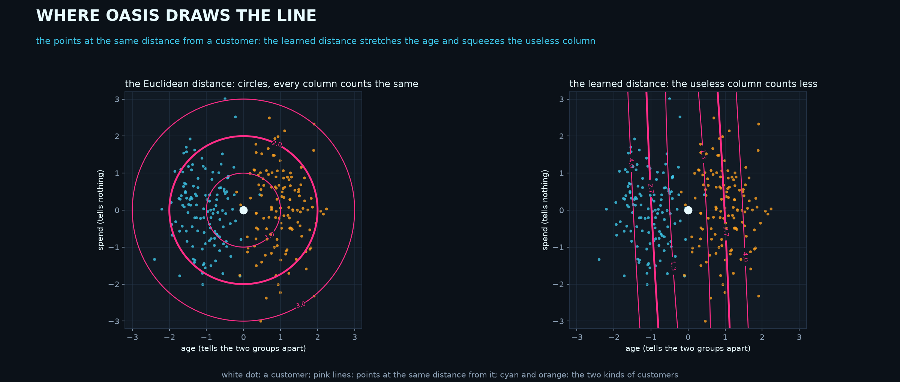
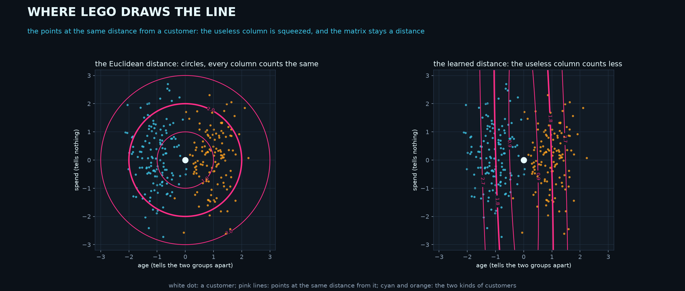

# Online metric learning: sequential Mahalanobis distance optimization

To find which past situations look like the current one, you need a way to measure the distance between them. Instead of assuming standard Euclidean formulas that get confused by noise, this tool learns a custom distance metric in real time from examples, so that situations that behave the same stay close together.

## The map of metric learning

Click a page to open it, or the job on the left (or the button at the top) to go back to the [map of the library](../index.md#the-library-folder-by-folder).

<object type="image/svg+xml" data="../../assets/maps/metric_learning.svg" style="width:100%"></object>

## Gamestory

London, deep night. The police archive is full of thousands of old cases, and the young detective must figure out which ones look most like tonight's investigation.

While comparing the files, he discovers that using a normal mathematical ruler is a disaster: giant numbers (like thousands of stolen pounds) hide small but decisive clues (like the suspect's age). To not be fooled by noise, the detective decides to build a custom-made ruler that adapts in real time as new clues arrive, choosing among three special techniques:

- **The triplet method (OASIS):** The detective compares three files at a time: a main suspect, an accomplice of his, and an innocent citizen. He learns to adjust his ruler so that the accomplice always turns out much "closer" than the innocent person.
- **The target distance method (LEGO):** Here the detective works in pairs and sets himself a precise goal: if two suspects are part of the same gang, their distance must become tiny; if they are strangers, it must become huge.
- **The threshold method (POLA):** The detective observes two files at a time receiving only a "same" or "different". Every time he makes a wrong prediction, he recalibrates the ruler and moves a safety threshold to separate accomplices from innocents.
- **The window memory (MetricKNNClassifier):** As the investigation goes on, the detective keeps on his desk only the latest most recent cases. When a new suspect pops up, he measures him with his freshly updated ruler, looks at the most similar "neighbors," and immediately discovers which gang he belongs to!

A bank has seen thousands of customers: some bought a product, some did not.
When a new customer arrives, the first thing any recommendation or fraud check needs to
answer is **"which past customers look like this one?"**

"Look like" is a distance. The default answer is Euclidean distance on the raw feature
vector. It is often the wrong answer: a column with big numbers (a balance in euros) drowns a
column with small ones (an age in years), and two customers can have very different numbers and
still be the *same* kind of customer. The
distance has to be **learned from data**, not assumed.

`MetricKNNClassifier` learns that distance online, one triplet or pair at a time, while
the data arrive. It uses one of three algorithms ported from their papers:

- **OASIS** (Chechik et al. 2009) — bilinear similarity from triplets `(anchor, similar, different)`.
- **LEGO** (Jain et al. 2008) — LogDet-regularized Mahalanobis matrix from pairs with a target distance.
- **POLA** (Shalev-Shwartz et al. 2004) — pseudo-metric from similar / dissimilar pairs, kept positive semi-definite.

## A first example: which customers look alike?

A bank has customers of two groups, young (around 30 years old) and older (around 50). Besides the age it knows three columns that tell nothing about the group but have big numbers: the monthly spending (about 500), the balance (about 3000) and the number of visits (about 20). With the plain Euclidean distance these numbers drown the age. `MetricKNNClassifier` learns a better distance while it classifies: each customer is first predicted from the closest past customers, and then learned.

```python
import numpy as np
from dense_armor.core.evaluation.metrics import Accuracy
from dense_armor.core.online.learn.metric_learning import (
    LEGO,
    OASIS,
    POLA,
    MetricKNNClassifier,
)

for name, metric, learn in (
    ("Euclidean", OASIS(C=0.1), False),
    ("OASIS", OASIS(C=0.1), True),
    ("LEGO", LEGO(), True),
    ("POLA", POLA(), True),
):
    rng = np.random.default_rng(0)
    knn = MetricKNNClassifier(
        metric, n_neighbors=1, window_size=1000, learn_metric=learn
    )
    acc = Accuracy()
    for _ in range(600):
        young = int(rng.random() < 0.5)
        x = {
            "age": rng.normal(30 if young else 50, 4),
            "spend": rng.normal(500, 150),
            "balance": rng.normal(3000, 1000),
            "visits": rng.normal(20, 8),
        }
        acc.update(young, knn.predict_one(x))
        knn.learn_one(x, young)
    print(name, round(acc.get(), 3))
```

```
Euclidean 0.563
OASIS 0.806
LEGO 0.896
POLA 0.631
```

With the Euclidean distance the neighbours are right 56 % of the time, little better than a coin. The learned distances find that only the age matters and give less weight to the other three columns: 81 % for OASIS, 90 % for LEGO and 63 % for POLA, on the same 600 customers.


The figure uses the customers of the first example of each algorithm page, with the columns put on the same scale: all three learn to give almost the whole distance to the age.

## 2. The three algorithms

| Algorithm | Learns from | Model | Page |
|---|---|---|---|
| OASIS | triplets: an anchor, a similar sample, a different one | a bilinear similarity `xᵀ W y`, no constraint | [OASIS](oasis.md) |
| LEGO | pairs with a target squared distance | a Mahalanobis matrix `A`, kept positive definite by the LogDet step | [LEGO](lego.md) |
| POLA | pairs labelled similar (+1) or different (−1) | a pseudo-metric `(A, b)`, projected onto the positive semi-definite cone | [POLA](pola.md) |

The same customers, the same four columns, and the distance that each algorithm learns (the Euclidean distance on the left of every picture draws circles; the learned distance draws stripes that cut the age axis, so that only the age counts):






Each page starts from the same example, the customers of the bank, and then goes through the algorithm
step by step, with the formula symbol by symbol, a hand case and what the original paper says.

## The pages of the section

| Page | Classes | What it does |
|---|---|---|
| [OASIS](oasis.md) | `OASIS` | a similarity learned from triplets: an anchor, a similar sample, a different one |
| [LEGO](lego.md) | `LEGO` | a Mahalanobis distance learned from pairs with a target distance |
| [POLA](pola.md) | `POLA` | a pseudo-metric learned from pairs labelled similar or different |
| [MetricKNNClassifier](metric_knn.md) | `MetricKNNClassifier` | a k-NN that learns its distance while it classifies, with the results on the river streams and the robot example |
| [MetricLearner](metric_learner.md) | `MetricLearner` | the base of the three: the pair, the triplet and the distance, and the toy data of the old page |

## The same problem on a robot

The same advantage on robot data, with three robot states told apart by two joint features and three noisy features, is on the page of [MetricKNNClassifier](metric_knn.md#6-the-same-on-a-robot): with the Euclidean distance the k-NN is right half of the time, and learning the metric while classifying lifts it to 0.89 (OASIS), 0.92 (LEGO) and 0.74 (POLA) after 600 samples.

## API reference

Each class has its reference on its own page: [OASIS](oasis.md#api-reference), [LEGO](lego.md#api-reference), [POLA](pola.md#api-reference), [MetricKNNClassifier](metric_knn.md#api-reference) and [MetricLearner](metric_learner.md#api-reference).

---

## Details

**OASIS** (Chechik, Sharma, Shalit, Bengio, 2009). W is not symmetric; the distance
uses `M = WᵀW`. The similarity is the bilinear form $S_W(p_i, p_j) = p_i^\top W p_j$ (eq. 2 of the
paper) and the update is the passive-aggressive step $W \leftarrow W + \tau V$ with
$\tau = \min(C,\; \ell_W / \lVert V\Vert^2)$ (eq. 5): "a gradient descent step with a step size τ
that can be computed exactly", in the paper's words.

**POLA** (Shalev-Shwartz, Singer, Ng, 2004). The `1 + ‖z‖⁴` in the denominator is not a
typo: the update is a projection of the pair $(A, b)$ onto a half-space, whose normal vector
$\chi = (-y\, z z^\top,\; y)$ has squared norm $\lVert z z^\top\Vert_F^2 + 1 = \lVert z\Vert^4 + 1$; the
`+ 1` comes from the threshold coordinate `b`. This gives $\alpha = \ell / (\lVert z\Vert^4 + 1)$ and the
update of eq. 4 of the paper; a second projection onto the positive semi-definite cone
(section 3.2) removes negative eigenvalues.

**LEGO** (Jain, Kulis, Dhillon, Grauman, 2008). The `ȳ` formula is equation (2.3) of
the paper: the update (2.2) is the exact minimiser of the LogDet-regularised loss, written in
closed form with the Sherman–Morrison formula; multiplying it on both sides by $z$ gives a
quadratic equation in $\bar y$, whose positive root is (2.3).
The LogDet step keeps `A` positive definite without projection: this is the difference
between LEGO and POLA in the same online setting, and the reason LEGO has no separate
"enforce PSD" step.

The three algorithms compared as kNN metrics on Iris, Wine, Digits and 20 newsgroups
(including `WᵀW` against the symmetrized `W`) are in Dense-Evolution-Discovery,
[Online Metric Learning: OASIS, LEGO, POLA](https://tatopenn-cell.github.io/Dense-Evolution-Discovery/river_metric_learning/).

**See also**: [Calibration](calibration.md) — if the k-NN above is used with
`predict_proba_one`, calibration turns its raw class frequencies into honest
probabilities.
