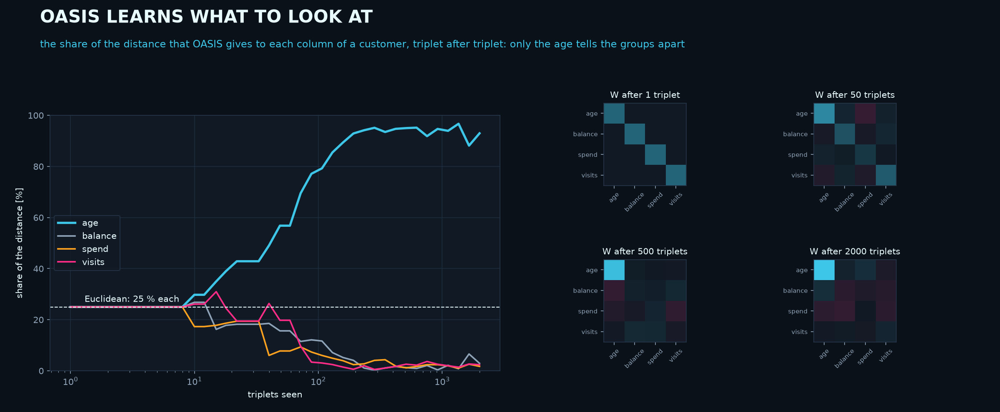
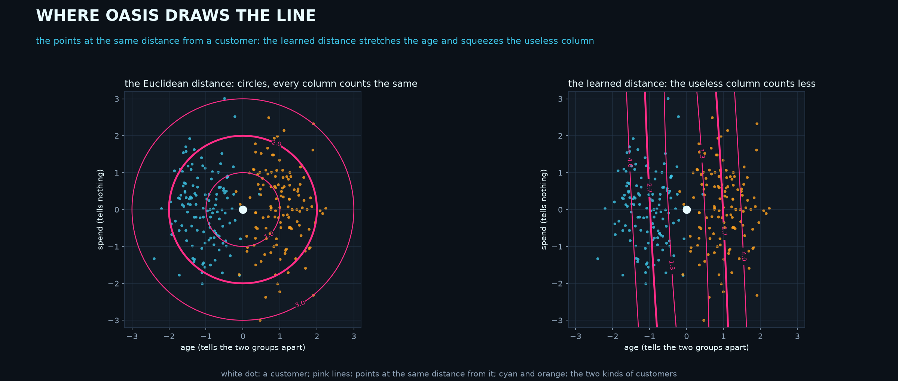
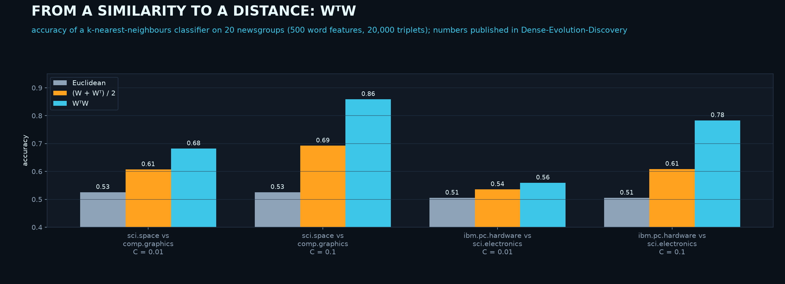

# OASIS: learn a similarity from triplets

OASIS (Chechik et al. 2009) learns what "alike" means from examples of one kind: *this customer is
more like that one than like this other one*. Each example is a **triplet** (an anchor, a customer of
the same kind, a customer of a different kind). It learns one triplet at a time, and it is the
light: one rank-one update per triplet and no eigendecomposition.
The other two are [LEGO](lego.md) and [POLA](pola.md); the overview is on [Metric learning](metric_learning.md).

## Gamestory

London, deep night. The mysterious thief has just robbed a bank. The young detective has to figure out which of the city's two gangs pulled off the heist: the Wolves or the Foxes.

The problem is that the thieves use a thousand tricks to confuse him: sometimes they steal a lot, sometimes very little, sometimes they smash windows, sometimes they don't. So the detective invents a lightning-fast rule called OASIS, which works like a card game with three cards at a time:

1. **Three cards on the table:** The detective takes three robberies:
    - Card A: tonight's robbery.
    - Card B: a robbery definitely done by the Wolves.
    - Card C: a robbery definitely done by the Foxes.
2. **The blunt question:** He looks at the three cards and asks himself: "Does tonight's robbery look more like the Wolves' one or the Foxes' one?".
3. **Fixing the mistake on the fly:** At first, the detective only looks at how much money was stolen, so he gets it wrong a lot. Every time he messes up, he slaps his forehead and changes his rule: "Stop looking at the money, it has nothing to do with it! From now on I only look at the time the alarm goes off!".
4. **Don't overdo it (the C rule):** Even when he is wrong, he doesn't throw away everything he has learned so far: he only makes a small adjustment (called C), so a single lucky trick by the thieves doesn't mess up his brain.

By the end of the game, the detective has cracked the trick: the Wolves always strike at 3 AM, while the Foxes strike at dawn. All the other clues were just a smokescreen!



Triplet after triplet, OASIS moves almost the whole distance onto the one column that tells the groups apart. Left: the share of the distance (the diagonal of `WᵀW`) that each column gets, from the 25 % each of the Euclidean distance to 93 % for the age after 2000 triplets. Right: the matrix `W` itself after 1, 50, 500 and 2000 triplets: it starts as the identity and ends with one strong entry on the age.

## A first example: which columns matter?

A bank has two kinds of customers, young and older. For each customer it knows four numbers, already put on the same scale: the age, which tells the two kinds apart, and the spending, the balance and the number of visits, which tell nothing about the group. With the plain Euclidean distance the three useless columns weigh three times as much as the useful one. OASIS sees 2000 triplets and learns a weight for each column; then it is tested on 600 new
triplets: how often is the anchor closer to the customer of its own kind?

```python
import numpy as np
from dense_armor.core.online.learn.metric_learning import OASIS

rng = np.random.default_rng(0)


def customer(young):
    return {
        "age": rng.normal(-1.0 if young else 1.0, 0.5),
        "spend": rng.normal(0, 1),
        "balance": rng.normal(0, 1),
        "visits": rng.normal(0, 1),
    }


def euclid(u, v):
    return sum((u[k] - v[k]) ** 2 for k in u) ** 0.5


oasis = OASIS(C=0.1)
for _ in range(2000):
    young = rng.random() < 0.5
    oasis.learn_triplet(customer(young), customer(young), customer(not young))
print(np.round(np.diag(oasis.W.T @ oasis.W), 2))
hits = {"Euclidean": 0, "OASIS": 0}
for _ in range(600):
    young = rng.random() < 0.5
    a, same, other = customer(young), customer(young), customer(not young)
    hits["Euclidean"] += euclid(a, same) < euclid(a, other)
    hits["OASIS"] += oasis.distance(a, same) < oasis.distance(a, other)
print({k: round(v / 600, 3) for k, v in hits.items()})
```

```
[5.49 0.17 0.1  0.14]
{'Euclidean': 0.747, 'OASIS': 0.948}
```

The first line is the weight that the learned distance gives to each column (the diagonal of
`WᵀW`, with the columns in alphabetical order: `age`, `balance`, `spend`, `visits`): the age weighs 5.49 and the three useless columns about 0.1 to 0.2. The second line is the
share of test triplets in which the anchor is closer to the customer of its own kind: 74.7 % with the
Euclidean distance, 94.8 % with the distance learned by OASIS.



The picture shows the same thing with two columns only (the age and the spending). The pink lines join the points at the same distance from the white customer. With the Euclidean distance they are circles: a difference in the useless column costs as much as one in the age. With the learned distance they become stripes that cut the age axis and run along the useless column: customers that differ only in the spending are close, customers of the two groups are far.

## How it learns

OASIS takes three samples at a time: an anchor `xa`, a similar sample `xp`, and a
different sample `xn`. It learns a matrix `W` such that the bilinear similarity

```
s(x, x') = xᵀ W x'
```

is **higher for `(xa, xp)` than for `(xa, xn)` by at least a margin of 1**.

### The formula, symbol by symbol

For an anchor `xa`, a similar `xp`, a different `xn`, define the loss

```
ℓ = max(0, 1 − s(xa, xp) + s(xa, xn))
```

If `ℓ > 0` (the constraint is violated), the update is a single rank-one step:

```
V = xa (xp − xn)ᵀ
τ = min(C, ℓ / ‖V‖²)
W ← W + τ V
```

`C` is the aggressiveness: how large a single step is allowed to be. `V` is the
rank-one direction that increases similarity to `xp` and decreases similarity to `xn`
simultaneously. The step size `τ` is the loss divided by the squared gradient magnitude,
capped at `C`.

### Hand case

Start `W = I`, `C = 0.1`, `xa = (1, 0)`, `xp = (1, 0.2)`, `xn = (0.8, 0)`.

```
s(xa, xp) = xaᵀ W xp = 1
s(xa, xn) = xaᵀ W xn = 0.8
ℓ = max(0, 1 − 1 + 0.8) = 0.8
xp − xn = (0.2, 0.2)
V = [[0.2, 0.2], [0, 0]]
‖V‖² = 0.08
τ = min(0.1, 0.8 / 0.08) = min(0.1, 10) = 0.1
W ← I + 0.1 · [[0.2, 0.2], [0, 0]] = [[1.02, 0.02], [0, 1]]
```

The `(0, 0)` entry of `W` and the off-diagonal entry increased. The next time the same
triplet arrives, `s(xa, xp)` is `1.02`, `s(xa, xn)` is `0.816`: the margin grew.

```python
from dense_armor.core.online.learn.metric_learning import OASIS

learner = OASIS(C=0.1)
learner.learn_triplet(
    {"x0": 1.0, "x1": 0.0}, {"x0": 1.0, "x1": 0.2}, {"x0": 0.8, "x1": 0.0}
)
```

OASIS's learned `W` is not required to be symmetric. The distance used downstream is
built from `M = WᵀW`, which is always positive semi-definite.

## What the paper says

These points are in Chechik et al. (2009), and the numbers of the hand case above were recomputed
with the code of the library:

- The similarity is bilinear, `S_W(p, p') = pᵀ W p'`, with `W` a `d × d` matrix that is **not**
  required to be positive, or even symmetric (Eq. 2).
- The wanted order is `S(p, p⁺) > S(p, p⁻) + 1`, with a margin of 1 (Eq. 1); the loss is the hinge
  loss of that order.
- `W` starts as the identity. Each triplet solves a small problem that keeps `W` close to its
  previous value while fixing the loss on the triplet; the solution is `W ← W + τ V` with
  `τ = min(C, ℓ / ‖V‖²)` (Eq. 5), a gradient step whose size is computed exactly.
- `C`, the aggressiveness, decides how far a single triplet may move `W`.
- The symmetric variants of the paper keep `W` symmetric by construction; the unconstrained OASIS does
  not, and the paper reports that it ended with an almost symmetric `W` (a symmetry index of 0.94 in
  its experiment).

## From a similarity to a distance

A k-nearest-neighbours classifier needs a distance, not a similarity. `OASIS.distance` uses
`M = WᵀW`, which is always positive semi-definite, so `(u − v)ᵀ M (u − v)` is never negative. This
choice is ours, not the paper's: the paper compares symmetric variants of OASIS (Section 4.3.1) and
finds them "slightly worse, or equal", but does not discuss `WᵀW`.

We measured it on text, 20 newsgroups with 500 word features, 20,000 triplets, k = 5 (published in
[Dense-Evolution-Discovery](https://tatopenn-cell.github.io/Dense-Evolution-Discovery/river_metric_learning/); the numbers below are taken from that page, not re-run here):

| Pair of groups | C | Euclidean | `(W + Wᵀ)/2` | `WᵀW` |
|---|---|---|---|---|
| sci.space vs comp.graphics | 0.01 | 0.5255 | 0.6071 | 0.6820 |
| sci.space vs comp.graphics | 0.1 | 0.5255 | 0.6922 | **0.8588** |
| comp.sys.ibm.pc.hardware vs sci.electronics | 0.01 | 0.5051 | 0.5356 | 0.5593 |
| comp.sys.ibm.pc.hardware vs sci.electronics | 0.1 | 0.5051 | 0.6085 | **0.7831** |



At `C = 0.1`, `WᵀW` beats the symmetrised `W` by 17 points on both pairs. A plausible reason: `(W + Wᵀ)/2`
can have negative eigenvalues, so `(u − v)ᵀ M (u − v)` stops being a distance.

On small dense data (30 % train, 70 % test, standardised features, k = 3, `C = 0.01`; same source):

| Dataset | Features | Euclidean | OASIS (`WᵀW`) |
|---|---|---|---|
| Iris | 4 | 0.9333 | 0.9524 (+1.9) |
| Wine | 13 | 0.9200 | **0.9520 (+3.2)** |
| Digits | 64 | 0.9459 | 0.9603 (+1.4) |

On Iris and Wine the test sets have 105 and 125 samples, so a difference of a few points is
indicative and not decisive.

## The parameter

| Parameter | Meaning | Default |
|---|---|---|
| `C` | aggressiveness: the largest step of one triplet. The paper recommends a small value; 0.01 to 0.1 works on the benchmarks above | 0.01 |

## API reference

::: dense_armor.core.online.learn.metric_learning.OASIS
    options:
      docstring_style: numpy

---

## Details

- `learn_triplet(x, x_pos, x_neg)` takes three dicts and returns nothing; `distance(x, x2)` takes two.
- The columns are the keys of the first dict, in alphabetical order (here `age`, `balance`, `spend`,
  `visits`); a key that appears later is ignored and a missing key counts as 0.
- The learner is also the metric of `MetricKNNClassifier(OASIS(...))`, see [Metric learning](metric_learning.md).
- Source: Chechik, G., Sharma, V., Shalit, U., Bengio, S. (2009), "An online algorithm for large scale
  image similarity learning", NIPS.
