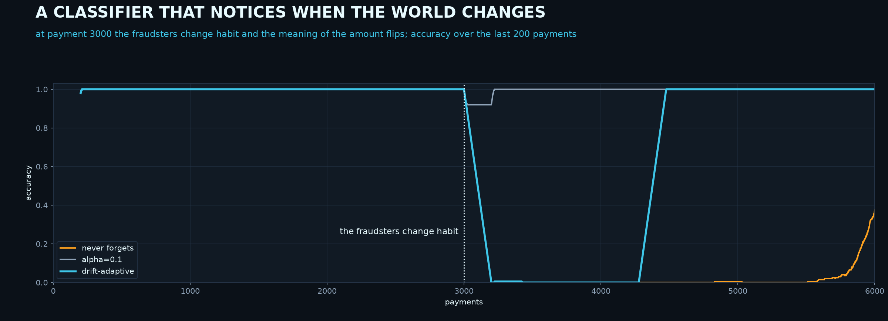

# Online classifiers: non-stationary state estimation and drift-adaptive architectures

These tools tell, sample by sample, which state a system is in (for example a payment that is normal or fraud). Rather than failing when external conditions change, these models continuously adapt their internal statistics or deploy background copies to keep the state estimate usable.

## The map of the online classifiers

Click a page to open it, or the job on the left (or the button at the top) to go back to the [map of the library](../index.md#the-library-folder-by-folder).

<object type="image/svg+xml" data="../../assets/maps/online_classifiers.svg" style="width:100%"></object>

## Gamestory

London, deep night. The mysterious thief has targeted the city's bank accounts. The young detective has to check the payments one by one, in real time, and decide on the fly: "Is this payment honest or is it a scam?".

At first it seems easy: the thief always makes giant withdrawals (400 pounds), while normal citizens spend very little (60 pounds). But in the middle of the night, the thief suddenly changes his trick: he starts making tiny withdrawals so as not to draw attention, right when citizens are making big purchases! To avoid getting fooled by the rule change, the detective uses three special helper programs called Online Classifiers:

- **1. The little program that never forgets (OnlineGaussianNB):** It learns one payment at a time. But if you don't tell it to forget the past, it stays stuck on the old rules: when the thief changes his trick, it keeps blocking honest citizens and lets the thief get away!
- **2. The short-memory programs (alpha and OnlineSoftmaxRegression):** To avoid getting stuck in the past, these helpers give more weight to the latest clues and slowly forget the old ones (thanks to a trick called alpha), or redraw the borders between honest people and thieves on the fly (OnlineSoftmaxRegression). That way they adapt right away to the new moves!
- **3. The Detective with the Substitute on the bench (DriftAdaptiveClassifier):** This is the smartest system of all! The main program works connected to an alarm. When the thief changes his trick and the program starts making too many mistakes, the siren goes off: immediately a backup program starts up and studies only the new clues. As soon as the backup proves it can guess better than the old program, it takes over command!

In the end, what are Online Classifiers? They are computer "brains" that don't need to study thousands of books before starting: they learn one clue at a time while things are happening, and know how to change their minds on the fly when the bad guys change the rules of the game!

A bank has to tell, payment by payment, whether a payment is normal or fraud, from a few numbers.
It has to keep doing it right when the world changes: customers change habit, fraudsters change
trick.

`OnlineGaussianNB` and `OnlineSoftmaxRegression` learn one sample at a time.
`DriftAdaptiveClassifier` wraps either of them with a drift detector on its own
prediction loss and swaps in a fresh copy when the old one goes stale.

## A first example: fraudsters change habit

Half of the payments are fraud. At first a fraud is a large payment (around 400) and a normal one is small (around 60). After 3000 payments the fraudsters change habit: they now make small test charges, while the customers' payments grow. The meaning of the amount flips. Three classifiers are tested on each payment before learning it: a Gaussian naive Bayes that never forgets, one with a fixed forgetting factor (`alpha=0.1`), and the `DriftAdaptiveClassifier` that wraps the first and swaps in a fresh copy when its own error jumps.

```python
import numpy as np
from dense_armor.core.online.drift.detector import CUSUMDriftDetector
from dense_armor.core.online.learn.online_classifiers import (
    DriftAdaptiveClassifier,
    OnlineGaussianNB,
)

rng = np.random.default_rng(1)
models = {
    "never forgets": OnlineGaussianNB(),
    "alpha=0.1": OnlineGaussianNB(alpha=0.1),
    "drift-adaptive": DriftAdaptiveClassifier(
        OnlineGaussianNB(),
        CUSUMDriftDetector(
            reference="fixed", radius=20, ref_mult=5, two_sided=False
        ),
        window=50,
        smooth_window=50,
    ),
}
hits = {k: [] for k in models}
for i in range(6000):
    fraud = int(rng.random() < 0.5)
    big = fraud if i < 3000 else 1 - fraud
    x = {
        "amount": rng.normal(400 if big else 60, 60 if big else 20),
        "hour": rng.normal(14, 3),
    }
    for k, m in models.items():
        hits[k].append(m.predict_one(x) == fraud)
        m.learn_one(x, fraud)
for k, h in hits.items():
    h = np.array(h, float)
    print(
        k,
        h[500:3000].mean().round(3),
        h[3000:3200].mean().round(3),
        h[5000:5900].mean().round(3),
    )
```

```
never forgets 1.0 0.0 0.046
alpha=0.1 1.0 0.92 1.0
drift-adaptive 1.0 0.0 1.0
```

The three columns are the accuracy before the change, over the 200 payments after it, and late in the stream (payments 5000 to 5900). The classifier that never forgets is perfect before the change, wrong every time right after it, and still wrong at the end (0.046): it keeps the old rule. The one with `alpha=0.1` forgets a little all the time and loses almost nothing (0.92). The drift-adaptive one is wrong right after the change, until its alarm rings and it swaps in the fresh copy, and then it is back at 1.0.



## The three classifiers, one page each

| Page | Class | What it is for |
|---|---|---|
| [OnlineGaussianNB](gaussian_nb.md) | `OnlineGaussianNB` | a mean and a variance per class and column, with an optional forgetting factor |
| [OnlineSoftmaxRegression](softmax.md) | `OnlineSoftmaxRegression` | a border between the classes that moves a little at every mistake, with a step that shrinks by itself |
| [DriftAdaptiveClassifier](drift_adaptive.md) | `DriftAdaptiveClassifier` | a wrapper with an alarm and a backup, for when you cannot know how fast the world changes |

## Cost

Per sample, on one CPU core:

| classifier | µs per sample |
|---|---|
| `OnlineGaussianNB` | 10.5 |
| `OnlineSoftmaxRegression` | 36.8 |
| `DriftAdaptiveClassifier(OnlineGaussianNB)` | 75.8 |

At 100 Hz the loop has 10 ms per cycle: all three fit with three orders of magnitude
to spare. The wrapper is 7× the bare NB because it runs a background copy in parallel
after each drift alarm.

## The robot example

The same classifiers on a robot that has to tell, sample by sample, whether it moves freely, touches something or collides, from its joint signals, and that has to keep doing it right when its load or its gripper changes.

### The data

6,000 samples, 3 states from a Markov chain (stay probability 0.95, mean dwell 20
samples), 4 joint features with unit noise:

- **free**: `(0, 0, 0, 0)`
- **contact**: `(2, 2, 0, 0)`
- **collision**: `(4, 4, 4, 4)`

From sample 3000 the contact load **moves to the other two joints**: contact becomes
`(0, 0, 2, 2)`. The classifier was trained on the old signature.

### Gaussian naive Bayes on the robot data

```python
import numpy as np
from dense_armor.core.online.learn.online_classifiers import OnlineGaussianNB

rng = np.random.default_rng(42)
s = np.zeros(6000, int)
for t in range(1, 6000):
    s[t] = (
        s[t - 1] if rng.random() < 0.95 else (s[t - 1] + rng.integers(1, 3)) % 3
    )
mu = np.array([[0, 0, 0, 0], [2, 2, 0, 0], [4, 4, 4, 4]], float)
X = mu[s] + rng.standard_normal((6000, 4))
X[3000:][s[3000:] == 1] += [-2, -2, 2, 2]
clf, hit = OnlineGaussianNB(), []
for x, y in zip(X, s):
    f = dict(zip("abcd", x))
    hit.append(clf.predict_one(f) == y)
    clf.learn_one(f, y)
print(
    np.mean(hit[500:3000]).round(3),
    np.mean(hit[3000:3200]).round(3),
    np.mean(hit[5000:5900]).round(3),
)
```

```
0.952 0.48 0.879
```

Prequential accuracy (predict first, then learn) before the change, right after it, and late.

### What happens when the signature changes

The contact state moves from joints 0–1 to joints 2–3 at sample 3000. A classifier
without forgetting keeps the old contact mean and gets every post-change contact sample
wrong. Prequential accuracy over `[500, 3000)` (pre), `[3000, 3200)` (post), and
`[5000, 5900)` (late):

| Classifier | pre | post | late | recovery |
|---|---|---|---|---|
| `OnlineGaussianNB(alpha=0)` | 0.952 | 0.480 | 0.879 | 617 |
| `OnlineGaussianNB(alpha=0.01)` | 0.952 | 0.790 | 0.941 | 59 |
| `OnlineGaussianNB(alpha=0.1)` | 0.950 | 0.925 | 0.913 | 0 |
| `OnlineSoftmaxRegression(eta=0.1, l2=1e-4)` | 0.934 | 0.565 | 0.919 | 213 |
| `DriftAdaptiveClassifier(OnlineGaussianNB(alpha=0))` | 0.952 | 0.480 | 0.931 | 145 |
| `DriftAdaptiveClassifier(OnlineSoftmaxRegression)` | 0.912 | 0.775 | 0.904 | 38 |

"Recovery" is the number of samples after 3000 until the 200-sample accuracy is back
within 0.05 of pre.

Without forgetting, Gaussian NB goes from 0.952 to 0.480 at the change and needs **617
samples** to recover. A fixed forgetting factor reacts faster if you already know how
fast the world changes — `alpha = 0.1` never loses accuracy, at the cost of a noisier
late phase (0.913 instead of 0.941).

The drift-adaptive wrapper is the third option: it does not need a forgetting factor
chosen in advance.

### The drift-adaptive wrapper on the robot data

```python
import numpy as np
from dense_armor.core.online.learn.online_classifiers import (
    OnlineGaussianNB,
    DriftAdaptiveClassifier,
)
from dense_armor.core.online.drift.detector import CUSUMDriftDetector

rng = np.random.default_rng(42)
s = np.zeros(6000, int)
for t in range(1, 6000):
    s[t] = (
        s[t - 1] if rng.random() < 0.95 else (s[t - 1] + rng.integers(1, 3)) % 3
    )
mu = np.array([[0, 0, 0, 0], [2, 2, 0, 0], [4, 4, 4, 4]], float)
X = mu[s] + rng.standard_normal((6000, 4))
X[3000:][s[3000:] == 1] += [-2, -2, 2, 2]
det = CUSUMDriftDetector(
    reference="fixed", radius=20, ref_mult=5, two_sided=False
)
clf, hit = (
    DriftAdaptiveClassifier(
        OnlineGaussianNB(), det, window=50, smooth_window=50
    ),
    [],
)
for x, y in zip(X, s):
    f = dict(zip("abcd", x))
    hit.append(clf.predict_one(f) == y)
    clf.learn_one(f, y)
print(
    np.mean(hit[500:3000]).round(3),
    np.mean(hit[3000:3200]).round(3),
    np.mean(hit[5000:5900]).round(3),
)
```

```
0.952 0.48 0.931
```

On the running data the wrapper leaves its pre-drift accuracy untouched (0.952), fires
about 55 samples after the change, and recovers in 145 samples. It reaches 0.931 in the
late phase — better than the no-forgetting baseline (0.879) and close to the tuned
`alpha = 0.1` (0.913).

## API reference

::: dense_armor.core.online.learn.online_classifiers
    options:
      docstring_style: numpy

---

## Details

The Gaussian NB variance uses the exponentially weighted Welford update
(Welford 1962); `OnlineSoftmaxRegression` uses AdaGrad steps (Duchi, Hazan and Singer,
JMLR 2011); the background-learner swap follows Gama et al., *Learning with drift
detection* (SBIA 2004).

All three classifiers return probabilities, so [calibration](calibration.md)
(`OnlinePlattScaling`) can wrap them in the binary case. The two together — adaptive
learning and honest probabilities — are what a control policy needs to be able to
trust the output.
