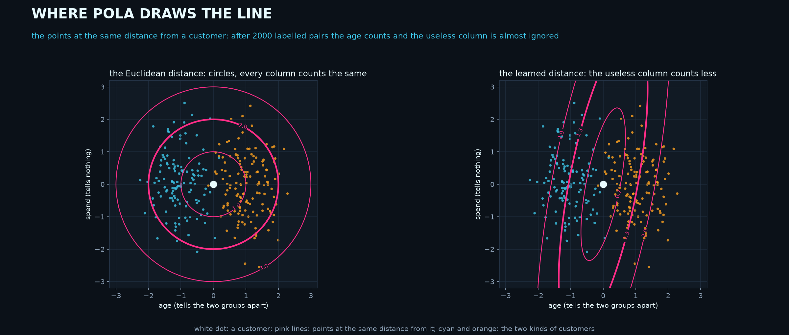

# POLA: learn a pseudo-metric from "similar" and "different" pairs

POLA (Shalev-Shwartz, Singer and Ng, 2004) learns from the simplest feedback: two customers and a
label, *similar* or *different*. It keeps a matrix `A` and a threshold `b`, predicts that two
customers are similar when their distance is below the threshold, and corrects itself when it is
wrong. The correction has two steps, and the second one, which keeps the matrix a valid distance, is
what makes POLA the most expensive of the three. The other two learners are [OASIS](oasis.md) and
[LEGO](lego.md); the overview is on [Metric learning](metric_learning.md).

## Gamestory

London, late at night. The mysterious thief strikes again, but this time he has left confusing traces all over the city.

While analyzing the files on his desk, the young detective realizes that the thief never acts alone: he has a network of accomplices hidden among the citizens. To unmask them, he cannot use a normal yardstick of judgment, because the flashiest details are just traps to throw him off the scent. So he decides to apply the POLA method, a rapid training based on pairwise comparison:

- **The "Similar or Different" game:** The police informant puts two files on the table at a time. He doesn't reveal who the culprits are, but gives a single blunt clue: "These two suspects work together" or "These two have nothing to do with each other".
- **Uncovering the decoy clues:** Each file has four pieces of data: the money in the bank account, museum visits, store spending, and age. At first, the detective looks at everything the same way, but he realizes that the money or spending change at random and only cause confusion.
- **Adjusting aim with every mistake:** Every time the detective is wrong about whether two suspects are accomplices, POLA makes him recalibrate his "investigation ruler". Slowly, he zeroes out the weight of useless details and focuses all his attention on the only clue that really matters: age (the thief only recruits the very young!).
- **The capture threshold:** At the end of the training, the detective has built a perfect ruler and a safety threshold. When he crosses paths with two new suspects on the street, he measures their "distance" with this new ruler: if they are closer than the threshold, the handcuffs snap shut!


Pair after pair, POLA moves the matrix and the threshold. Left: the squared distance of 200 fresh pairs, on average, over 10 runs (line: median, band: quartiles). The threshold `b` starts at 1 and rises to about 1.64; the pairs of the same kind stay below it (a median of 1.10 at the end) and the pairs of different kinds climb well above it (5.34). Right: how many times, in 2000 pairs, the correction would have made `A` lose positive semi-definiteness (a negative eigenvalue), and the projection cut it back to zero: about 500 times. That projection is what makes POLA more expensive than the other two learners.

## A first example: similar or different

A bank has two kinds of customers, young and older. For each customer it knows four numbers, already put on the same scale: the age, which tells the two kinds apart, and the spending, the balance and the number of visits, which tell nothing about the group. With the plain Euclidean distance the three useless columns weigh three times as much as the useful one. POLA sees 2000 pairs, half of customers of the same kind (`+1`) and half of different kinds
(`-1`).

```python
import numpy as np
from dense_armor.core.online.learn.metric_learning import POLA

rng = np.random.default_rng(0)
def customer(young):
    return {"age": rng.normal(-1.0 if young else 1.0, 0.5), "spend": rng.normal(0, 1), "balance": rng.normal(0, 1), "visits": rng.normal(0, 1)}
def euclid(u, v):
    return sum((u[k] - v[k]) ** 2 for k in u) ** 0.5

pola = POLA()
for _ in range(2000):
    young = rng.random() < 0.5
    if rng.random() < 0.5:
        pola.learn_pair(customer(young), customer(young), +1)
    else:
        pola.learn_pair(customer(young), customer(not young), -1)
print(np.round(np.diag(pola.A), 2), round(pola.b, 2))
hits = {"Euclidean": 0, "POLA": 0}
for _ in range(600):
    young = rng.random() < 0.5
    a, same, other = customer(young), customer(young), customer(not young)
    hits["Euclidean"] += euclid(a, same) < euclid(a, other)
    hits["POLA"] += pola.distance(a, same) < pola.distance(a, other)
print({k: round(v / 600, 3) for k, v in hits.items()})
```

```
[0.58 0.23 0.12 0.29] 1.78
{'Euclidean': 0.758, 'POLA': 0.86}
```

The first line is the diagonal of the matrix `A` (columns in alphabetical order, the age first: it weighs the most, 0.58) and the threshold
`b = 1.78`: two customers are called similar when their squared distance is at most `b`. The second
line is the share of 600 test triplets in which the anchor is closer to the customer of its own kind:
75.8 % with the Euclidean distance, 86.0 % with POLA: with the same 2000 pairs it gets less far than
OASIS and LEGO in this example. POLA moves only when a pair is on the wrong side of the threshold, or
closer to it than the margin of 1.



The pink lines join the points at the same distance from the white customer, in a version of the example with two columns only (the age and the spending): the circles become stripes that follow the age.

## How it learns

POLA learns a pseudo-metric from a stream of pairs labelled `y = +1` (similar) or
`y = −1` (different). It keeps a matrix `A` and a threshold `b`; a pair is predicted
similar when the squared Mahalanobis distance `d = zᵀ A z` is below `b`.

### The formula, symbol by symbol

For a pair with `z = u − v` and label `y ∈ {+1, −1}`:

```
d = zᵀ A z
ℓ = max(0, y (d − b) + 1)
α = ℓ / (1 + ‖z‖⁴)
A ← A − y α z zᵀ
b ← b + y α
```

Then `A` is projected back onto the PSD cone. If `A` still has a negative eigenvalue,
it is removed (the paper shows only a single eigenvalue can go negative, so removing one
rank-one direction is enough).

### Hand case

Start `A = I`, `b = 1`, `z = (1, 1)`, label `y = +1`.

```
d = [1, 1] · I · [1, 1]ᵀ = 2
ℓ = max(0, 1 · (2 − 1) + 1) = 2
‖z‖⁴ = (√2)⁴ = 4
α = 2 / (1 + 4) = 0.4
A ← I − 1 · 0.4 · [[1, 1], [1, 1]] = [[0.6, −0.4], [−0.4, 0.6]]
b ← 1 + 0.4 = 1.4
```

The eigenvalues of the new `A` are 0.2 and 1.0 — both positive, no projection needed.
The pair is similar (`y = +1`), but its distance, 2, was larger than `b − 1 = 0` allows.
The update shrinks `A` along `z`: the new distance of the same pair is `zᵀ A z = 0.4`,
exactly the new `b − 1 = 0.4`, so the pair now just meets the constraint (a loss of zero).

```python
from dense_armor.core.online.learn.metric_learning import POLA

learner = POLA()
learner.learn_pair({"x0": 1.0, "x1": 0.0},
                   {"x0": 0.0, "x1": 0.0},
                   1)
```

## What the paper says

These points are in Shalev-Shwartz et al. (2004), Section 3; the formulas and the hand case above were
recomputed with the code of the library:

- The loss is an adaptation of the hinge loss, `ℓ(A, b) = max(0, y (d_A(x, x')² − b) + 1)`: a pair is
  predicted dissimilar when `d² > b`, and the loss is zero only with a margin of 1 on the right side.
- The algorithm starts with `A = 0`, and `b` any number (the library starts from `b = 1`).
- The update is **two projections**. First the pair `(A, b)` is projected onto the set of pairs with zero
  loss on the current example: this gives the step `Â = A − y α v vᵀ`, `b̂ = b + y α`, with
  `α = ℓ / (1 + ‖v‖⁴)`, where `v = x − x'`. Then the result is projected onto the admissible pairs,
  `A` positive semi-definite and `b ≥ 1`.
- The projection of `b̂` is `max(1, b̂)`. For a dissimilar pair (`y = −1`) the step *adds* a positive
  semi-definite term, so `A` stays positive semi-definite; for a similar pair it subtracts one, and the
  projection of `A` onto the positive semi-definite cone is done with an eigendecomposition.
- The paper gives a bound on the number of mistakes of the similarity predictions, and a way to turn the
  online algorithm into a batch one.

## Results

On small dense data (30 % train, 70 % test, standardised features, k = 3; numbers taken from the page
published in [Dense-Evolution-Discovery](https://tatopenn-cell.github.io/Dense-Evolution-Discovery/river_metric_learning/), not re-run here):

| Dataset | Features | Euclidean | POLA |
|---|---|---|---|
| Iris | 4 | 0.9333 | 0.9524 (+1.9) |
| Wine | 13 | 0.9200 | **0.9520 (+3.2)** |
| Digits | 64 | 0.9459 | **0.9658 (+2.0)** |

POLA is best or tied for best on Wine and Digits and is never below the baseline in these three
datasets, at the cost of an eigendecomposition for every similar pair (Digits was trained on 20,000 pairs
for POLA, against 50,000 for the others, for that reason).

## The parameter

| Parameter | Meaning | Default |
|---|---|---|
| `b_init` | the starting threshold; a pair is called similar when its squared distance is at most `b` | 1.0 |

## API reference

::: dense_armor.core.online.learn.metric_learning.POLA

---

## Details

- `learn_pair(x, x2, y)` takes two dicts and `y`: any value above 0 is read as `+1`, any other as `−1`.
- Because `A` starts at 0, the distance of every pair is 0 until the first corrections; `distance` returns
  the square root of `max(zᵀ A z, 1e-12)`.
- Source: Shalev-Shwartz, S., Singer, Y., Ng, A. Y. (2004), "Online and batch learning of pseudo-metrics",
  ICML.
