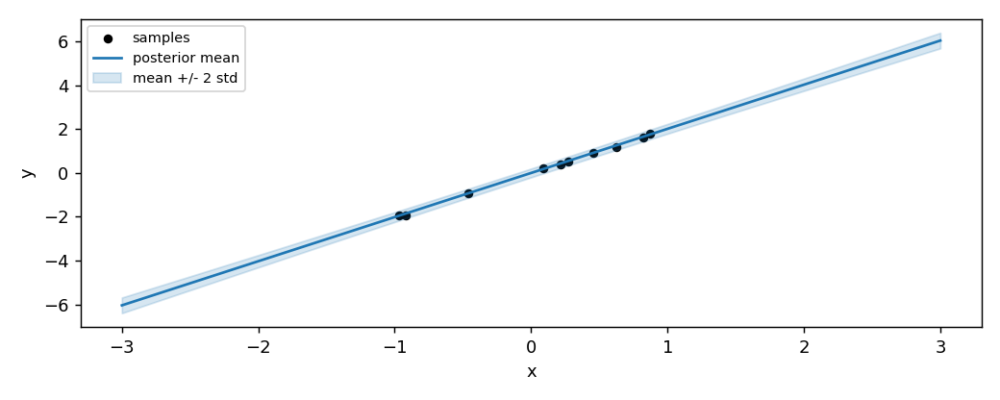

# BayesianLinearRegression

**In plain words:** A prediction tool that gives not only one number but also a range around it: the range is wide when it has seen few examples and narrow when it has seen many. It learns one example at a time.

BayesianLinearRegression is the Bayesian companion of LinearRegression. It
learns the same linear function on the same stream, but it returns not a
single prediction, it returns an interval. The width of the interval grows
where the model has seen few samples and shrinks where the model has seen
many, which is the kind of uncertainty that a frequentist model does not
give. This page shows the update, the two equivalent forms (streaming and
batch), and the predictive interval on a real stream.

## 1. What it does

On each sample the model updates a Gaussian posterior over the weights. The
posterior is fully described by two quantities: a mean `m`, which is the
current best guess of the weights, and a covariance `S`, which is the
current uncertainty on that guess. The updates are:

    A_t = A_{t-1} + beta * x_t x_t^T
    b_t = b_{t-1} + beta * x_t y_t
    m_t = S_t @ b_t
    S_t = inv(A_t)

with `A_0 = alpha * I`, `b_0 = 0`. `alpha` is the prior precision on the
weights, `beta` the precision of the noise on the targets. The prediction on
a sample `x` is the posterior mean at `x`, and the predictive variance is
`1/beta + x^T S x`.

A small example. Suppose the model has seen five samples of the line
`y = 2 x` and the current `m` is roughly `[2.0]`, `S` is small. On a new
sample `x = 1.0` the prediction is around `2.0` with a narrow interval. On
a sample `x = 50.0`, far outside the observed range, the same `m` predicts
a value around `100.0` but the interval is wide, because the model has
never seen `x` near 50 and cannot be sure that the linear relation still
holds.

The model is closed-form: no optimizer, no learning rate, no iteration.
The `alpha` and `beta` hyper-parameters set the prior and the noise model,
not the speed of convergence.

## 2. The two forms

The object form updates the posterior one sample at a time:

```python
import numpy as np
from dense_armor.utility.linear.bayes import BayesianLinearRegression

model = BayesianLinearRegression(alpha=1.0, beta=1.0,
                                 intercept=False, feature_keys=["x"])
for i in range(5):
    model.learn_one({"x": float(i + 1)}, float(2 * (i + 1)))
print(round(model.predict_one({"x": 3.0}), 3))
```

```
5.893
```

Unlike `LinearRegression` and `LogisticRegression`, this estimator does
not expose a pure `init_state` / `step` pair. The Bayesian update is not
a gradient step: it is a closed-form update of the posterior, and it is
not used inside `jax.lax.scan` by the rest of the package. The estimator
runs through `learn_one` only.

The streaming update is algebraically identical to the batch posterior:
on the same stream the two produce the same `m` and the same `S` up to
numerical precision (`max|dm| ~ 1e-16`, `max|dS| ~ 1e-19` on a 20-sample
test). The tests in `test/linear/test_bayes.py` check this equivalence.

## 3. The predictive interval

The predictive variance on a sample `x` is `1/beta + x^T S x`. The first
term is the noise on the target, the second is the uncertainty on the
weights projected onto `x`. The second term grows with `x^T S x`, which is
small where the model has seen data and large elsewhere.

The figure shows the posterior mean and the `mean +/- 2 std` band after
ten samples of a noisy line, on a range that goes beyond the observed
samples:



The band is narrow around the observed samples and wide at the two ends.
That is the Bayesian signature: the model admits it does not know.

`predict_one(..., return_estimate=True)` returns the mean and the standard
deviation of the prediction as a single named tuple, without a second call:

```python
from dense_armor.utility.linear.bayes import BayesianLinearRegression

model = BayesianLinearRegression(alpha=1.0, beta=1.0,
                                 intercept=False, feature_keys=["x"])
for i in range(5):
    model.learn_one({"x": float(i + 1)}, float(2 * (i + 1)))
out = model.predict_one({"x": 3.0}, return_estimate=True)
print(round(out.mean, 3), round(out.std, 6))
```

```
5.893 1.077365
```

The standard deviation `1.077` is what the model believes about the
prediction on `x = 3` after five samples with `alpha = beta = 1`. The
value is large because the prior is loose and the noise is large. With
more samples, or a larger `beta`, the interval shrinks. On a far away
`x` the same number would be much larger. This is the object the caller can use to
decide whether to trust the prediction, something LinearRegression cannot
provide.

## 4. On a real arm

A `SyntheticArm` from a real Panda URDF gives `q`, `qd`, and `tau` at
50 Hz. The model learns the torque of joint 0 as a function of its
velocity:

```python
from pathlib import Path
import numpy as np
from dense_armor.utility.datasets import SyntheticArm
from dense_armor.utility.linear.bayes import BayesianLinearRegression

ds = SyntheticArm(Path("test/fixtures/urdf/panda.urdf"),
                  period_s=1.0, rate_hz=50.0, n_cycles=2, seed=0)
model = BayesianLinearRegression(alpha=1.0, beta=100.0,
                                 intercept=True, feature_keys=["qd0"])
for sig, _ in ds.stream():
    model.learn_one({"qd0": float(sig["qd_0"])}, float(sig["tau_0"]))
print(round(model.predict_one({"qd0": 0.5}), 3))
```

```
8.041
```

The value `8.041` is the posterior mean on `qd = 0.5`. It is not close to
the `-2.158` of `SGD(lr=1e-3)` on the same stream, and the gap is not a
bug. The reason is that the two methods answer two different questions.

SGD with `lr=1e-3` has not converged after 100 samples: its weight `w =
[1.43, -7.18]` is still far from the least-squares optimum of this
stream. BayesianLinearRegression solves the same least-squares problem in
closed form, and its posterior mean `[8.19, -0.294]` is the exact
solution for the given `alpha, beta`. The first component is the bias
term, and it is very close to the target mean `mean(tau_0) = 8.19` of
this stream: the joint torque has a large constant offset and a small
dependence on the velocity, so any correctly fitted model will put most of
the prediction in the bias.

Which one is the right tool? It depends on the question:

- To track a changing relationship on a long stream, first-order optimizers
  (SGD, AdaGrad, Adam) are the right tool, because they adjust the weights
  sample by sample.
- To obtain a closed-form estimate together with its uncertainty on a
  stationary window, BayesianLinearRegression is the right tool, because
  it does not need a learning rate and it gives an interval, not a point.

Neither is better in the abstract: they answer different questions.

## Details

### References

Bishop, C. M. (2006). *Pattern Recognition and Machine Learning*.
Springer. Section 3.3.1, equation 3.53, page 152:

    m_N = beta * S_N * Phi^T t
    S_N^{-1} = alpha * I + beta * Phi^T Phi

The docstring of `bayes.py` derives the streaming form
`m_N = m_{N-1} + K (y - x^T m_{N-1})` from equation 3.53 by direct
algebra, and the tests compare the two. Section 3.3.1, lines after
equation 3.51, states explicitly: "if data points arrive sequentially,
then the posterior distribution at any stage acts as the prior
distribution for the subsequent data point". This implementation follows
that statement.

### Choices stated explicitly

- **Zero-mean isotropic prior.** The prior on the weights is
  `N(0, alpha^{-1} I)`. This is the special case that Bishop uses in the
  remainder of Section 3.3 after equation 3.52. A general Gaussian prior
  `N(m_0, S_0)` is handled by the batch form, not by the streaming form.
- **Closed-form update.** The mean and covariance are updated in closed
  form at every sample. No optimizer is involved. The `alpha` and `beta`
  parameters are the same ones in Bishop, not a learning rate.
- **Symmetrisation of the covariance.** After the rank-one update of `S`
  the code symmetrises it: `S = 0.5 (S + S^T)`. Without this, numerical
  drift can break the symmetry after many samples and the Kalman update
  can become unstable.
- **`return_estimate=True` returns an `Estimate`.** The object has
  attributes `.mean` and `.std`. This is the caller's window on the
  posterior uncertainty, and it is the reason the model is useful for
  applications where the prediction alone is not enough.
- **`return_std=True` returns the standard deviation alone.** For callers
  that only need the width of the interval, without the mean.
- **No pure `init_state` / `step` form.** The estimator is used through
  `learn_one` only. The Bayesian update is closed form and does not need
  the `jax.lax.scan` machinery.

### Measured cost

The covariance is a `d x d` matrix, one entry per pair of features. On a
problem with `d = 100`, the update is the most expensive of the models in
the package. On the two-feature problem of the tests, the update is
`0.0178 ms` per sample, close to AdaGrad.

### Development diary

The docstring was verified against Bishop Section 3.3.1, equation 3.53
on page 152, extracted from the PDF via `pypdf` during this session. The
streaming update in the docstring matches the batch form of Bishop step
by step. The example in Section 4 was rewritten after an initial version
compared the prediction to SGD on the same stream and reported a
"discrepancy"; the discrepancy was not a bug, it was a comparison between
an exact closed-form solution and a stochastic method that has not yet
converged, and the page now says so explicitly. The figure was regenerated
to show the interval, not just the mean.
