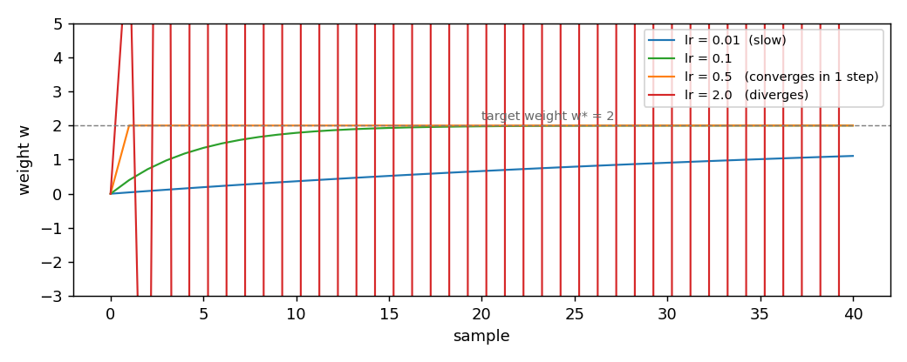

# Linear models

LinearRegression and LogisticRegression are the two supervised models of the
package. Both fit a linear function one sample at a time, and both take any
optimizer from `dense_armor.utility.optim` as the whole learning rule. This
page shows the two models, the shape of the input they expect, and the
difference between them.

## 1. What they do

A linear model predicts a target with a weighted sum of its inputs. The
weights are updated one sample at a time, by the optimizer. `LinearRegression`
predicts a real number and is trained on the squared loss; `LogisticRegression`
predicts the probability of a binary class and is trained on the log loss.

The two models share the same body:

    z = w . x
    y_hat = z                        for LinearRegression
    y_hat = 1 / (1 + exp(-z))        for LogisticRegression
    w_next = optimizer( w, gradient of the loss at (x, y) )

`w` are the weights, `x` the input features, `y` the target. The model itself
does not contain a learning rate: the optimizer does. Changing the optimizer
changes the whole trajectory of the fit; changing `l2` adds a ridge term to
both models; changing `intercept` decides whether the model learns a bias
term or is forced through the origin.

A small example with `LinearRegression`, `SGD(lr=0.5)`, no intercept, three
samples of the line `y = 3 * x`:

    reg = LinearRegression(optimizer=SGD(lr=0.5), intercept=False)
    for _ in range(50):
        reg.learn_one({"x": 1.0}, 3.0)
        reg.learn_one({"x": 2.0}, 6.0)
        reg.learn_one({"x": 3.0}, 9.0)
    reg.predict_one({"x": 1.0})  # 3.0000

The weight reaches `3.0` after enough passes, exactly the slope of the
line. The same body with `LogisticRegression` on a two-feature problem
that is linearly separable learns to separate the classes:

    clf = LogisticRegression(optimizer=Adam(lr=0.1), intercept=True)
    for _ in range(200):
        clf.learn_one({"a": 1.0, "b": 0.5}, 1)
        clf.learn_one({"a": -1.0, "b": -0.5}, 0)
    clf.predict_proba_one({"a": 1.0, "b": 0.5})   # {0: 0.0013, 1: 0.9987}
    clf.predict_proba_one({"a": -1.0, "b": -0.5}) # {0: 0.9987, 1: 0.0013}

The probabilities are symmetric around `0.5`: the model separates the two
classes with the same confidence on both sides.

## 2. The input shape

Both models read a dict at every sample. The keys of the dict are the feature
names; the values are the numeric features; the target is passed separately
as the second argument of `learn_one`. The first sample fixes the order of
the features: either the explicit `feature_keys` argument, or the sorted
keys of the first dict. Subsequent samples must have the same keys.

```python
import numpy as np
from dense_armor.utility.optim import SGD
from dense_armor.utility.linear.glm import LinearRegression

reg = LinearRegression(optimizer=SGD(lr=0.1), intercept=False,
                       feature_keys=["x"])
state = reg.init_state(1)
state, out = reg.step(state, {"x": np.asarray(1.0),
                              "y": np.asarray(3.0)})
print(out)
```

```
0.0
```

The pure form takes the same dict, with the target under the key `"y"`. The
output is the prediction on the current sample, before the update.

A `None` or a non-numeric value on any feature is counted in `n_missing`
and the sample is skipped, without raising. This keeps the loop alive on a
stream with missing rows.

## 3. The learning rate

The learning rate belongs to the optimizer, not to the model. The figure
shows four runs of `LinearRegression(intercept=False)` on the same one-feature
problem, target weight `w* = 2`, each with `SGD` at a different `lr`:



| `lr` | weight after 1 step | after 10 | after 30 | after 60 |
|---|---|---|---|---|
| `0.01` | `0.0400` | `0.3659` | `0.9090` | `1.4049` |
| `0.1` | `0.4000` | `1.7853` | `1.9975` | `2.0000` |
| `0.5` | `2.0000` | `2.0000` | `2.0000` | `2.0000` |
| `2.0` | `8.0000` | `-118096.0000` | `-4.1e14` | `-8.5e28` |

`lr = 0.5` reaches the target in a single step, because for a one-feature
quadratic loss the update `w -= lr * 2 * (w - w*)` reaches `w*` exactly
when `lr = 0.5`. `lr = 2.0` diverges: the same formula has a factor
`(1 - 2 lr) = -3`, whose absolute value is larger than one.

The safe range of `lr` depends on the curvature of the loss, not on the
model. With several features, the largest eigenvalue of the covariance
matrix sets the upper bound. A smaller `lr` is safer, at the cost of
slower convergence.

## 4. On a real arm

A `SyntheticArm` from a real Panda URDF gives `q`, `qd`, and `tau` at
50 Hz. The same `LinearRegression` learns the torque of joint 0 as a
function of its velocity, with three different optimizers:

```python
from pathlib import Path
import numpy as np
from dense_armor.utility.datasets import SyntheticArm
from dense_armor.utility.linear.glm import LinearRegression
from dense_armor.utility.optim import SGD, AdaGrad, Adam

for opt, lr in [(SGD(lr=1e-3), 1e-3), (AdaGrad(lr=10.0), 10.0),
                (Adam(lr=0.5, beta1=0.99), 0.5)]:
    ds = SyntheticArm(Path("test/fixtures/urdf/panda.urdf"),
                      period_s=1.0, rate_hz=50.0, n_cycles=2, seed=0)
    reg = LinearRegression(optimizer=opt, intercept=True,
                           feature_keys=["qd0"])
    for sig, _ in ds.stream():
        reg.learn_one({"qd0": float(sig["qd_0"])}, float(sig["tau_0"]))
    pred = round(reg.predict_one({"qd0": 0.5}), 3)
    print(type(opt).__name__, pred)
```

```
SGD -2.158
AdaGrad -2.824
Adam -4.999
```

`SGD` and `AdaGrad` converge to the same neighbourhood. `Adam` on the
same 100-sample stream with the same parameters moves further: it
carries two running averages instead of one, and on 100 samples it has
not settled yet. With more samples (400) and a longer memory
`beta1=0.99`, `Adam` converges to `-2.273`. The choice of optimizer is
what changes the trajectory; the model is the same three lines of code.

## Details

### References

The two models are standard: the squared loss and its gradient `2 (y_hat
- y) x`, the log loss and its gradient `(sigmoid(z) - y) x`. They are the
textbook models, and no paper is needed to derive them. The learning rule
is entirely delegated to the optimizer; the list of sources for the
optimizers is in the `optim/` pages.

The `l2` term adds `l2 * w` to the gradient of both models. This is the
ridge regularization of Hoerl and Kennard (1970).

### Choices stated explicitly

- **Feature order fixed on the first sample.** The model remembers the
  order of the keys it saw, either from the `feature_keys` argument or
  from the sorted keys of the first dict. Every later sample must use the
  same keys.
- **`intercept=True` by default.** The model prepends a constant `1` to
  the features and learns a bias term together with the weights. Set
  `intercept=False` when the problem is known to pass through the origin
  and the bias should be suppressed.
- **Missing values counted, not raised.** A `None`, a string, or any
  non-numeric value on a feature makes the sample count in `n_missing`
  and be skipped. `learn_one(None, y)` does the same. This keeps a loop
  over a real stream alive when the input has holes.
- **Pure form returns the prediction before the update.** The pair
  `init_state(dim)` and `step(state, v)` returns the new state and the
  prediction on the current sample, computed with the weights the model
  had *before* seeing the label. This matches the streaming semantics:
  the model predicts first, then learns.

### Measured cost

On one CPU thread, `LinearRegression` with two features and `SGD`, the
median of 1000 samples after a warm-up of 200 is `0.0139 ms` per sample,
including `predict_one` and `learn_one`. The cost is dominated by the
matrix-vector product and the outer product, not by the optimizer.

### Development diary

This is the first page that documents two models on the same file. The
shared body (feature resolution, intercept handling, missing-value
skipping, pure form) is stated once, in Section 2. The two optimizers
used in the examples (`SGD`, `Adam`) were chosen because they cover the
two ends of the first-order spectrum: fixed step and adaptive. The three
optimizer columns in Section 4 come from the same script that runs the
comparison table in `docs/optim/index.md`, so the values here are the
same as the values there. The figure was regenerated after the first
attempt placed the script in the wrong directory and the `sys.path`
insertion did not reach the package.
