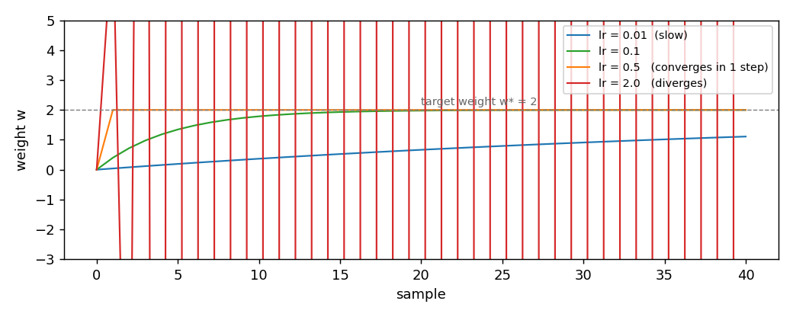

# The learning rate of the linear models

The learning rate belongs to the optimizer, not to the model. This page shows what it does to the fit of a `LinearRegression`. The overview is on [Linear models](index.md); the models are on the [GLM](glm.md) page and the optimizers in the [Optimizers](../optim/index.md) section.

The figure
shows four runs of `LinearRegression(intercept=False)` on the same one-feature
problem, target weight `w* = 2`, each with `SGD` at a different `lr`:

| `lr` | weight after 1 step | after 10 | after 30 | after 60 |
|---|---|---|---|---|
| `0.01` | `0.0400` | `0.3659` | `0.9090` | `1.4049` |
| `0.1` | `0.4000` | `1.7853` | `1.9975` | `2.0000` |
| `0.5` | `2.0000` | `2.0000` | `2.0000` | `2.0000` |
| `2.0` | `8.0000` | `-118096.0000` | `-4.1e14` | `-8.5e28` |

`lr = 0.5` reaches the target in a single step, because for a one-feature
quadratic loss the update `w -= lr * 2 * (w - w*)` reaches `w*` exactly
when `lr = 0.5`. `lr = 2.0` diverges: the same formula has a factor
`(1 - 2 lr) = -3`, whose absolute value is larger than one.

The safe range of `lr` depends on the curvature of the loss, not on the
model. With several features, the largest eigenvalue of the covariance
matrix sets the upper bound. A smaller `lr` is safer, at the cost of
slower convergence.
