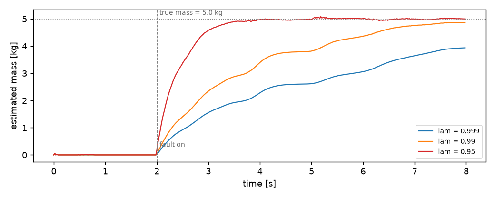

# PayloadEstimator

**In plain words:** This tool works out how heavy the object a robot is carrying is, while the arm is moving, from the forces on its joints. It needs no special weighing test beforehand.

PayloadEstimator estimates the mass of a payload attached to a link of the
robot, while the robot is moving. It does not use a pre-recorded
identification experiment. It reads the joint torques from the live stream,
computes the residual against the unloaded model, and fits a single scalar,
the mass, with a recursive least-squares update that forgets old samples.
This page shows the update, the fit on a stream where the payload appears
at a known time, and the non-negativity constraint on the estimate.

## 1. What it does

A rigid-body model predicts the torque of each joint from the joint
positions, velocities, and accelerations, assuming the model is unloaded.
If a payload is attached to a link, the real torques are larger than the
prediction by the amount the payload weighs on each joint. The
PayloadEstimator uses that residual as a measurement of the unknown mass.

The residual on joint `i` on a sample:

    r_i = tau_i - (M(q) qdd + bias(q, qd) + gravity(q))_i

The gravity torque of a point mass `m` at link `L` projected on joint `i`
is `m * g * Jz(q)_i`, where `Jz(q)_i` is the vertical component of the
Jacobian of the link position with respect to joint `i`. So the model
assumes:

    r_i ~ m * phi_i,  with phi_i = g * Jz(q)_i

The unknown is a single scalar `m`. The estimator updates it with the
standard recursive least squares with forgetting. At every sample `P` is
divided by `lam` once, then the nine joints update `m` one after the other:

    P = P / lam
    K = P * phi / (1 + phi * P * phi)
    m = m + K * (r - phi * m)
    P = P - K * phi * P

`P` is the scalar covariance of the estimate. `lam` is the forgetting
factor, in `(0, 1]`. `lam = 1` treats all past samples with the same
weight; `lam < 1` discounts older samples, so the estimate follows a
payload that changes over time. The forgetting is applied once per sample,
so `lam = 0.99` means a memory of about 100 samples (2 s at 50 Hz); the nine
joints of a sample then contribute nine scalar updates to the same `m`. The
first sample is skipped, because there is no previous `qd` to compute `qdd`.

`predict_one()` returns `max(m, 0)`, so the estimate is never negative.

## 2. The two forms

The estimator is used through the standard streaming interface. It takes
the Signal from the robot, which carries the joint channels `q_j, qd_j,
tau_j`:

```python
from pathlib import Path
from dense_armor.dynamics.urdf_dynamics import RigidBodyModel
from dense_armor.utility.datasets import SyntheticArm
from dense_armor.utility.linear.payload import PayloadEstimator

model = RigidBodyModel(Path("test/fixtures/urdf/panda.urdf"))
est = PayloadEstimator(model, link="panda_link7", lam=0.99)

ds = SyntheticArm(Path("test/fixtures/urdf/panda.urdf"),
                  period_s=4.0, rate_hz=50.0, n_cycles=1,
                  fault_at_s=2.0, fault="payload", payload_mass=5.0,
                  payload_link="panda_link7", seed=0)
for sig, _ in ds.stream():
    est.learn_one(sig)
print(round(est.predict_one(), 3))
```

```
3.362
```

The estimator also accepts a dict with the same channels, `{"q_0": ...,
"qd_0": ..., "tau_0": ..., ..., "q_8": ..., "qd_8": ..., "tau_8": ...,
"t": ...}`, so it can be used on a recorded dataset without wrapping it
in a Signal.

The estimate is one scalar. The state is `(m, P)`: the current mass and
the current covariance. There is no weight vector, no per-joint
adaptation.

## 3. The forgetting factor

The forgetting factor `lam` controls how fast the estimate reacts to a
change. Values close to `1` treat the whole history equally: on a
stationary payload the estimate is stable, but it takes longer to react
when the payload changes. Values closer to `0` weight recent samples more:
the estimate follows a change quickly but is noisier.

The figure shows three values of `lam` on the same stream, with a payload
of `5.0 kg` appearing at `t = 2.0 s`:



With `lam = 0.99` the estimate is `2.88 kg` at `t = 3.5` and enters the band
of 10 % around `5.0 kg` `4.26 s` after the fault (it is `4.87 kg` at the end
of the 8 s stream). With `lam = 0.95` (a memory of about 20 samples) it enters
the band `0.96 s` after the fault and ends at `5.00 kg`; with `lam = 0.999` it
has not entered it at the end (`3.94 kg`). Before the fault the largest value
is `0.054 kg`, and at `t = 1.5` it is `0.0000 kg`, which is the correct
estimate on an unloaded arm.

The forgetting is what makes the estimator adapt to a payload that
appears, disappears, or changes. Without it, `lam = 1`, the estimate
would be the average of everything seen since the start of the stream,
and it would take much longer to converge.

## 4. On a real arm

A `SyntheticArm` from a real Panda URDF gives `q`, `qd`, and `tau` at
50 Hz. The payload appears at `t = 2.0 s` as a fault injected by the
dataset, with mass `5.0 kg` on `panda_link7`. The estimator follows:

```python
from pathlib import Path
import numpy as np
from dense_armor.dynamics.urdf_dynamics import RigidBodyModel
from dense_armor.utility.datasets import SyntheticArm
from dense_armor.utility.linear.payload import PayloadEstimator

URDF = Path("test/fixtures/urdf/panda.urdf")
model = RigidBodyModel(URDF)

ds = SyntheticArm(URDF, period_s=4.0, rate_hz=50.0, n_cycles=2,
                  fault_at_s=2.0, fault="payload", payload_mass=5.0,
                  payload_link="panda_link7", seed=0)
est = PayloadEstimator(model, link="panda_link7", lam=0.99)
ts, ms = [], []
for sig, _ in ds.stream():
    est.learn_one(sig)
    ts.append(float(getattr(sig, "t", 0.0)))
    ms.append(float(est.predict_one()))
```

The trajectory of `ms` over `ts`:

| `t` | estimated mass |
|---|---|
| `0.50` | `+0.0000 kg` |
| `1.50` | `+0.0000 kg` |
| `2.50` | `+1.4057 kg` |
| `3.50` | `+2.8762 kg` |
| `5.00` | `+3.8170 kg` |
| `7.00` | `+4.7582 kg` |

The full trajectory over the 400 samples of the stream has
`min = +0.0000` and `max = +4.8713`, and it is never negative. The
estimate enters the band of 10 % around the true mass `5.0 kg` `4.26 s` after
the fault and stays there.

Two properties are important here. First, the estimator is **online**:
it does not need a pre-recorded identification experiment, and it
follows the change on the same stream that the controller uses. Second,
the estimator is **bounded below by zero**: even if the residual is
negative (which can happen because of noise or a small model mismatch),
the returned mass never becomes negative, so the downstream controller
is never told the payload has negative mass.

## Details

### References

The method is the standard recursive least squares with an exponential
forgetting factor, on a scalar unknown. This is a classical estimator
that appears in every textbook on adaptive filtering and system
identification; the version used here has no paper-specific
formulation.

The overall idea of estimating the inertial parameters of a link online
from the live residual is the subject of Foster, J., McCrory, S.,
DeBuys, C., Bertrand, S., Griffin, R. (2024). *Physically Consistent
Online Inertial Adaptation for Humanoid Loco-manipulation*. arXiv
2405.07901. The paper's method is an Extended Kalman Filter on ten
inertial parameters per link, with a log-Cholesky parameterization that
keeps the estimate physically consistent by construction. This
implementation is a simplification: one scalar (the mass), one
estimator (RLS, not EKF), no covariance matrix on the parameters, no
log-Cholesky. On the case the paper considers, a known payload on a
known link, the two agree on the answer.

The recursive least-squares update with an exponential forgetting
factor is a textbook estimator, present in every introduction to
adaptive filtering and system identification. The rank-one
Sherman-Morrison update without the forgetting term appears in
Orabona, F. (2019). *A Modern Introduction to Online Learning*,
Section 7.11 (Vovk-Azoury-Warmuth forecaster), which uses a ridge-style
regularization instead of a decay; the two share the same
Sherman-Morrison structure. The source cited here does not cover the
forgetting factor itself, which is why the docstring of `payload.py`
describes the estimator as standard rather than as derived from a
specific paper.

### Choices stated explicitly

- **Single scalar unknown.** The estimator fits one parameter, the mass
  of the payload. The first moment of the mass (the position of the
  center of mass on the link) is assumed to be at the link's origin,
  which is exact only for a point mass placed there. On a real payload
  the first moment is non-zero and the fit captures a combination of
  mass and first moment. The paper's ten-parameter-per-link model does
  not make this approximation.
- **Recursive least squares, not Extended Kalman Filter.** The update
  is `m += K (r - phi m)` with a rank-one update of the scalar
  covariance. No Jacobian, no matrix inversion, no parameterized
  manifold. The cost per sample is `O(n_joints)`.
- **Forgetting factor `lam`.** The estimate is a weighted average of the
  residuals seen so far, with weights decaying as `lam^k` for `k`
  samples in the past. Values close to `1` give a stable but slow
  estimate; values closer to `0` give a reactive but noisy estimate.
  The default `0.99` has a memory of about 100 samples: on the stream of
  section 3 it enters the 10 % band `4.26 s` after the fault, while
  `lam = 0.95` takes `0.96 s`.
- **Non-negative output.** `predict_one()` returns `max(m, 0)`. This is
  a hard constraint on the output, not on the internal state: the
  internal `m` can be negative, and only the returned value is clamped.
  This keeps the downstream controller from receiving a negative mass
  during the initial transient, when the residual is dominated by noise.
- **Forgetting once per sample, one update per joint.** The covariance is
  divided by `lam` once per sample; the same scalar `m` is then updated nine
  times, once per joint of the Panda, as nine independent measurements of the
  same quantity. An earlier version divided by `lam` at every joint update,
  which made the forgetting `lam^9` per sample (`0.91` for `lam = 0.99`, a
  memory of about 12 samples).
- **Skipped samples.** The first sample (no previous `qd`), a sample with
  `dt <= 0`, a sample with a NaN in `q`, `qd` or `tau`, and a sample without
  the nine channels are not used; the last two are counted in `n_missing`.

### Measured cost

Each sample requires one call to the rigid-body dynamics (`mass_matrix`,
`bias`, `gravity`, and the link Jacobian) plus nine scalar RLS updates.
The dominant cost is the dynamics call, not the RLS. On a CPU thread
the full stream of `n_cycles=2` (400 samples) takes of the order of a
minute with the URDF of the Panda, most of which is spent in the JAX
compilation of the dynamics on the first sample and in the per-sample
evaluation afterwards.

### Development diary

The docstring was verified against the source of `learn_one`. The
update rule of the source is the classical RLS with forgetting, and no
specific paper claims it. The connection to Foster et al. (2024) is
one of theme, not of formula: the paper solves the same problem with a
much more elaborate method, and this implementation is a simplification
of the idea. The earlier version of the docstring did not make this
distinction, and it cited the paper as if the update rule were derived
from it. The page now says so explicitly. The figure was generated from
a single run of `make_figure_payload.py` with `n_cycles=1` after an
earlier attempt with three forgetting factors on `n_cycles=2` took more
than ten minutes on the CPU thread.
