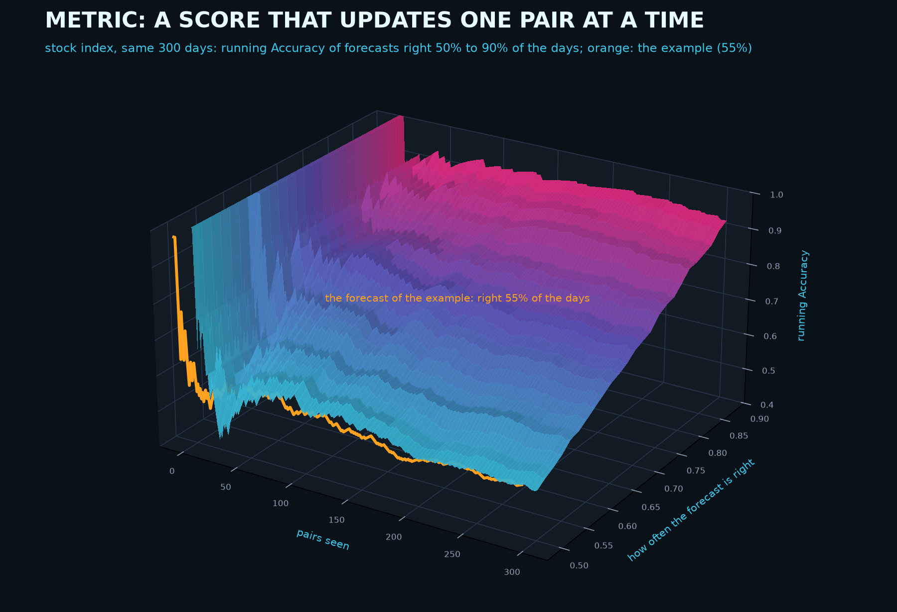
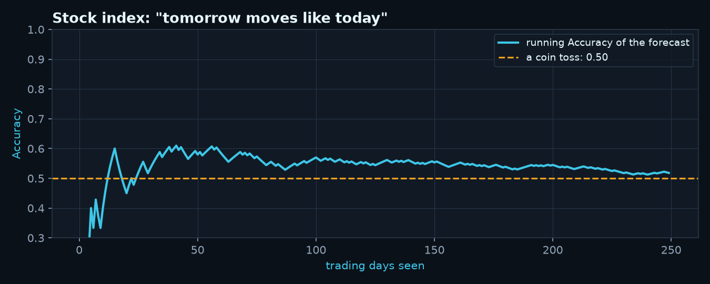

# Metrics: a score that updates one pair at a time

[← Metrics](index.md)

A metric answers one question about a model that keeps learning: how well is it doing so far? Each evening a trader compares what the forecast said about a stock index with what the index really did. The metric reads that pair, updates its score and forgets the pair. A robot controller can do the same with its fault flags.



The picture follows the same 300 trading days for 25 forecasts, right from 50% to 90% of the days. Each point of the surface is the `Accuracy` after that many pairs. The forecast that is right 90% of the days reads 0.80 after 10 pairs, 0.88 after 50 and 0.907 after 300. The forecast of the first example, right 55% of the days, reads 0.60, 0.62 and 0.583, and between pair 20 and pair 300 it stays between 0.552 and 0.648: a few dozen pairs are needed before the score stops jumping.

| class | what it does |
|---|---|
| `Metric` | the base of every online metric: `update`, `get`, `revert`, `merge`, `works_with` |
| `Accuracy` | the share of right answers, the metric used on this page |

## 1. A first example: does a stock index move today as it moved yesterday?

Each evening the direction of the day is written as 1 (up) or 0 (down). The forecast is the simplest one: tomorrow moves like today. Eight days make seven pairs.

```python
from dense_armor.core.evaluation.metrics import Accuracy

stock_up = [1, 1, 0, 1, 0, 0, 1, 1]
m = Accuracy()
for yesterday, today in zip(stock_up[:-1], stock_up[1:]):
    m.update(today, yesterday)
print(round(m.get(), 3), m.n)
```

```
0.429 7
```

Count by hand. The pairs (truth, forecast) are (1, 1) right, (0, 1) wrong, (1, 0) wrong, (0, 1) wrong, (0, 0) right, (1, 0) wrong and (1, 1) right: three right out of seven, 3/7 = 0.429.



On 250 trading days (249 pairs) the same forecast reads 0.400 after 10 pairs, 0.580 after 50, 0.570 after 100 and 0.518 after 249. The dashed line is a coin toss, 0.50: the forecast does hardly better.

## 2. What the metric keeps

The metric keeps two numbers: how many pairs were right and how many pairs it has seen. The score is their ratio, and after a million pairs it still keeps two numbers, not the list of pairs.

$$A = \frac{1}{n} \sum_{i=1}^{n} [y_i = \hat{y}_i]$$

Here $n$ is the number of pairs, $y_i$ is what really happened, $\hat{y}_i$ is what the forecast said, and $[P]$ is 1 when $P$ is true and 0 otherwise. In the example the sum is 3 and $n$ is 7, so $A = 3/7$.

**Source:** the docstring of `Accuracy` cites no paper. The metric is the fraction of samples where `y_pred == y_true`, and the base class `Metric` (module `dense_armor.core.evaluation.metrics.base`) only checks the pair, counts it and keeps the time stamps.

## 3. A pair that cannot be used

A day without a value (`None` or `NaN`) is skipped: it is counted in `n_missing` and the score does not change.

```python
from dense_armor.core.evaluation.metrics import Accuracy

m = Accuracy()
m.update(1, 1)
m.update(None, 1)
print(m.get(), m.n, m.n_missing)
```

```
1.0 1 1
```

## 4. Undo and combine

`revert` removes a pair that was added before; the rolling windows of the stream page use it. `merge` joins two metrics that read different parts of the stream.

```python
from dense_armor.core.evaluation.metrics import Accuracy

m = Accuracy()
m.update(1, 1)
m.update(0, 1)
m.revert(0, 1)
print(m.get(), m.n)
```

```
1.0 1
```

```python
from dense_armor.core.evaluation.metrics import Accuracy

a, b = Accuracy(), Accuracy()
a.update(1, 1)
b.update(0, 1)
print(a.merge(b).get())
```

```
0.5
```

The first metric has one right pair and the second one a wrong pair, so together they are right once out of two: 0.5.

## 5. The parameters

`Accuracy()` takes no parameters. A pair is added with `update(y_true, y_pred, t=None, w=1.0)`:

| Parameter | Meaning | Default |
|---|---|---|
| `y_true` | what really happened | none |
| `y_pred` | what the forecast said | none |
| `t` | the time stamp of the pair | `None` |
| `w` | the weight of the pair | `1.0` |

`revert(y_true, y_pred, w=1.0)` undoes one pair, `merge(other)` combines two metrics, and `works_with(model)` tells whether the metric fits the role of the model.

## 6. The same score on a robot joint

A joint controller flags a fault with 1 and no fault with 0, and the maintenance log says what was true. The same metric reads the pairs.

```python
from dense_armor.core.evaluation.metrics import Accuracy

m = Accuracy()
for fault, flag in [(0, 0), (1, 1), (0, 1), (1, 1)]:
    m.update(fault, flag)
print(m.get(), m.n)
```

```
0.75 4
```

Three of the four flags are right, so the accuracy is 3/4 = 0.75.

## API reference

::: dense_armor.core.evaluation.metrics.base.Metric

---

## Details

### Choices

- **What `Accuracy` keeps:** the number of right pairs (`hits_`) and the number of pairs (`total_`). `merge` adds both, and `revert` subtracts the pair that is undone.
- **The figures** are drawn with the library by `docs/assets/metrics/make_basics_figures.py`. The surface uses one stream of 300 days: the same random draws compared with 25 hit rates. The second figure uses 250 days in which the direction repeats the day before with probability 0.55, so the forecast "tomorrow moves like today" is right 55% of the days.
