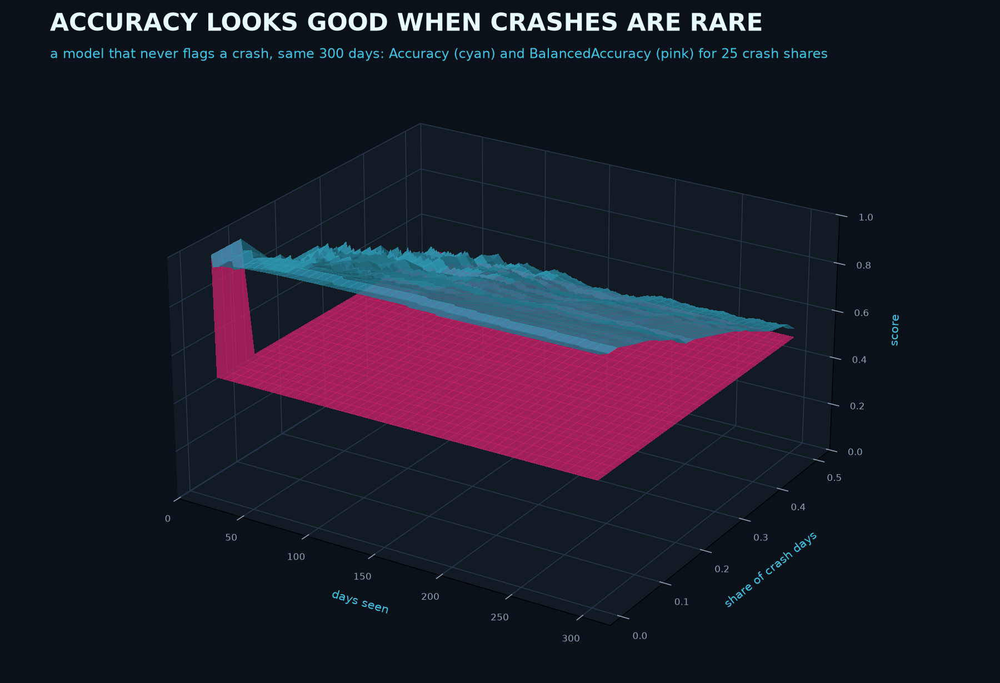
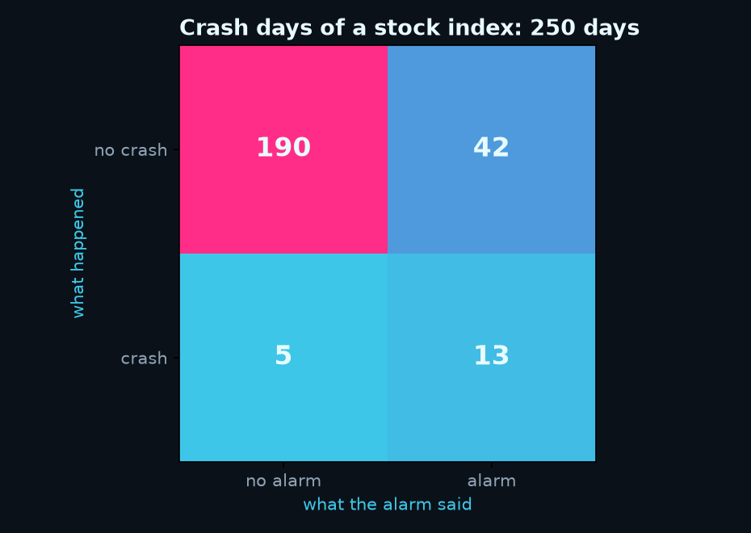
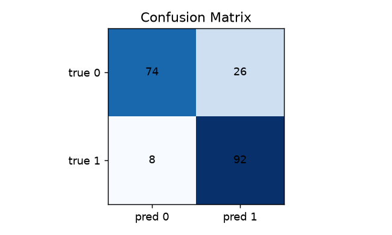
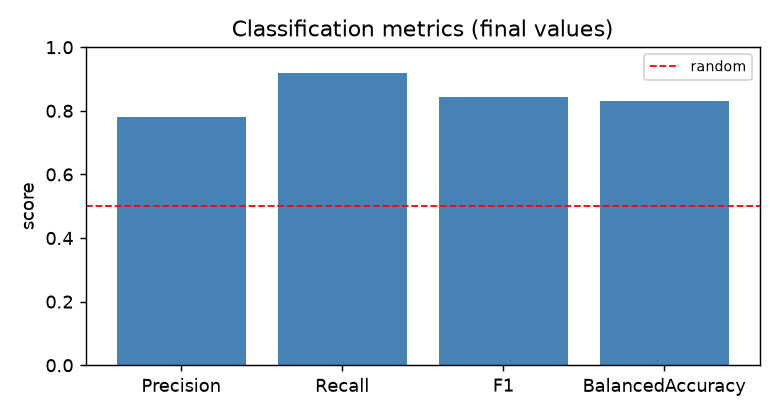

# Classification: the confusion matrix and balanced accuracy

[← Classification](index.md)

When crashes are rare, an alarm that never rings is right almost every day, and the accuracy looks excellent. The confusion matrix counts every kind of answer separately: crash and alarm, crash and no alarm, no crash and alarm, no crash and no alarm. Balanced accuracy averages the recall of each class, so the rare class counts as much as the common one. A robot controller is judged the same way in the last section.



The picture follows the same 300 trading days for 25 crash shares between 1% and 50%, with a model that never flags a crash. The cyan surface is the `Accuracy`, the pink one the `BalancedAccuracy`. After 300 days the accuracy reads 0.99 when 1% of the days are crashes, 0.937 at 10% and 0.537 at 50%; the balanced accuracy reads 0.5 in all three cases.

| class | what it does |
|---|---|
| `ConfusionMatrix` | counts every (true class, predicted class) pair |
| `BalancedAccuracy` | the mean of the recall of each class |

## 1. A first example: the same alarm, counted in full

Ten trading days: 1 is a crash day and 0 is a normal day, and the alarm rings (1) or stays quiet (0).

```python
from dense_armor.core.evaluation.metrics import BalancedAccuracy, ConfusionMatrix

crash = [0, 0, 1, 0, 0, 1, 0, 0, 0, 1]
alarm = [0, 1, 1, 0, 0, 1, 0, 1, 0, 0]
cm, bal = ConfusionMatrix(), BalancedAccuracy()
for truth, flag in zip(crash, alarm):
    cm.update(truth, flag)
    bal.update(truth, flag)
print(cm.get())
print(round(bal.get(), 3))
```

```
{0: {0: 5.0, 1: 2.0}, 1: {1: 2.0, 0: 1.0}}
0.69
```

Count by hand. On the 7 normal days the alarm stayed quiet 5 times and rang 2 times: `{0: {0: 5, 1: 2}}`. On the 3 crash days it rang twice and stayed quiet once: `{1: {1: 2, 0: 1}}`. The recall of the normal days is 5/7 = 0.714 and the recall of the crash days is 2/3 = 0.667, so the balanced accuracy is (0.714 + 0.667) / 2 = 0.69.



On 250 trading days the alarm of the figure gives 190 and 42 on the normal days, and 5 and 13 on the 18 crash days. The recall of the crash days is 13/18 = 0.722 and the recall of the normal days 190/232 = 0.819, so the balanced accuracy is 0.771.

Now the alarm that never rings, on the same ten days.

```python
from dense_armor.core.evaluation.metrics import Accuracy, BalancedAccuracy

crash = [0, 0, 1, 0, 0, 1, 0, 0, 0, 1]
never = [0] * 10
acc, bal = Accuracy(), BalancedAccuracy()
for truth, flag in zip(crash, never):
    acc.update(truth, flag)
    bal.update(truth, flag)
print(acc.get(), bal.get())
```

```
0.7 0.5
```

The accuracy is 7/10 = 0.7 because 7 days are normal. The recall of the normal days is 1.0 and the recall of the crash days is 0.0, so the balanced accuracy is 0.5: the score of a model that knows nothing.

## 2. What the metric keeps

`ConfusionMatrix` keeps one count for each pair (true class, predicted class), and `get()` returns them as a nested dict `{y_true: {y_pred: count}}`. It is the one metric of the library whose `get()` does not return a float. `BalancedAccuracy` keeps the same counts and returns the mean of the recall of each class; for two classes 0 and 1 this is

$$\text{BA} = \frac{TPR + TNR}{2}$$

where TPR is the recall of the positive class and TNR the recall of the negative class. A model that always answers the majority class scores 0.5.

**Source:** the docstrings of `ConfusionMatrix` and `BalancedAccuracy` cite no paper. `BalancedAccuracy` is the mean of the per-class recall, and `ConfusionMatrix` is the multiclass confusion matrix; `works_with` still uses the classifier role.

## 3. Combine two shards

`merge` adds the nested counts of two matrices, so two workers that read different parts of the stream give the same matrix as one worker that reads all of it.

```python
from dense_armor.core.evaluation.metrics import ConfusionMatrix

crash = [0, 0, 1, 0, 0, 1, 0, 0, 0, 1]
alarm = [0, 1, 1, 0, 0, 1, 0, 1, 0, 0]
a, b = ConfusionMatrix(), ConfusionMatrix()
for truth, flag in zip(crash[:5], alarm[:5]):
    a.update(truth, flag)
for truth, flag in zip(crash[5:], alarm[5:]):
    b.update(truth, flag)
print(a.merge(b).get())
```

```
{0: {0: 5.0, 1: 2.0}, 1: {1: 2.0, 0: 1.0}}
```

## 4. The parameters

`ConfusionMatrix()` and `BalancedAccuracy()` take no parameters. A pair is added with `update(y_true, y_pred, t=None, w=1.0)`, as on the first page of this section.

## 5. The same counts on a robot joint

A joint controller flags a fault with 1 and no fault with 0, and the maintenance log says what was true.

```python
from dense_armor.core.evaluation.metrics import ConfusionMatrix

m = ConfusionMatrix()
for a, b in [(0, 0), (0, 1), (1, 1)]:
    m.update(a, b)
print(m.get())
```

```
{0: {0: 1.0, 1: 1.0}, 1: {1: 1.0}}
```

True class 0 was predicted as 0 once and as 1 once; true class 1 was predicted as 1 once. The `ConfusionMatrix` stores these counts so you can compute precision, recall or F1 for any class after the stream ends. The `merge` method lets you combine partial matrices from different workers.





```python
from dense_armor.core.evaluation.metrics import BalancedAccuracy

m = BalancedAccuracy()
for a, b in [(0, 0), (0, 1), (1, 1), (1, 1)]:
    m.update(a, b)
print(round(m.get(), 4))
```

```
0.75
```

Class 0: one true positive, one false negative → recall = 0.5. Class 1: two true positives, zero false negatives → recall = 1.0. Balanced accuracy = (0.5 + 1.0) / 2 = 0.75. A model that always guesses the majority class on a 90/10 split reaches 0.9 accuracy but only 0.5 balanced accuracy, exposing the imbalance.

## API reference

::: dense_armor.core.evaluation.metrics.classification.ConfusionMatrix

::: dense_armor.core.evaluation.metrics.classification.BalancedAccuracy

---

## Details

### Choices

- **Base implementation:** `ConfusionMatrix` stores the full cross-tabulation, and two `ConfusionMatrix` objects merge by adding their nested dicts.
- **Revert:** when `revert(y, p)` is called, the counts are decremented appropriately for use in `Rolling` windows.
- **The figures** are drawn with the library by `docs/assets/metrics/make_classification_figures.py`. The surface uses one stream of 300 days: the same random draws compared with 25 crash shares from 1% to 50%, and a model that always says "no crash". The matrix of the second figure uses the same 250 days as the figure of the first page.
