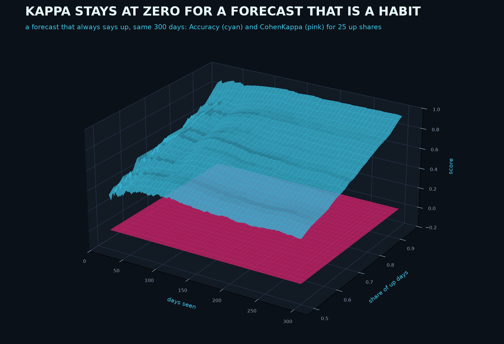
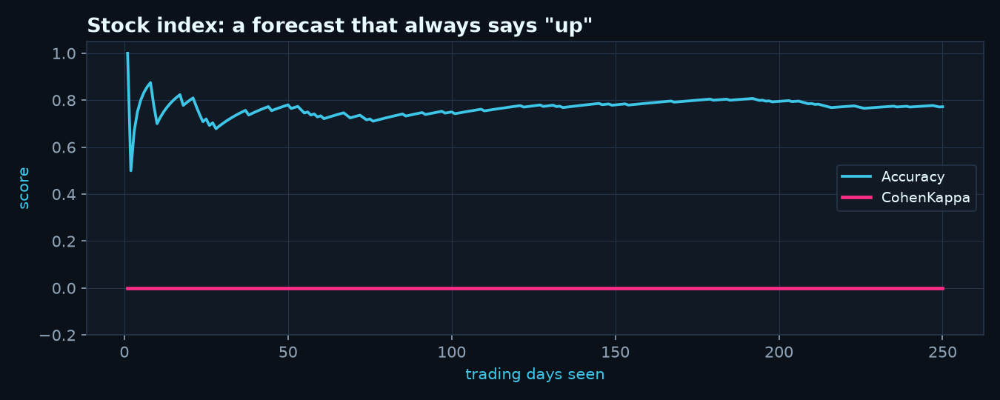

# Classification: Cohen's kappa

[← Classification](index.md)

A forecast that always says "the index goes up" is right on most days when the index mostly goes up, so its accuracy looks good. Cohen's kappa asks how much better the forecast is than a guess that follows the same habits, and it scores 0 when the forecast does no better. The same happens with a robot controller whose flag follows its own habit, in the last section.



## 1. A first example: a forecast that always says up

Ten trading days: 1 is an up day and 0 a down day. The forecast says 1 every day.

```python
from dense_armor.core.evaluation.metrics import Accuracy, CohenKappa

stock_up = [1, 1, 0, 1, 1, 1, 0, 1, 1, 1]
always_up = [1] * 10
acc, kappa = Accuracy(), CohenKappa()
for truth, forecast in zip(stock_up, always_up):
    acc.update(truth, forecast)
    kappa.update(truth, forecast)
print(acc.get(), kappa.get())
```

```
0.8 0.0
```

Count by hand. The forecast is right on the 8 up days: the observed agreement is p_o = 8/10 = 0.8. The truth says up on 80% of the days and the forecast says up on 100% of them, so two guessers with these habits would agree on p_e = 0.8 × 1.0 = 0.8 of the days (the two down shares, 0.2 and 0, add nothing). So kappa = (0.8 − 0.8) / (1 − 0.8) = 0.



On 250 trading days with 193 up days the forecast reads 0.772 for the accuracy and 0.0 for the kappa.

The picture follows the same 300 trading days for 25 up shares between 50% and 95%, with a forecast that always says "up". The cyan surface is the `Accuracy`, the pink one the `CohenKappa`. After 300 days the accuracy reads 0.43 when 50% of the days are up, 0.743 at 80% and 0.937 at 95%; the kappa reads 0.0 in all three cases.

| class | what it does |
|---|---|
| `CohenKappa` | agreement between the forecast and the truth, corrected for chance |

## 2. What the metric keeps

`CohenKappa` keeps the confusion counts and the totals of each row and each column, and computes at any moment

$$\kappa = \frac{p_o - p_e}{1 - p_e}$$

where $p_o$ is the observed agreement and $p_e$ is the agreement expected by chance under the marginal label frequencies. A value of 1.0 is perfect agreement, 0.0 is chance and a negative value is worse than chance.

**Source:** the docstring of `CohenKappa` cites Cohen, J. (1960). Educational and Psychological Measurement 20(1), 37-46. The docstring of the module `dense_armor.core.evaluation.metrics.classification` gives the full title: A coefficient of agreement for nominal scales. The docstrings give the journal and its pages, and no chapter, equation or page of a paper in the folder.

## 3. The parameters

`CohenKappa()` takes no parameters. A pair is added with `update(y_true, y_pred, t=None, w=1.0)`, as on the first page of this section.

## 4. The same score on a robot joint

A joint controller flags a fault with 1 and no fault with 0, and the maintenance log says what was true.

```python
from dense_armor.core.evaluation.metrics import CohenKappa

m = CohenKappa()
for a, b in zip([1, 0, 1, 1, 0, 1], [1, 1, 1, 0, 0, 1]):
    m.update(a, b)
print(round(m.get(), 3))
```

```
0.25
```

$$kappa = (p_o - p_e)/(1 - p_e)$$

where $p_o$ is the observed agreement (4 of 6) and $p_e$ the agreement two independent guessers with the same label frequencies would reach: $p_e = 20/36 = 0.556$ and $kappa = 0.25$.

## API reference

::: dense_armor.core.evaluation.metrics.classification.CohenKappa

---

## Details

### Choices

- **What `CohenKappa` keeps:** the confusion counts (`cm_`), the row and column totals (`row_`, `col_`) and the number of pairs (`total_`).
- **The figures** are drawn with the library by `docs/assets/metrics/make_classification_figures.py`. The surface uses one stream of 300 days: the same random draws compared with 25 up shares from 50% to 95%, and a forecast that always says "up". The second figure uses 250 days with an up share of 80%.
