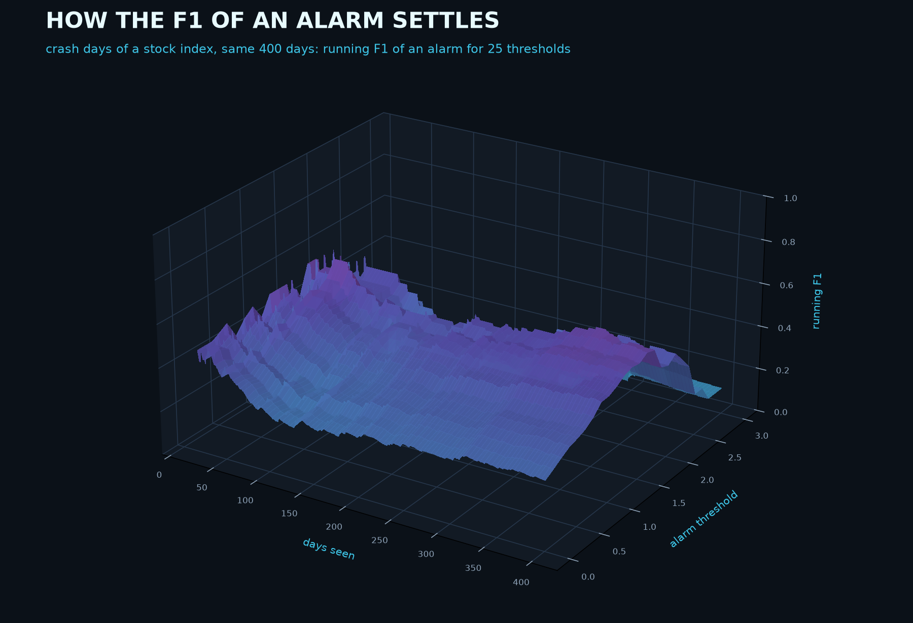
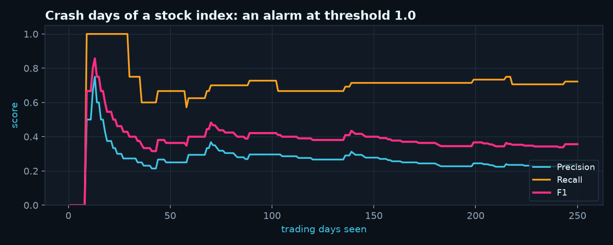

# Classification: precision, recall and F1

[← Classification](index.md)

An alarm says "a crash is coming" or says nothing. Precision tells how often the alarm is right when it rings. Recall tells how many of the real crashes it caught. F1 puts the two in one number, so an alarm that rings every day, or never, cannot score well. A robot controller that flags faults is judged the same way, in the last section.



The picture follows the same 400 trading days for 25 alarms that ring when a score passes a threshold between 0 and 3. Each point of the surface is the `F1` after that many days. After 400 days the alarm with threshold 1.62 reads 0.553, the best of the 25; the alarm that rings every day (threshold 0.0) reads 0.315, and the alarm that almost never rings (threshold 3.0) reads 0.12.

| class | what it does |
|---|---|
| `Precision` | of the days the alarm rang, the share that really were crashes |
| `Recall` | of the crash days, the share the alarm caught |
| `F1` | the harmonic mean of precision and recall |
| `FBeta` | the same mean with a weight `beta` on recall |
| `Accuracy` | the share of right answers, the metric of the page before this one |

## 1. A first example: an alarm for the crash days of a stock index

Ten trading days: 1 is a crash day and 0 is a normal day. The alarm rings (1) or stays quiet (0).

```python
from dense_armor.core.evaluation.metrics import F1, Precision, Recall

crash = [0, 0, 1, 0, 0, 1, 0, 0, 0, 1]
alarm = [0, 1, 1, 0, 0, 1, 0, 1, 0, 0]
ms = [Precision(positive=1), Recall(positive=1), F1(positive=1)]
for truth, flag in zip(crash, alarm):
    for m in ms:
        m.update(truth, flag)
print([round(m.get(), 3) for m in ms])
```

```
[0.5, 0.667, 0.571]
```

Count by hand. The alarm rang on days 2, 3, 6 and 8. On days 3 and 6 there was a crash: two true positives, TP = 2. On days 2 and 8 there was none: two false positives, FP = 2. The crash of day 10 was missed: one false negative, FN = 1. So P = TP/(TP+FP) = 2/4 = 0.5, R = TP/(TP+FN) = 2/3 = 0.667 and F1 = 2PR/(P+R) = 0.571.



On 250 trading days with 18 crash days the same kind of alarm rang 55 times. After 250 days the precision reads 0.236, the recall 0.722 and the F1 0.356: the alarm catches most crashes, but most of its rings are false.

## 2. What the metric keeps

`Precision`, `Recall` and `F1` keep three counts for the positive class: true positives (`tp_`), false positives (`fp_`) and false negatives (`fn_`). The score is computed from them at any moment, and after a million days the metric still keeps three counts.

$$P = \frac{TP}{TP+FP} \qquad R = \frac{TP}{TP+FN} \qquad F_1 = \frac{2PR}{P+R}$$

In the example TP is 2, FP is 2 and FN is 1, so P = 2/4, R = 2/3 and F1 = 0.571.

**Source:** the docstring of the module `dense_armor.core.evaluation.metrics.classification` says that `F1` is the harmonic mean of precision and recall and cites Sasaki, Y. (2007). The truth of the F-measure. Teach Tutor Mater. The docstrings of `Precision` and `Recall` cite no paper: precision is the fraction of predicted positives that are correct and recall the fraction of true positives that are detected. The docstring of `F1` cites none either; it says `F1` is a thin subclass of `FBeta` with `beta = 1.0`.

## 3. Giving recall more weight

A missed crash costs more than a false alarm, so the trader wants recall to count more. `FBeta` is the weighted harmonic mean, and `F1` is the case `beta = 1`.

$$F_\beta = \frac{(1+\beta^2)\,P\,R}{\beta^2 P + R}$$

```python
from dense_armor.core.evaluation.metrics import FBeta

crash = [0, 0, 1, 0, 0, 1, 0, 0, 0, 1]
alarm = [0, 1, 1, 0, 0, 1, 0, 1, 0, 0]
m = FBeta(beta=2.0, positive=1)
for truth, flag in zip(crash, alarm):
    m.update(truth, flag)
print(round(m.get(), 3))
```

```
0.625
```

With beta = 2 the formula gives 5 × 0.5 × 0.667 / (4 × 0.5 + 0.667) = 0.625, above the F1 of 0.571 because the recall (0.667) is higher than the precision (0.5).

**Source:** the docstring of `FBeta` gives the formula `F_beta = (1 + beta**2) * P * R / (beta**2 * P + R)` and cites no paper.

## 4. Combine two shards

`merge` joins two metrics that read different parts of the stream; the counts are added, so the result is the same as reading the whole stream.

```python
from dense_armor.core.evaluation.metrics import Precision

crash = [0, 0, 1, 0, 0, 1, 0, 0, 0, 1]
alarm = [0, 1, 1, 0, 0, 1, 0, 1, 0, 0]
a, b = Precision(positive=1), Precision(positive=1)
for truth, flag in zip(crash[:5], alarm[:5]):
    a.update(truth, flag)
for truth, flag in zip(crash[5:], alarm[5:]):
    b.update(truth, flag)
print(a.merge(b).get())
```

```
0.5
```

## 5. The parameters

| Parameter | Meaning | Default |
|---|---|---|
| `positive` | class treated as "positive" for precision/recall | True |
| `average` | how to combine per-class metrics: "binary", "macro", "micro", "weighted" | "binary" |
| `beta` | weight for FBeta: higher favors recall | 1.0 |
| `eps` | small constant to avoid log(0) in LogLoss (see the Probabilities page) | 1e-15 |

`average="macro"` takes the mean of the per-class scores, `average="micro"` pools the counts, and `average="weighted"` weights each class by how often it occurs.

## 6. The same scores on a robot joint

A joint controller flags a fault with 1 and no fault with 0, and the maintenance log says what was true. The same metrics read the pairs, here with the macro average of F1 next to the binary one.

```python
from dense_armor.core.evaluation.metrics import F1, Precision, Recall

y = [1, 0, 1, 1, 0, 1]
p = [1, 1, 1, 0, 0, 1]
ms = [Precision(positive=1), Recall(positive=1), F1(positive=1), F1(average="macro")]
for a, b in zip(y, p):
    for m in ms:
        m.update(a, b)
print([round(m.get(), 3) for m in ms])
```

```
[0.75, 0.75, 0.75, 0.625]
```

Count by hand for class 1: true positives TP = 3 (positions 0, 2, 5), one false positive FP (position 1), one false negative FN (position 3).

P = TP/(TP+FP) = 3/4,  R = TP/(TP+FN) = 3/4,  F_1 = 2PR/(P+R) = 0.75.

For class 0: TP = 1, FP = 1, FN = 1, so F1 = 0.5. The macro F1 is (0.75 + 0.5) / 2 = 0.625. `average="micro"` pools the counts; `average="weighted"` weights by class frequency; `FBeta(beta=2)` weights recall more.

## API reference

::: dense_armor.core.evaluation.metrics.classification.Accuracy

::: dense_armor.core.evaluation.metrics.classification.Precision

::: dense_armor.core.evaluation.metrics.classification.Recall

::: dense_armor.core.evaluation.metrics.classification.F1

::: dense_armor.core.evaluation.metrics.classification.FBeta

---

## Details

### Choices

- **Base implementation:** `Accuracy` inherits from `Metric` and implements `_update` by incrementing `hits` when $y = \hat{y}$.
- **Merge:** two `Accuracy` metrics with $n_1, hits_1$ and $n_2, hits_2$ merge to $n_1+n_2, hits_1+hits_2$; two `Precision` or `Recall` metrics add their counts.
- **Revert:** when `revert(y, p)` is called, counts are decremented appropriately for use in `Rolling` windows.
- **The figures** are drawn with the library by `docs/assets/metrics/make_classification_figures.py`. The surface uses one stream of 400 days with a crash on about 10% of the days and 25 thresholds from 0 to 3; the second figure uses 250 days and the threshold 1.0.
- **The next pages** of this section: [confusion matrix and balanced accuracy](confusion_matrix.md) and [Cohen's kappa](kappa.md).
