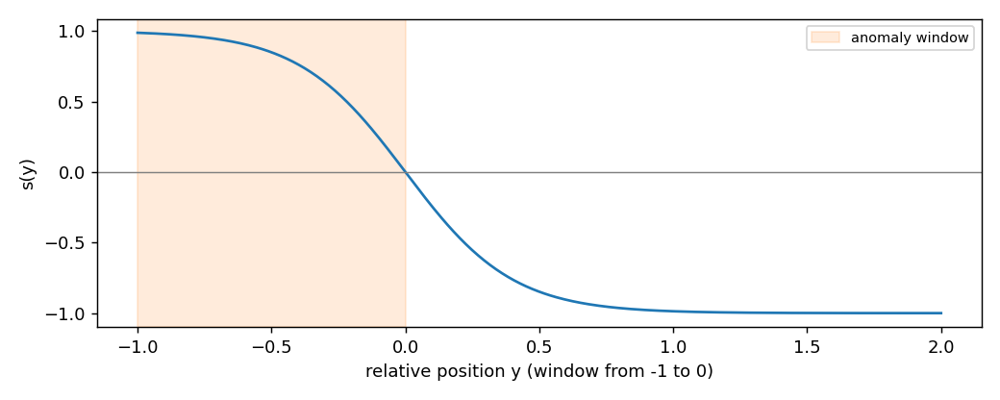

# Metrics for events: delay, false alarms and NAB

## 9. Events: delay and false alarms

A fault is not one sample: it lasts. `EventMetrics` takes the labelled event windows, then the
alarm times, and answers the two questions a robot operator asks: how late was the alarm, and
how often does it ring for nothing?

```python
from dense_armor.utility.metrics import EventMetrics

m = EventMetrics([(10.0, 20.0), (40.0, 45.0)], dt=0.5, normal_time_s=3600.0)
for t in (5.0, 12.0, 12.5, 30.0):
    m.add_alarm(t)
print(m.detection_delays_s(), m.missed_events(), m.false_alarms(), m.false_alarms_per_hour())
```

```
[2.0, None] 1 2 2.0
```

The first event starts at 10 s and the first alarm inside it is at 12 s: delay 2 s. The second
event has no alarm: missed. The alarms at 5 s and 30 s are outside every event: two false
alarms over one hour of normal operation, 2 per hour. `dt` is the sample period, used in step
10 to count the points of a window.

## 10. How much of the event was caught

Tatbul et al. (2018) extend precision and recall to ranges. The recall of one real event mixes
two rewards:

$$\mathrm{Recall}(R_i, P) = \alpha \cdot \mathrm{Existence}(R_i, P) + (1 - \alpha) \cdot
\mathrm{Overlap}(R_i, P) \qquad \text{(Eq. 4)}$$

The existence reward is 1 if any alarm falls inside the event (Eq. 5). The overlap reward
(Eq. 6) adds up a weight $\delta(i)$ for every point $i$ of the event that the alarms cover,
divided by the sum of all the weights, and is shrunk by a cardinality factor when the event is
split across several alarm ranges (Eq. 7). The weights are the **positional bias** of their
Figure 2b: flat ($\delta = 1$), front ($\delta = L - i + 1$, early points count more), back
($\delta = i$), middle. Precision (Eq. 9) uses the same overlap reward, with flat bias.

```python
from dense_armor.utility.metrics import EventMetrics

for bias in ("front", "back"):
    m = EventMetrics([(0.0, 9.0)], positional_bias=bias, threshold_window=1.0)
    for t in (0.0, 1.0, 2.0):
        m.add_alarm(t)
    print(bias, round(m.range_precision(), 3), round(m.range_recall(), 3), round(m.range_f1(), 3))
```

```
front 1.0 0.491 0.659
back 1.0 0.109 0.197
```

The event has 10 points (0 to 9 s at `dt=1.0`); the three alarms, merged into one range by
`threshold_window=1.0`, cover the first three. With front bias the weights are 10, 9, …, 1
(sum 55) and the covered ones add up to 10 + 9 + 8 = 27: recall 27/55 = 0.491. With back bias
they are 1 + 2 + 3 = 6: recall 6/55 = 0.109. Precision is 1.0 in both cases because every alarm
point lies inside the event. For a robot, front bias says "catching the start of a fault is what
matters".

## 11. One score for early detection: NAB

The Numenta Anomaly Benchmark (Lavin and Ahmad 2015) gives each detection a weight that depends
on where it falls.



$$s(y) = \frac{2}{1 + e^{5y}} - 1$$

where $y$ is the position relative to the window: $-1$ at its start, $0$ at its end, positive
after it. The earliest detection in a window earns $A_{TP}\,s(y)$; a missed window costs
$A_{FN}$; an alarm outside every window costs $|A_{FP}|\,s(y)$ measured after the preceding
window, or $-|A_{FP}|$ if no window precedes it. The total is normalised so that a perfect
detector scores 100 and a detector that never fires scores 0 (Eq. 4).

```python
from dense_armor.utility.metrics import EventMetrics

for alarms in ([0.0], [9.0], [9.0, 14.5], []):
    m = EventMetrics([(0.0, 10.0)])
    for t in alarms:
        m.add_alarm(t)
    print(alarms, round(m.nab_score(), 2))
```

```
[0.0] 100.0
[9.0] 62.67
[9.0, 14.5] 58.18
[] 0.0
```

A detection at 9 s in a window from 0 to 10 s has $y = -0.1$ and earns $s = 0.245$; normalised
between the null detector ($-1$) and the perfect one ($s(-1) = 0.987$) it gives
$100 \cdot 1.245 / 1.987 = 62.67$. The extra alarm at 14.5 s is 0.45 windows after the end:
$s = -0.809$, times $|A_{FP}| = 0.11$, which lowers the score to 58.18. The default weights are
the paper's standard profile ($A_{TP} = 1$, $A_{FP} = -0.11$, $A_{FN} = -1$); pass `a_tp`,
`a_fp`, `a_fn` to change them.

## 12. A real detector on a stream

`evaluate_events` runs a detector over `(t, x)` pairs and returns everything at once. This is
the case of the figure at the top.

```python
import numpy as np
from dense_armor.utility.drift.detector import CUSUMDriftDetector
from dense_armor.utility.evaluate import evaluate_events

rng = np.random.default_rng(1)
x = np.concatenate([rng.normal(0, 1, 3000), rng.normal(3, 1, 1000)])
det = CUSUMDriftDetector(reference="fixed", radius=76, ref_mult=10, k=0.5, h=20.0)
s = [(i / 20, v) for i, v in enumerate(x)]
r = evaluate_events(s, det, [(150.0, 199.95)], dt=0.05, normal_time_s=150.0)
print(round(r["detection_delays_s"][0], 2), r["missed"], r["false_alarms_per_hour"])
```

```
0.3 0 0.0
```

The CUSUM detector catches the step 0.30 s after it starts (6 samples at 20 Hz), misses
nothing and raises no alarm during the 150 s of normal operation. The returned dict also holds
`range_precision`, `range_recall`, `range_f1` and `nab_score`. A drift detector is read
through `update` and `drift_detected`; an anomaly detector through `score_one`, `learn_one` and
a `score_threshold` attribute.

## 13. A warning: point-adjusted F1

Many papers score anomaly detectors with **point adjustment**: if one point inside a real
anomaly is flagged, the whole anomaly counts as found. Kim et al. (2021) show that this rewards
noise.

```python
import numpy as np
from dense_armor.utility.metrics import F1, PointAdjustedF1

rng = np.random.default_rng(0)
y = np.zeros(2000, dtype=int)
for s in (200, 700, 1200, 1700):
    y[s:s + 100] = 1
p = (rng.random(2000) < 0.05).astype(int)
pa, f1 = PointAdjustedF1(positive=1, warn=False), F1(positive=1)
for a, b in zip(y.tolist(), p.tolist()):
    pa.update(a, b)
    f1.update(a, b)
print(round(pa.get(), 3), round(f1.get(), 3))
```

```
0.895 0.063
```

The "detector" flags 5 % of the samples at random. The plain F1 is 0.063, as it should be; the
point-adjusted F1 is 0.895, because each 100-sample anomaly almost surely contains one random
flag. `PointAdjustedF1` is here only to compare with published numbers; it warns when read.
Report the range-based metrics of step 10 next to it.
