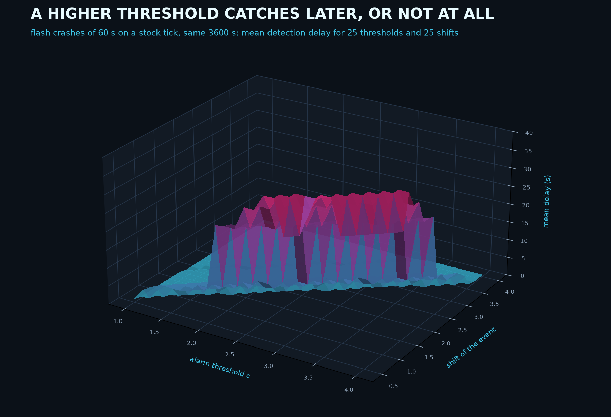
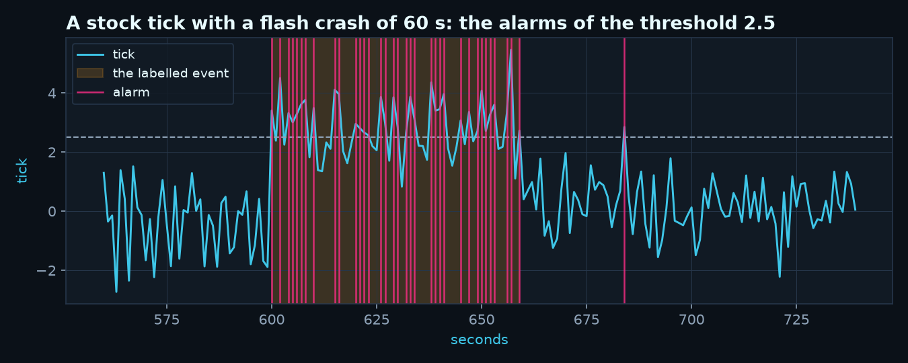

# Events: delay and false alarms

[← Events](index.md)

A fault is not one sample: it lasts. `EventMetrics` takes the labelled event windows, then the alarm times, and answers the two questions an operator asks first: how late was the alarm, and how often does it ring for nothing? An event with no alarm inside is missed. A robot controller with fault alarms is judged the same way, in the last section.



## 1. A first example: flash crashes on a stock tick

Two flash crashes were labelled: seconds 10 to 20 and seconds 40 to 45. The detector rang at 5, 12, 12.5 and 30 seconds, over one hour of normal operation.

```python
from dense_armor.core.evaluation.metrics import EventMetrics

m = EventMetrics([(10.0, 20.0), (40.0, 45.0)], dt=0.5, normal_time_s=3600.0)
for t in (5.0, 12.0, 12.5, 30.0):
    m.add_alarm(t)
print(m.detection_delays_s(), m.missed_events(), m.false_alarms(), m.false_alarms_per_hour())
```

```
[2.0, None] 1 2 2.0
```

The first crash starts at 10 s and the first alarm inside it is at 12 s: delay 2 s. The second crash has no alarm: missed. The alarms at 5 s and 30 s are outside every event: two false alarms over one hour of normal operation, 2 per hour. `dt` is the sample period, used to count the points of a window on the next pages.



The figure shows 180 s of the stream around the first crash. With a shift of 3 and the threshold 2.5 the four crashes are caught with delays of 0, 0, 2 and 0 s and none is missed, and over the 3360 s of normal operation the detector rings 28 times for nothing, 30.0 per hour.

### The event window

`EventMetrics` takes a list of `(start, end)` tuples. Internally these are validated as `EventWindow` objects: a frozen dataclass with `start` and `end` (seconds), where `end >= start` is enforced. It provides `contains(t)` to test whether a time stamp falls inside, and `n_points(dt)` to compute how many discrete samples the window covers at a given sample period `dt`.

```python
from dense_armor.core.evaluation.metrics import EventWindow

ew = EventWindow(start=10.0, end=20.0)
print(f"contains(15.0): {ew.contains(15.0)}")
print(f"n_points(dt=1.0): {ew.n_points(1.0)}")
```

```
contains(15.0): True
n_points(dt=1.0): 11
```

Count by hand: a window from 10.0 to 20.0 s at `dt=1.0` covers the points 10.0, 11.0, …, 20.0, that is 11 points. At `dt=0.5` it would be 21 points. The formula is `round((end - start) / dt) + 1`, with a minimum of 1.

`EventWindow` raises `ValueError` if `end < start` or if `n_points` is called with `dt <= 0`. It is a plain data carrier; `EventMetrics` builds a list of `EventWindow` objects from the input tuples and uses their `contains` and `n_points` methods for all range-based calculations.

The picture follows the same 3600 seconds of a stock tick, with four flash crashes of 60 s in which the mean of the tick shifts, and a detector that rings on every sample above a threshold c. Each point of the surface is the mean detection delay of the crashes it caught, for 25 thresholds and 25 shifts; where no crash was caught there is a gap. With a shift of 2.98 the alarms come at the first second of the crash or at the third: for the threshold 3.0 the four delays are 0, 0, 2 and 0 s. With a shift of 1.52 and the same threshold the delays are 2, 5, 21 and 11 s, mean 9.75 s. The threshold also decides the false alarms: over the 3360 s of normal operation the threshold 3.0 rings 7 times for nothing (7.5 per hour), the threshold 2.0 rings 75 times (80.36 per hour) and the threshold 1.0 rings 559 times (598.93 per hour).

| class | what it does |
|---|---|
| `EventMetrics` | collects the alarms against the labelled windows and reports the metrics of the events |
| `EventWindow` | one labelled event interval, with `contains` and `n_points` |

## 2. What the metric keeps

`EventMetrics` keeps the labelled windows and the alarm times. The delay of an event is the time of the first alarm inside the window minus the start of the window, or `None` if there is none; a false alarm is an alarm outside every window; the false alarms per hour are their number divided by the normal time in hours. If `normal_time_s` is not given, the normal time is inferred from the first and last alarm time stamps minus the event durations. Two alarms within `threshold_window` seconds are the same detection (default 0).

**Source:** the docstring of the module `dense_armor.core.evaluation.metrics.events` explains that in event detection the target is a set of intervals and that two alarms close together are one event, and an alarm outside every labelled event is a false alarm. The delay, the missed events and the false alarms are not attributed to a paper; the module lists three papers for the other metrics: Tatbul et al. (2018), Lavin and Ahmad (2015) and Xu et al. (2018) with Kim et al. (2021).

## 3. The parameters

| Parameter | Meaning | Default |
|---|---|---|
| `events` | the labelled event windows, as `EventWindow` or `(start, end)` pairs | none |
| `dt` | sample period in seconds, used to count the discrete points of a window | 1.0 |
| `normal_time_s` | total normal time in seconds, the denominator of false alarms per hour | `None` |
| `threshold_window` | two alarms within this many seconds are the same detection | 0.0 |

The other parameters (`alpha`, `positional_bias`, `cardinality`, `a_tp`, `a_fp`, `a_fn`) belong to the range metrics and to the NAB score, on their pages. `EventMetrics` raises `ValueError` on a bad bias, an empty `events`, or out-of-range weights.

## 4. The same metrics on a robot joint

A joint controller raises a fault alarm, and the maintenance log says when the faults really were: from 2 s to 4 s and from 9 s to 10 s, in one minute of normal operation, sampled at 100 Hz. The controller rang at 1.0, 3.5, 6.0 and 9.2 seconds.

```python
from dense_armor.core.evaluation.metrics import EventMetrics

m = EventMetrics([(2.0, 4.0), (9.0, 10.0)], dt=0.01, normal_time_s=60.0)
for t in (1.0, 3.5, 6.0, 9.2):
    m.add_alarm(t)
print([round(v, 2) for v in m.detection_delays_s()], m.missed_events(), m.false_alarms(), m.false_alarms_per_hour())
```

```
[1.5, 0.2] 0 2 120.0
```

The first fault starts at 2 s and the alarm at 3.5 s is the first inside it: delay 1.5 s. The second starts at 9 s and the alarm at 9.2 s gives 0.2 s. The alarms at 1.0 s and 6.0 s are outside both faults: two false alarms in one minute, that is $2 / (60/3600) = 120$ per hour.

## API reference

::: dense_armor.core.evaluation.metrics.events.EventMetrics

::: dense_armor.core.evaluation.metrics.events.EventWindow

---

## Details

### Choices

- **Base implementation:** `EventMetrics` is not a `Metric`: it collects alarms and answers with several numbers, and `report()` returns all of them in one dict.
- **The figures** are drawn with the library by `docs/assets/metrics/make_events_figures.py`. One stream of 3600 one-second samples of N(0, 1) noise with four events of 60 s at 600, 1400, 2200 and 3000 s in which the mean shifts; the same noise for every shift. The surface uses 25 thresholds from 1 to 4 and 25 shifts from 0.5 to 4; the second figure uses the shift 3 and the threshold 2.5.
