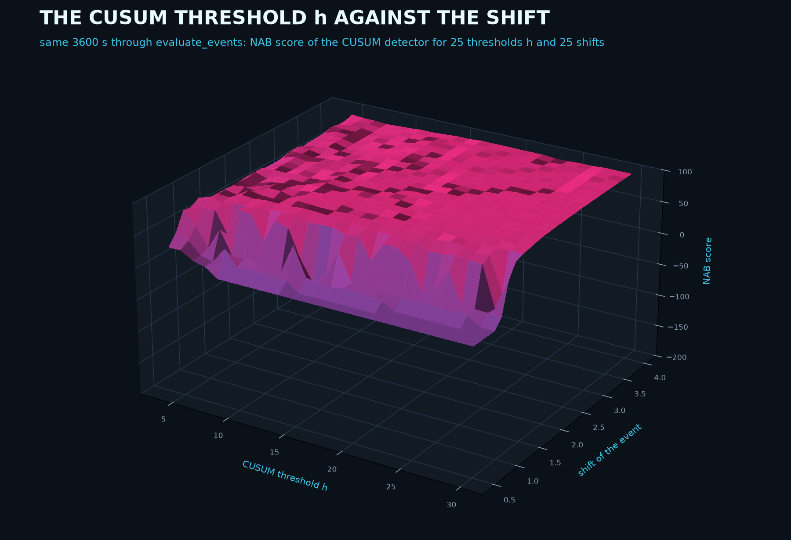
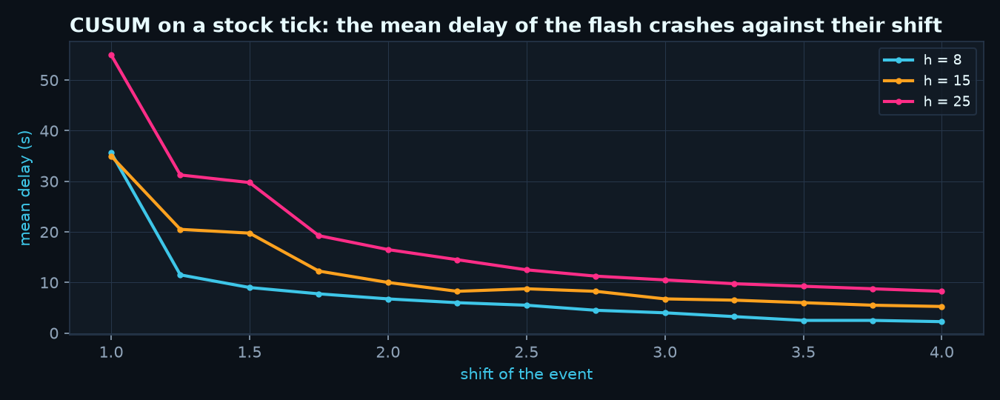

# Events: a detector on a stream

[← Events](index.md)

The pages before this one feed the alarms by hand. `evaluate_events` runs a drift detector or an anomaly detector over a stream of `(t, x)` pairs, registers every alarm with its time stamp, and returns all the numbers at once: the delay of each event, the missed events, the false alarms per hour, the range precision, recall and F1, and the NAB score. A robot with a CUSUM detector is in the last section.



## 1. A first example: a trigger on a stock tick

A stream of 100 seconds of a stock tick and a flash crash labelled from second 10 to second 20. The detector is a stub that fires once, at second 15; it only needs `update` and `drift_detected`.

```python
from dense_armor.core.evaluation.evaluate import evaluate_events


class TriggerAt:
    def __init__(self, at):
        self.at, self.drift_detected = at, False

    def update(self, v, t=None):
        self.drift_detected = t == self.at
        return self


stream = [(float(i), float(i)) for i in range(100)]
r = evaluate_events(stream, TriggerAt(15.0), [(10.0, 20.0)])
print(r["mean_delay_s"], r["missed"], r["false_alarms"])
```

```
5.0 0 0
```

Count by hand. The only alarm is at 15 s, inside the event that starts at 10 s: delay 15 − 10 = 5 s. Nothing is missed and no alarm is outside the event. The returned dict also has `detection_delays_s`, `false_alarms_per_hour`, `range_precision`, `range_recall`, `range_f1` and `nab_score`.



The figure follows the mean detection delay of the CUSUM detector for 13 shifts between 1 and 4 and three decision thresholds. For the shifts 1, 2, 3 and 4 the threshold h = 8 reads 35.67 s, 6.75 s, 4.0 s and 2.25 s, the threshold h = 15 reads 35.0 s, 10.0 s, 6.75 s and 5.25 s, and h = 25 reads 55.0 s, 16.5 s, 10.5 s and 8.25 s: a bigger shift is caught sooner, and a higher threshold waits longer.

The picture follows the same 3600 seconds of a stock tick, with four flash crashes of 60 s, through `evaluate_events` with the CUSUM detector of the library (first 30 samples as the reference, slack 0.5, restart after each alarm). Each point of the surface is the NAB score for 25 decision thresholds h between 4 and 30 and 25 shifts of the event. With a shift of 2.98 the threshold h = 10.5 reads 90.2 with a mean delay of 5.5 s and h = 20.25 reads 95.97 with a mean delay of 9.0 s; with a shift of 1.52 the threshold 10.5 reads 89.01 with a delay of 14.0 s; with a shift of 4.0 the threshold 5.08 reads 93.23 with a delay of 1.75 s and h = 30 reads 97.29 with a delay of 9.25 s. For the smallest shifts the score falls to large negative values, because the events are missed. A higher threshold costs delay and saves false alarms.

| function | what it does |
|---|---|
| `evaluate_events` | runs a detector over a stream with labelled events and returns the dict of `EventMetrics.report()` |

## 2. What the function does

The detector reads the stream one sample at a time. Every sample on which it raises an alarm is registered with its time stamp in an `EventMetrics`, which then reports the numbers. A drift detector is read through `update` and `drift_detected`; an anomaly detector through `score_one`, `learn_one` and a `score_threshold` attribute (the score is taken before learning). A dict `x` is passed to `score_one`; a dict with one key is unwrapped for a drift detector's `update`.

**Source:** the docstring of the module `dense_armor.core.evaluation.evaluate.events` reports the range-based precision, recall and F1 of Tatbul et al. (2018) (arXiv:1803.03639) and the NAB score of Lavin and Ahmad (2015) (arXiv:1510.03336). The docstring of `evaluate_events` cites no paper.

## 3. The parameters

| Parameter | Meaning | Default |
|---|---|---|
| `stream` | `(t, x)` pairs, `t` in seconds, in time order | none |
| `detector` | a drift detector (`update` + `drift_detected`) or an anomaly detector (`score_one` + `learn_one` + `score_threshold`) | none |
| `events` | the labelled event windows | none |
| `**kwargs` | forwarded to `EventMetrics`: `dt`, `alpha`, `positional_bias`, `cardinality`, `normal_time_s`, `threshold_window`, `a_tp`, `a_fp`, `a_fn` | |

`evaluate_events` raises `TypeError` if the detector exposes neither interface, and `ValueError` if an anomaly detector has no `score_threshold`.

## 4. The same evaluation on a robot joint

A joint signal at 20 Hz: 3000 samples of noise and then 1000 samples whose mean has risen by 3, a step from 150 s to 200 s. A CUSUM detector with a fixed reference watches it over 150 s of normal operation.

```python
import numpy as np
from dense_armor.core.online.drift.detector import CUSUMDriftDetector
from dense_armor.core.evaluation.evaluate import evaluate_events

rng = np.random.default_rng(1)
x = np.concatenate([rng.normal(0, 1, 3000), rng.normal(3, 1, 1000)])
det = CUSUMDriftDetector(reference="fixed", radius=76, ref_mult=10, k=0.5, h=20.0)
s = [(i / 20, v) for i, v in enumerate(x)]
r = evaluate_events(s, det, [(150.0, 199.95)], dt=0.05, normal_time_s=150.0)
print(round(r["detection_delays_s"][0], 2), r["missed"], r["false_alarms_per_hour"])
```

```
0.3 0 0.0
```

The CUSUM detector catches the step 0.30 s after it starts (6 samples at 20 Hz), misses nothing and raises no alarm during the 150 s of normal operation.

## API reference

::: dense_armor.core.evaluation.evaluate.events.evaluate_events

---

## Details

### Choices

- **Where it lives:** `evaluate_events` is in `dense_armor.core.evaluation.evaluate.events`.
- **The figures** are drawn with the library by `docs/assets/metrics/make_events_figures.py`. The surface and the lines use the stream of the delay page and `CUSUMDriftDetector(reference="fixed", radius=10, ref_mult=3, k=0.5, h=h, reset_on_alarm=True)`.
