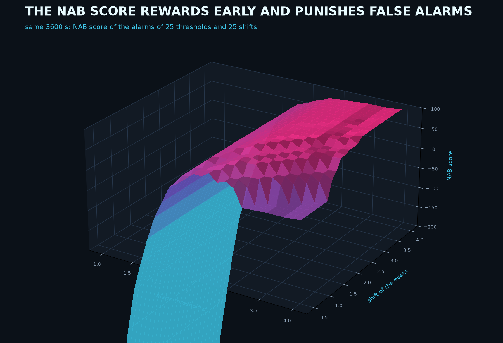
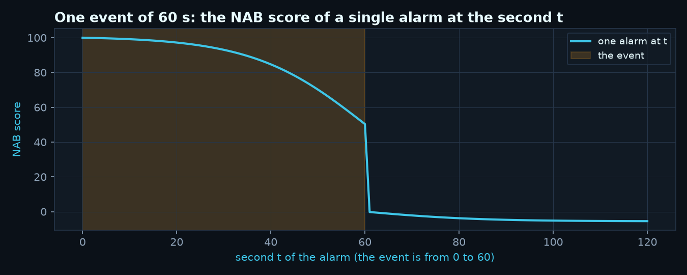

# Events: the NAB score

[← Events](index.md)

How early the alarm came matters as much as whether it came: an alarm at the first second of a flash crash lets the desk act, an alarm at the last second is nearly useless. The NAB score of the Numenta Anomaly Benchmark gives each detection a weight that depends on where it falls in the event, punishes false alarms and missed events, and folds everything into one number: 100 for a perfect detector and 0 for a detector that never rings. A robot fault is scored the same way, in the last section.



## 1. A first example: a flash crash on a stock tick

One flash crash from second 0 to second 10. Four detectors: one rings at second 0, one at second 9, one at second 9 and again at 14.5, and one never rings.

```python
from dense_armor.core.evaluation.metrics import EventMetrics

for alarms in ([0.0], [9.0], [9.0, 14.5], []):
    m = EventMetrics([(0.0, 10.0)])
    for t in alarms:
        m.add_alarm(t)
    print(alarms, round(m.nab_score(), 2))
```

```
[0.0] 100.0
[9.0] 62.67
[9.0, 14.5] 58.18
[] 0.0
```

A detection at 9 s in a window from 0 to 10 s has $y = -0.1$ and earns $s = 0.245$; normalised between the null detector ($-1$) and the perfect one ($s(-1) = 0.987$) it gives $100 \cdot 1.245 / 1.987 = 62.67$. The extra alarm at 14.5 s is 0.45 windows after the end: $s = -0.809$, times $|A_{FP}| = 0.11$, which lowers the score to 58.18. The default weights are the standard profile of the paper ($A_{TP} = 1$, $A_{FP} = -0.11$, $A_{FN} = -1$); pass `a_tp`, `a_fp`, `a_fn` to change them.



The figure follows one event from 0 to 60 s and one alarm at the second t. The score is 100.0 for an alarm at 0, 98.36 at 15 s, 93.04 at 30 s, 78.25 at 45 s and 52.43 at 59 s. After the end of the event the alarm is a false alarm and the event is missed: −2.18 at 70 s and −5.46 at 120 s.

The picture follows the same 3600 seconds of a stock tick, with four flash crashes of 60 s, and a detector that rings on every sample above a threshold c. Each point of the surface is the NAB score for 25 thresholds and 25 shifts. With a shift of 2.98 the threshold 3.0 reads 90.28, because the alarms come in the first seconds, while the threshold 2.0 reads −2.63: the crashes are caught as early, but the 75 false alarms take everything. With a shift of 1.52 and the threshold 2.0 it reads −2.7. With a shift of 4.0 the threshold 4.0 reads 99.97, and the threshold 1.0, which rings 559 times for nothing, reads −663.21, below the bottom of the picture.

| class | what it does |
|---|---|
| `EventMetrics` | its method `nab_score` (the class is on the [delay page](delays.md)) |

## 2. What the metric keeps

The scaled sigmoid gives the weight of a detection from its position $y$ relative to the window: $-1$ at its start, $0$ at its end, positive after it.

$$s(y) = \frac{2}{1 + e^{5y}} - 1$$

The earliest detection in a window earns $A_{TP}\,s(y)$; a missed window costs $A_{FN}$; an alarm outside every window costs $|A_{FP}|\,s(y)$ measured after the preceding window, or $-|A_{FP}|$ if no window precedes it. The total is normalised so that a perfect detector scores 100 and a detector that never fires scores 0 (Eq. 4 of the paper).

**Source:** the docstring of the module `dense_armor.core.evaluation.metrics.events` implements the NAB score of Lavin, A., Ahmad, S. (2015). Evaluating real-time anomaly detection algorithms: the Numenta Anomaly Benchmark. In IEEE ICMLA (arXiv:1510.03336 in the docstring of `evaluate_events`). The scaled sigmoid is that of Figure 3, the contributions of the true positives, false positives and false negatives follow Figure 3 and the equations 2 to 4 of the paper, and the profile weights are parameters. `nab_score` is the normalised score of equation 4.

## 3. The parameters

| Parameter | Meaning | Default |
|---|---|---|
| `a_tp` | NAB weight of a true positive, in `[0, 1]` | 1.0 |
| `a_fp` | NAB weight of a false positive, in `[-1, 0]` | -0.11 |
| `a_fn` | NAB weight of a missed window, in `[-1, 0]` | -1.0 |

The defaults are the standard profile of the paper.

## 4. The same score on a robot joint

A joint fault is labelled from 20 s to 30 s. Four controllers: one rings at 20 s, one at 22 s, one at 22 s and again at 40 s, and one never rings.

```python
from dense_armor.core.evaluation.metrics import EventMetrics

for alarms in ([20.0], [22.0], [22.0, 40.0], []):
    m = EventMetrics([(20.0, 30.0)])
    for t in alarms:
        m.add_alarm(t)
    print(alarms, round(m.nab_score(), 2))
```

```
[20.0] 100.0
[22.0] 98.86
[22.0, 40.0] 93.4
[] 0.0
```

An alarm at 22 s in a window from 20 s to 30 s has $y = (22 - 30)/10 = -0.8$ and earns $s = 0.964$; normalised, $(1 + 0.964)/(1 + 0.987) = 98.86$. The alarm at 40 s is one window after the end, $y = 1$, $s = -0.987$, times 0.11: $-0.109$, and the score becomes $(1 + 0.964 - 0.109)/(1 + 0.987) = 93.4$.

## API reference

The method `nab_score` belongs to `EventMetrics`, whose reference is on the [delay page](delays.md#api-reference).

---

## Details

### Choices

- **Where it lives:** `nab_score` is a method of `EventMetrics`, in `dense_armor.core.evaluation.metrics.events`.
- **The figures** are drawn with the library by `docs/assets/metrics/make_events_figures.py`. The surface uses the stream of the delay page with the default NAB weights; the second figure uses one event from 0 to 60 s and one alarm.
