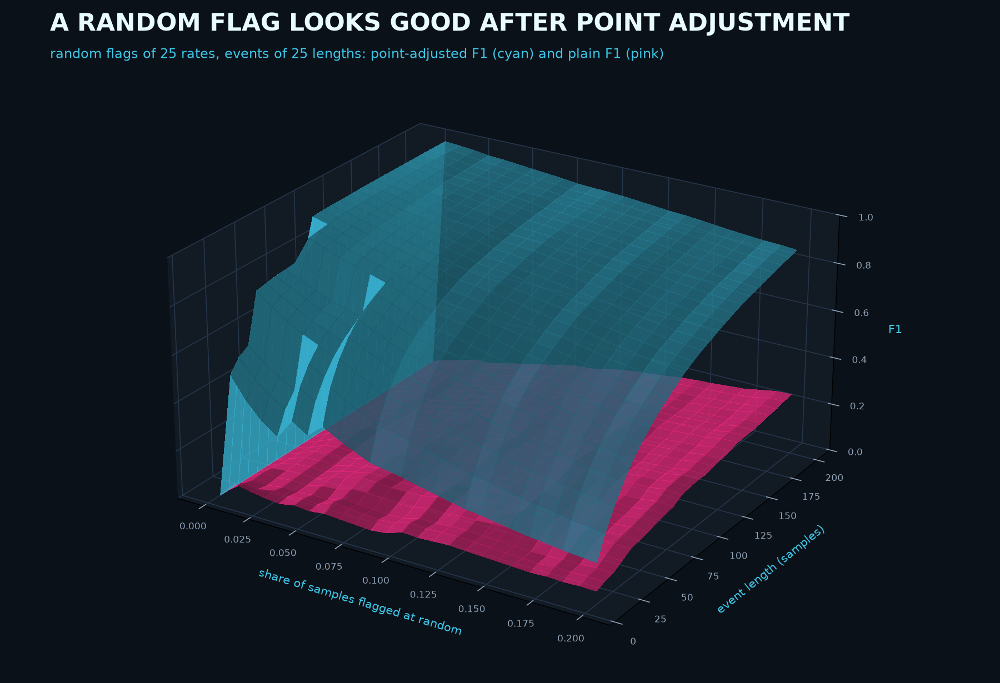
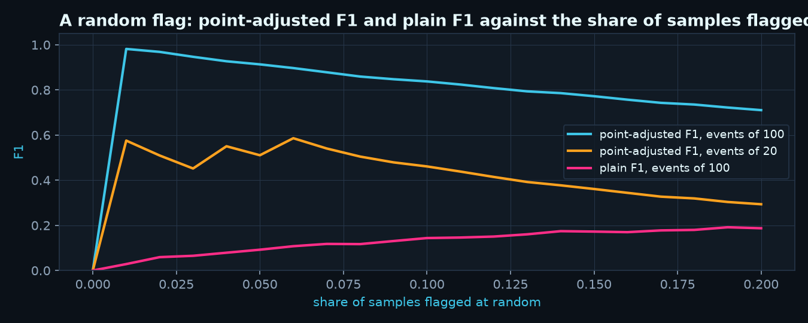

# Events: point-adjusted F1

[← Events](index.md)

Many papers score anomaly detectors with point adjustment: if one point inside a real anomaly is flagged, the whole anomaly counts as found. It sounds fair, one alert inside an anomaly is enough to act, but Kim et al. (2021) show that it rewards noise: a flag thrown at random reaches a high score. `PointAdjustedF1` is here only to compare with published numbers, next to the range metrics of the [range page](range.md). A robot flag is judged the same way, in the last section.



## 1. A first example: flash crashes on a stock tick

Twelve samples of a stock tick, with two flash crashes of four samples (samples 3 to 6 and 9 to 12). The "detector" flags only the fourth sample.

```python
from dense_armor.core.evaluation.metrics import F1, PointAdjustedF1

crash = [0, 0, 1, 1, 1, 1, 0, 0, 1, 1, 1, 1]
flag = [0, 0, 0, 1, 0, 0, 0, 0, 0, 0, 0, 0]
pa, f1 = PointAdjustedF1(positive=1, warn=False), F1(positive=1)
for a, b in zip(crash, flag):
    pa.update(a, b)
    f1.update(a, b)
print(round(pa.get(), 3), round(f1.get(), 3))
```

```
0.667 0.222
```

Count by hand. The plain F1 sees one true positive, no false positive and seven false negatives: precision 1, recall 1/8, F1 = 2 × 1 × 0.125 / 1.125 = 0.222. With point adjustment the flag on the fourth sample counts the whole first crash as found: four true positives and four false negatives (the second crash), so precision 1, recall 4/8 = 0.5 and F1 = 0.667. One flag triples the score.



On the same stream, with events of 100 samples, the point-adjusted F1 reads 0.913 for a share of 5% of random flags, 0.838 for 10% and 0.71 for 20%; with events of 20 samples it reads 0.511, 0.461 and 0.294; the plain F1 with events of 100 samples reads 0.092, 0.144 and 0.187.

The picture follows 2000 samples of a stock tick with four labelled flash crashes, and a "detector" that flags a share of the samples at random, for 25 shares between 0 and 20% and 25 event lengths between 10 and 200 samples. The cyan surface is the point-adjusted F1 and the pink one the plain F1. For a share of 5% and events of 97 samples the point-adjusted F1 reads 0.911 and the plain F1 0.094; for events of 10 samples it reads 0.361 and 0.043; for a share of 10% and events of 97 samples it reads 0.834 and 0.147; for a share of 20% and events of 200 samples it reads 0.866 and 0.255. The longer the event, the more likely that a random flag lands in it, and the higher the point-adjusted score.

| class | what it does |
|---|---|
| `PointAdjustedF1` | F1 where one flagged sample inside an anomaly counts the whole anomaly as found |

## 2. What the metric keeps

`PointAdjustedF1` keeps the whole stream of labels and predictions in order, because the protocol needs to know where each anomaly segment starts and ends. `merge` is not implemented: two streams cannot be joined without that order. It warns when it is read, unless `warn=False`.

**Source:** the docstring of `PointAdjustedF1` and of the module `dense_armor.core.evaluation.metrics.events` give the protocol of Xu, H. et al. (2018). Unsupervised anomaly detection via variational auto-encoder for seasonal KPIs in web applications. In WWW, and the warning of Kim, S., Choi, K., Choi, H.-S., Lee, B., Yoon, S. (2021). Towards a rigorous evaluation of time-series anomaly detection. arXiv:2109.05257: a random anomaly score reaches a high point-adjusted F1, so the metric cannot distinguish a real detector from noise. It should be reported only next to the range-based precision and recall of Tatbul et al. (2018).

## 3. The parameters

| Parameter | Meaning | Default |
|---|---|---|
| `positive` | the label treated as the positive class | 1 |
| `warn` | whether to emit a `UserWarning` the first time the metric is scored | `True` |

## 4. The same score on a robot joint

A fault flag on 2000 samples of a joint, with four faults of 100 samples. The "detector" flags 5% of the samples at random.

```python
import numpy as np
from dense_armor.core.evaluation.metrics import F1, PointAdjustedF1

rng = np.random.default_rng(0)
y = np.zeros(2000, dtype=int)
for s in (200, 700, 1200, 1700):
    y[s:s + 100] = 1
p = (rng.random(2000) < 0.05).astype(int)
pa, f1 = PointAdjustedF1(positive=1, warn=False), F1(positive=1)
for a, b in zip(y.tolist(), p.tolist()):
    pa.update(a, b)
    f1.update(a, b)
print(round(pa.get(), 3), round(f1.get(), 3))
```

```
0.895 0.063
```

The "detector" flags 5 % of the samples at random. The plain F1 is 0.063, as it should be; the point-adjusted F1 is 0.895, because each 100-sample anomaly almost surely contains one random flag. `PointAdjustedF1` is here only to compare with published numbers; it warns when read. Report the range-based metrics of the [range page](range.md) next to it.

## API reference

::: dense_armor.core.evaluation.metrics.events.PointAdjustedF1

---

## Details

### Choices

- **Base implementation:** `PointAdjustedF1` inherits from `Metric`; `merge` is not implemented.
- **The figures** are drawn with the library by `docs/assets/metrics/make_events_figures.py`. The surface uses 2000 samples with four events at samples 200, 700, 1200 and 1700, and the same random draws for the 25 shares and the 25 lengths; the second figure uses events of 100 and of 20 samples.
