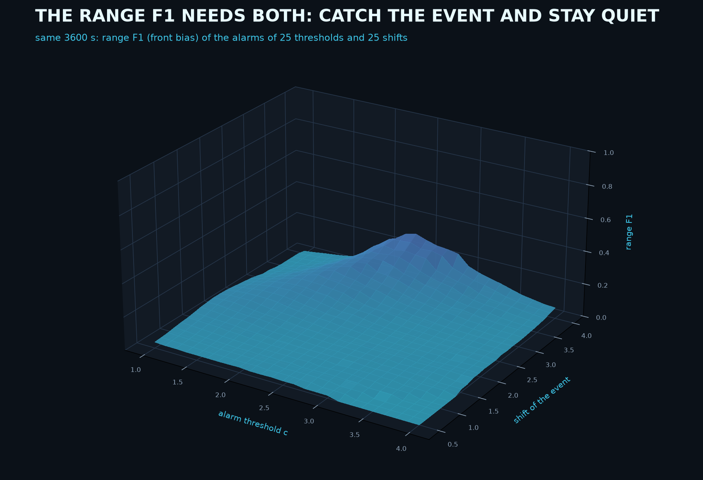
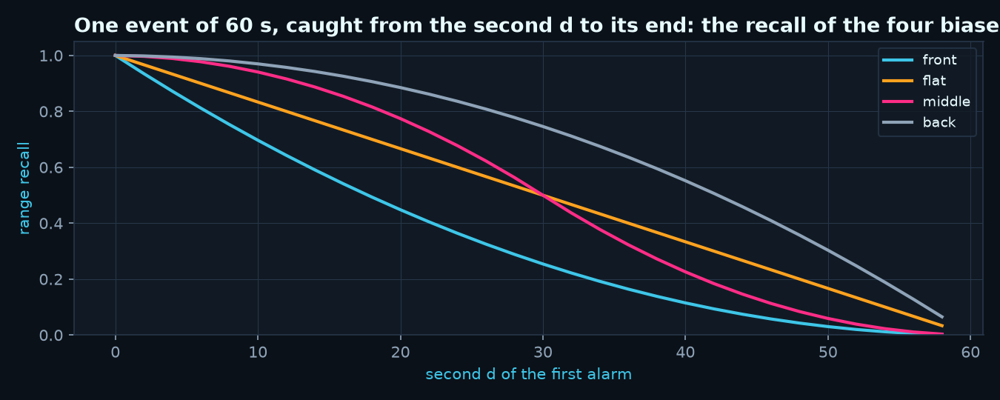

# Events: range precision and recall

[← Events](index.md)

Precision and recall count samples, but an event is an interval. An alarm can cover only the end of a crash, a crash can be split across two alarms, and catching the first seconds of a crash is worth more than catching the last. The range-based precision and recall of Tatbul et al. (2018) redefine the two for intervals: how much of the event the alarms cover, where in the event, and in how many pieces. A robot fault is judged the same way, in the last section.



## 1. A first example: a flash crash on a stock tick

One flash crash of 10 seconds, from second 0 to second 9, with one point per second. The detector rang at seconds 0, 1 and 2, and the three alarms are merged into one range by `threshold_window=1.0`.

```python
from dense_armor.core.evaluation.metrics import EventMetrics

for bias in ("front", "back"):
    m = EventMetrics([(0.0, 9.0)], positional_bias=bias, threshold_window=1.0)
    for t in (0.0, 1.0, 2.0):
        m.add_alarm(t)
    print(bias, round(m.range_precision(), 3), round(m.range_recall(), 3), round(m.range_f1(), 3))
```

```
front 1.0 0.491 0.659
back 1.0 0.109 0.197
```

Count by hand. The event has 10 points (0 to 9 s at `dt=1.0`); the alarm range covers the first three. With front bias the weights are 10, 9, …, 1 (sum 55) and the covered ones add up to 10 + 9 + 8 = 27: recall 27/55 = 0.491. With back bias they are 1 + 2 + 3 = 6: recall 6/55 = 0.109. Precision is 1.0 in both cases because every alarm point lies inside the event. The F1 is the harmonic mean: 0.659 and 0.197.



The figure follows one event of 60 s that the alarms cover from the second d to its end. If the alarms start at the first second all four biases read 1.0. If they start at second 10, the recall is 0.697 with the front bias, 0.833 with flat, 0.941 with middle and 0.97 with back; at second 30 it is 0.254, 0.5, 0.5 and 0.746; at second 58 it is 0.002, 0.033, 0.003 and 0.065. The front bias punishes a late alarm most, and the back bias least.

The picture follows the same 3600 seconds of a stock tick, with four flash crashes of 60 s, and a detector that rings on every sample above a threshold c; consecutive alarms within a second are merged into one range. Each point of the surface is the range F1 (front bias) for 25 thresholds and 25 shifts. The range F1 stays low, because every false alarm is a range of its own that lowers the precision: with a shift of 2.98 it reads 0.158 for the threshold 2.0 and 0.063 for the threshold 3.0, with a shift of 1.52 and the threshold 2.0 it reads 0.042, and with a shift of 4.0 it reads 0.017 for the threshold 1.0, which rings 559 times for nothing, and 0.066 for the threshold 4.0.

| class | what it does |
|---|---|
| `EventMetrics` | its methods `range_precision`, `range_recall` and `range_f1` (the class is on the [delay page](delays.md)) |

## 2. What the metric keeps

The recall of one real event $R_i$ against the alarm ranges $P$ mixes two rewards:

$$\mathrm{Recall}(R_i, P) = \alpha \cdot \mathrm{Existence}(R_i, P) + (1 - \alpha) \cdot \mathrm{Overlap}(R_i, P) \qquad \text{(Eq. 4 of the paper)}$$

The existence reward is 1 if any alarm falls inside the event (Eq. 5). The overlap reward (Eq. 6) adds up a weight $\delta(i)$ for every point $i$ of the event that the alarms cover, divided by the sum of all the weights, and is shrunk by a cardinality factor when the event is split across several alarm ranges (Eq. 7). The weights are the positional bias of Figure 2b of the paper: flat ($\delta = 1$), front ($\delta = L - i + 1$, early points count more), back ($\delta = i$) and middle. Precision uses the same overlap reward with flat bias. A window sampled at period `dt` has `round((end - start) / dt) + 1` points.

**Source:** the docstring of the module `dense_armor.core.evaluation.metrics.events` implements range-based precision and recall from Tatbul, N., Lee, T. J., Zdonik, S., Alam, M., Gottschlich, J. (2018). Precision and recall for time series. In NeurIPS (arXiv:1803.03639 in the docstring of `evaluate_events`). The positional-bias functions are the four of Figure 2b, the existence reward is equation 5, the overlap reward is equation 6 and the cardinality factor is equation 7; recall uses the user-selected positional bias and precision uses flat (Section 5 of the paper). `range_recall` is equation 3, `range_precision` is equation 8 and `range_f1` is their harmonic mean.

## 3. The parameters

| Parameter | Meaning | Default |
|---|---|---|
| `alpha` | existence-reward weight in `[0, 1]`; `0` ignores existence and rewards only overlap | 0.0 |
| `positional_bias` | one of `"flat"`, `"front"`, `"back"`, `"middle"`; used for recall, precision always uses flat | `"front"` |
| `cardinality` | whether the cardinality factor of equation 7 penalises a real event split across several predictions | `True` |
| `threshold_window` | two alarms within this many seconds are the same detection | 0.0 |

## 4. The same metrics on a robot joint

A joint fault is labelled from 0 s to 9 s, one point per second. The controller rang at seconds 4, 5 and 6, in the middle of the fault, and the three alarms are merged into one range. The four biases give four different recalls.

```python
from dense_armor.core.evaluation.metrics import EventMetrics

for bias in ("flat", "middle", "front", "back"):
    m = EventMetrics([(0.0, 9.0)], positional_bias=bias, threshold_window=1.0)
    for t in (4.0, 5.0, 6.0):
        m.add_alarm(t)
    print(bias, round(m.range_precision(), 3), round(m.range_recall(), 3), round(m.range_f1(), 3))
```

```
flat 1.0 0.3 0.462
middle 1.0 0.467 0.636
front 1.0 0.273 0.429
back 1.0 0.327 0.493
```

Count by hand. The alarm range covers the points 5, 6 and 7 of the 10 points of the event. Flat: 3 of 10, 0.3. Front: the weights 6, 5 and 4 over the sum 55, 15/55 = 0.273. Back: 5 + 6 + 7 = 18 over 55, 0.327. Middle: the weights grow to the middle and fall after it (1, 2, 3, 4, 5, 5, 4, 3, 2, 1, sum 30), and the covered points weigh 5 + 5 + 4 = 14: 14/30 = 0.467. For a robot, front bias says "catching the start of a fault is what matters".

## API reference

The methods `range_precision`, `range_recall` and `range_f1` belong to `EventMetrics`, whose reference is on the [delay page](delays.md#api-reference).

---

## Details

### Choices

- **Where it lives:** the three methods are in the class `EventMetrics`, in `dense_armor.core.evaluation.metrics.events`.
- **The figures** are drawn with the library by `docs/assets/metrics/make_events_figures.py`. The surface uses the stream of the delay page with `threshold_window=1.0`; the second figure uses one event from 0 to 59 s and alarms at every second from d to 59.
