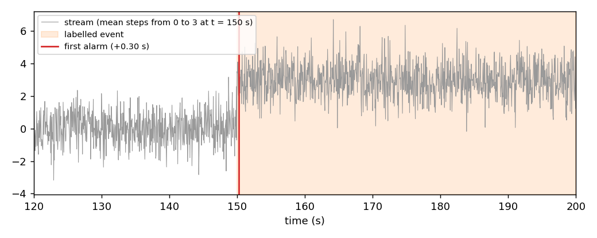

# Metrics and evaluation

A robot that keeps learning needs to know whether it is learning well. These tools keep a small running score that is updated every time a new reading arrives and its answer can be compared with what really happened.

## What this is

A robot that learns while it works needs a way to tell whether it is learning well. You cannot
stop it, collect a test set and score it at the end: the data never ends and the world changes
under it. The answer is to score it **as it goes**: every time a new sample arrives, compare
what the model predicted with what really happened, and keep a small running summary.

This page shows those running summaries (the **metrics**), the protocol that feeds them
(predict first, then learn), and the metrics made for events on a robot: how fast a fault is
caught and how often the alarm rings for nothing.

The figure is the case this page builds towards: a signal sampled at 20 Hz changes at
t = 150 s, a drift detector raises its first alarm 0.30 s later, and the metrics turn that into
numbers: delay, missed events, false alarms per hour.

- [Metrics: pairs, classification and probabilities](basics.md) (steps 1-3)
- [Metrics: regression and uncertainty](regression.md) (steps 4-5)
- [Metrics on a stream: windows, predict then learn, model choice](stream.md) (steps 6-8)
- [Metrics for events: delay, false alarms and NAB](events.md) (steps 9-13)

## API reference

::: dense_armor.utility.metrics

::: dense_armor.utility.evaluate

---

## Details

- **NAB, Eq. 1 against Figure 3.** The paper prints the scaled sigmoid as
  $\sigma^A(y) = (A_{TP} - A_{FP})\,\frac{1}{1 + e^{5y}} - 1$ and states that the right end of
  the window gives $\sigma(0) = 0$; that holds only when $A_{TP} - A_{FP} = 2$. Figure 3
  instead multiplies the scaled sigmoid by the profile weight (its total,
  $-1.0 \cdot 0.11 + 0.9999 \cdot 1 - 0.8093 \cdot 0.11 - 1.0 \cdot 0.11 = 0.6909$, checks out).
  The library follows Figure 3 and the text. The paper names two more profiles (reward low FP,
  reward low FN) without giving their weights, so only the standard weights are defaults.
- **Window boundary.** `Rolling(window_s=w)` drops a sample when $t_\text{now} - t \ge w$, with
  a tolerance of $10^{-9}$ s so that timestamps such as `i * 0.01` do not lose or gain a sample
  to rounding.
- **Same numbers as the robot benchmark.** On the CUSUM stream of step 12, `evaluate_events`
  returns the same delay and false alarms per hour as `run_cusum` in
  `benchmarks/casper_benchmark.py` for thresholds 2, 5 and 20 (tested).
- **Sources.** Tatbul, N. et al. (2018), "Precision and recall for time series", NeurIPS,
  arXiv:1803.03639. Lavin, A., Ahmad, S. (2015), "Evaluating real-time anomaly detection
  algorithms: the Numenta Anomaly Benchmark", IEEE ICMLA, arXiv:1510.03336. Kim, S. et al.
  (2021), "Towards a rigorous evaluation of time-series anomaly detection", arXiv:2109.05257.
  Ksieniewicz, P., Zyblewski, P. (2020), "stream-learn", arXiv:2001.11077 (test-then-train and
  prequential protocols). Amekoe, K. M. et al. (2024), arXiv:2409.10111 (delayed labels).
  Xie, L., Zou, S., Xie, Y., Veeravalli, V. V. (2021), "Sequential (quickest) change
  detection", arXiv:2104.04186 (detection delay and false alarm rate).
