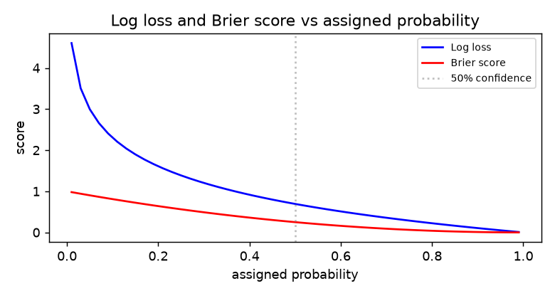

# Probabilities: log loss and the Brier score

While a classifier only outputs hard labels (0 or 1), a probabilistic model outputs a confidence score between 0 and 1. Log loss and Brier score measure how well those predicted probabilities match what actually happened.

## Log loss and Brier score

```python
from dense_armor.core.evaluation.metrics import BrierScore, LogLoss

ll, br = LogLoss(), BrierScore()
for y, p in [(1, 0.9), (0, 0.2), (1, 0.6)]:
    ll.update(y, p)
    br.update(y, p)
print(round(ll.get(), 4), round(br.get(), 4))
```

```
0.2798 0.07
```

The log-loss is the mean of $-\ln p$ given to what happened: $-(\ln 0.9 + \ln 0.8 + \ln 0.6)/3 = 0.2798$. The Brier score is the mean squared distance between probability and outcome: $(0.1^2 + 0.2^2 + 0.4^2)/3 = 0.07$. Both are lower for better forecasts.



## How it works

`LogLoss` accumulates $-\ln p$ when the true label is 1 and $-\ln(1-p)$ when it is 0, then returns the mean. `BrierScore` accumulates $(1-p)^2$ when the true label is 1 and $p^2$ when it is 0, then returns the mean. Both metrics are proper scoring rules: they are minimized when the predicted probabilities equal the true class probabilities.

## The parameters

| Parameter | Meaning | Default |
|---|---|---|
| `eps` | small constant to avoid log(0) in LogLoss | 1e-15 |
| `normalize` | divide by count to get mean | True |

## API reference

::: dense_armor.core.evaluation.metrics.classification.LogLoss  
::: dense_armor.core.evaluation.metrics.classification.BrierScore

## Details

- **Base implementation:** Both `LogLoss` and `BrierScore` inherit from `Metric` and track the sum of scores and the count `n`.
- **Merge:** Two `LogLoss` metrics with sums `s1, n1` and `s2, n2` merge to `s1+s2, n1+n2`. Same for `BrierScore`.
- **Revert:** When `revert(y, p)` is called, the score is subtracted from the sum. Used by `Rolling` windows.