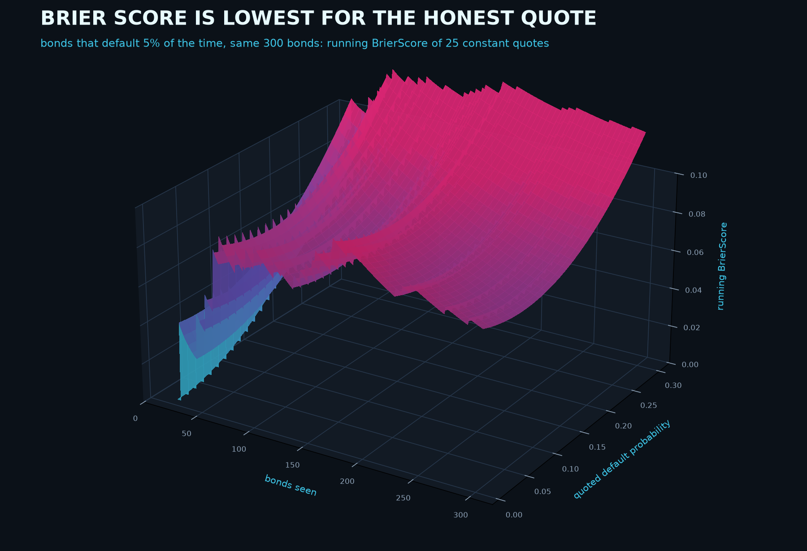
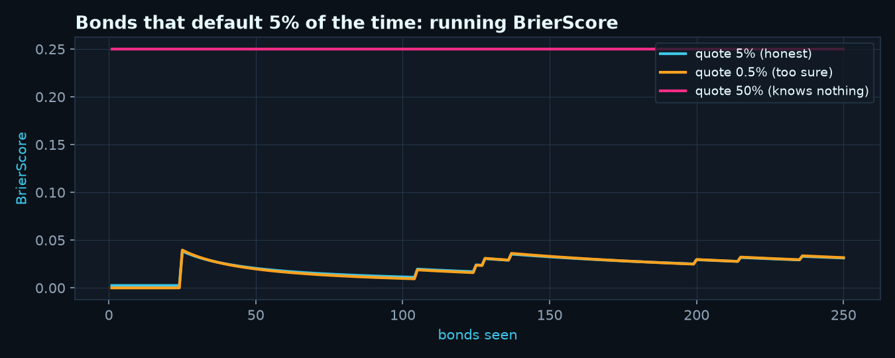

# Probabilities: the Brier score

[← Probabilities](index.md)

A trading model quotes the default probability of a corporate bond. The Brier score tells how far the quoted probability is from what actually happened: it is the mean of the squared distance, so a quote of 0.85 for a bond that defaults costs 0.0225 and a quote of 0.05 costs 0.9025. A robot controller that quotes the probability of a fault is judged the same way, in the last section.



The picture follows the same 300 bonds, each defaulting with probability 5% (24 of them defaulted), for 25 constant quotes between 1% and 30%. Each point of the surface is the `BrierScore` after that many bonds. After 300 bonds the best quote is 0.082 and reads 0.0736; the quote of 1% reads 0.0785 and the quote of 30% reads 0.122.

| class | what it does |
|---|---|
| `BrierScore` | the mean squared distance between the probability and what happened |

## 1. A first example: the default probability of a bond

Five bonds are quoted, and then we learn which ones defaulted: 1 is a default and 0 is no default.

```python
from dense_armor.core.evaluation.metrics import BrierScore

bond_default = [0, 1, 0, 0, 1]
bond_prob = [0.05, 0.20, 0.03, 0.02, 0.15]
br = BrierScore()
for y, p in zip(bond_default, bond_prob):
    br.update(y, p)
print(round(br.get(), 4))
```

```
0.2733
```

Count by hand. The squared distances are $0.05^2 = 0.0025$, $0.80^2 = 0.64$, $0.03^2 = 0.0009$, $0.02^2 = 0.0004$ and $0.85^2 = 0.7225$. Their sum is 1.3663 and the mean is 1.3663 / 5 = 0.2733.



On 250 bonds, 8 of them defaulted. The honest quote of 5% reads 0.0313 after 250 bonds, the quote of 0.5% (too sure) reads 0.0317 and the quote of 50% reads 0.25, the score of a constant 0.5 forecast.

## 2. What the metric keeps

`BrierScore` keeps the sum of the squared distances (`sum_`) and the number of pairs (`total_`), and the score is their ratio.

$$B = \frac{1}{n} \sum_{i=1}^{n} (p_i - y_i)^2$$

It accumulates $(1-p)^2$ when the true label is 1 and $p^2$ when it is 0. It is a proper scoring rule: it is minimized when the predicted probabilities equal the true class probabilities.

**Source:** the docstring of `BrierScore` gives the formula `mean((p - y)**2)`, says that the lower the better and that `0.25` is the score of a constant 0.5 forecast, and cites no paper. The docstring of the module `dense_armor.core.evaluation.metrics.classification` says that the log-loss and the Brier score are the standard proper losses (Brier 1950; Good 1952); its list of references contains Brier, G. W. (1950). Verification of forecasts expressed in terms of probability. Monthly Weather Review 78(1), 1-3.

## 3. The parameters

`BrierScore()` takes no parameters. A pair is added with `update(y_true, y_pred, t=None, w=1.0)`. The label `y` is 1 or 0; a value between them is read as a soft label and is not checked.

## 4. The same score on a robot joint

A joint controller quotes the probability of a fault, and the maintenance log says what was true: 1 is a fault.

```python
from dense_armor.core.evaluation.metrics import BrierScore

br = BrierScore()
for y, p in [(1, 0.9), (0, 0.2), (1, 0.6)]:
    br.update(y, p)
print(round(br.get(), 4))
```

```
0.07
```

The Brier score is the mean squared distance between probability and outcome: $(0.1^2 + 0.2^2 + 0.4^2)/3 = 0.07$. Lower is better.

## API reference

::: dense_armor.core.evaluation.metrics.classification.BrierScore

---

## Details

### Choices

- **Base implementation:** `BrierScore` inherits from `Metric` and tracks the sum of scores and the count `n`.
- **Merge:** two `BrierScore` metrics with sums `s1, n1` and `s2, n2` merge to `s1+s2, n1+n2`.
- **Revert:** when `revert(y, p)` is called, the score is subtracted from the sum. Used by `Rolling` windows.
- **The figures** are drawn with the library by `docs/assets/metrics/make_probabilities_figures.py`. The surface uses one stream of 300 bonds, the same random draws for the 25 quotes; the second figure uses 250 bonds.
