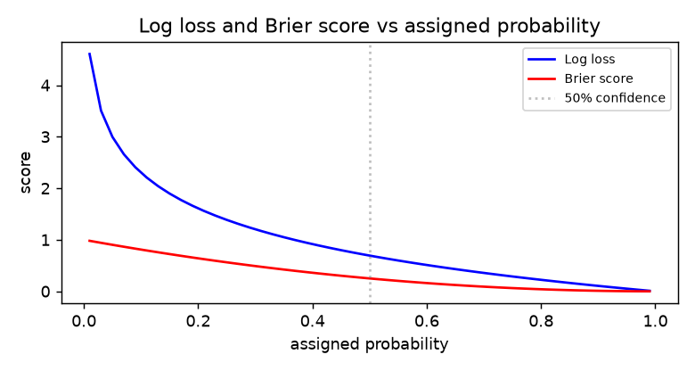

# Probabilities: scores for a model that answers with a probability

[← Metrics](../index.md)

## The map of probabilities

Click a page to open it, or a job on the left (or the button at the top) to go back to the [map of the library](../../index.md#the-library-folder-by-folder).

<object type="image/svg+xml" data="../../assets/maps/probabilities.svg" style="width:100%"></object>

While a classifier only outputs hard labels (0 or 1), a probabilistic model outputs a confidence score between 0 and 1. Log loss and the Brier score measure how well those predicted probabilities match what actually happened: each one reads a pair, a probability and what happened, updates its score and forgets the pair.

## A first example: the default probability of a bond

A trading model quotes the probability that a corporate bond defaults. Five bonds are quoted, and then we learn which ones really defaulted: 1 is a default and 0 is no default. Both metrics read the same five pairs.

```python
from dense_armor.core.evaluation.metrics import BrierScore, LogLoss

bond_default = [0, 1, 0, 0, 1]
bond_prob = [0.05, 0.20, 0.03, 0.02, 0.15]
ll, br = LogLoss(), BrierScore()
for y, p in zip(bond_default, bond_prob):
    ll.update(y, p)
    br.update(y, p)
print(round(ll.get(), 4), round(br.get(), 4))
```

```
0.7217 0.2733
```

The two bonds that defaulted were quoted at 20% and 15%, so the model was sure they would not default, and both scores are high. The log loss is the mean of $-\ln p$ given to what happened: $-(\ln 0.95 + \ln 0.20 + \ln 0.97 + \ln 0.98 + \ln 0.15)/5 = 0.7217$. The Brier score is the mean squared distance between probability and outcome: $(0.05^2 + 0.80^2 + 0.03^2 + 0.02^2 + 0.85^2)/5 = 0.2733$. Both are lower for better forecasts.



## How they work

`LogLoss` accumulates $-\ln p$ when the true label is 1 and $-\ln(1-p)$ when it is 0, then returns the mean. `BrierScore` accumulates $(1-p)^2$ when the true label is 1 and $p^2$ when it is 0, then returns the mean. Both metrics are proper scoring rules: they are minimized when the predicted probabilities equal the true class probabilities.

## The probability metrics, one page each

| page | classes | what it is for |
|---|---|---|
| [Log loss](log_loss.md) | `LogLoss` | punishes a confident wrong probability very hard |
| [Brier score](brier_score.md) | `BrierScore` | the mean squared distance between the probability and what happened |

The metrics that read a class instead of a probability are in [Classification](../classification/index.md).

---

## Details

### Choices

- **The example** uses the same five bonds on the two pages: `bond_default` is what happened and `bond_prob` is the quoted probability.
- **The map** is drawn with the library by `docs/assets/maps/make_probabilities_map.py`; the classes are the names of the catalog of `usable`.
