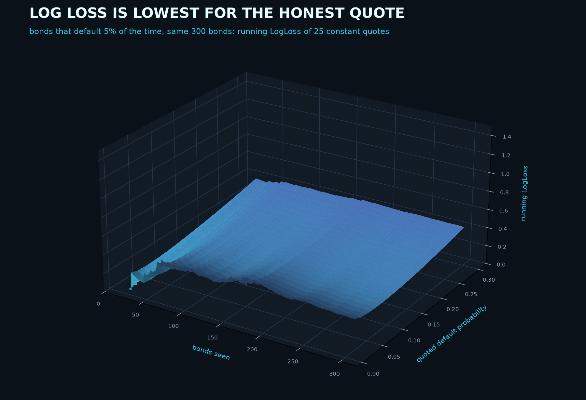
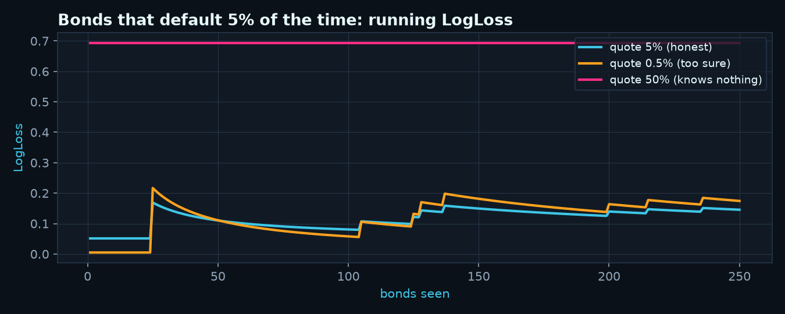

# Probabilities: log loss

[← Probabilities](index.md)

A trading model quotes the default probability of a corporate bond. Log loss tells whether the quoted probability is honest: if the model says 5% and the bond defaults, the score grows, and it grows without limit when the model says 0%. A robot controller that quotes the probability of a fault is judged the same way, in the last section.



The picture follows the same 300 bonds, each defaulting with probability 5% (24 of them defaulted), for 25 constant quotes between 1% and 30%. Each point of the surface is the `LogLoss` after that many bonds. After 300 bonds the best quote is 0.082 and reads 0.2788, close to the share of bonds that defaulted (24/300 = 0.08); the quote of 1% reads 0.3777 and the quote of 30% reads 0.4245.

| class | what it does |
|---|---|
| `LogLoss` | the mean of $-\ln$ of the probability given to what happened |

## 1. A first example: the default probability of a bond

Five bonds are quoted, and then we learn which ones defaulted: 1 is a default and 0 is no default.

```python
from dense_armor.core.evaluation.metrics import LogLoss

bond_default = [0, 1, 0, 0, 1]
bond_prob = [0.05, 0.20, 0.03, 0.02, 0.15]
ll = LogLoss()
for y, p in zip(bond_default, bond_prob):
    ll.update(y, p)
print(round(ll.get(), 4))
```

```
0.7217
```

Count by hand. The probability given to what happened is 0.95, 0.20, 0.97, 0.98 and 0.15. Their $-\ln$ are 0.0513, 1.6094, 0.0305, 0.0202 and 1.8971, the sum is 3.6085 and the mean is 3.6085 / 5 = 0.7217.



On 250 bonds, 8 of them defaulted. The honest quote of 5% reads 0.1455 after 250 bonds, the quote of 0.5% (too sure) reads 0.1744 and the quote of 50% (a model that knows nothing) reads 0.6931, which is $\ln 2$.

## 2. What the metric keeps

`LogLoss` keeps the sum of the scores of the pairs (`sum_`) and the number of pairs. The probability `p` is clipped to `[eps, 1 - eps]` so that $\ln 0$ never happens, and the score is

$$L = -\frac{1}{n} \sum_{i=1}^{n} \left[ y_i \ln p_i + (1-y_i) \ln (1-p_i) \right]$$

It accumulates $-\ln p$ when the true label is 1 and $-\ln(1-p)$ when it is 0. It is a proper scoring rule: it is minimized when the predicted probabilities equal the true class probabilities.

**Source:** the docstring of `LogLoss` gives the formula `-mean(y log p + (1 - y) log(1 - p))` and cites no paper. The docstring of the module `dense_armor.core.evaluation.metrics.classification` says that the log-loss and the Brier score are the standard proper losses (Brier 1950; Good 1952); its list of references contains Brier, G. W. (1950). Verification of forecasts expressed in terms of probability. Monthly Weather Review 78(1), 1-3. The full reference of Good (1952) is in the docstring of the module `regression`: Good, I. J. (1952). Rational decisions. J. Royal Statistical Society B 14(1), 107-114.

## 3. The parameters

| Parameter | Meaning | Default |
|---|---|---|
| `eps` | clipping floor: the probability is clipped to `[eps, 1 - eps]` to avoid `log(0)` | 1e-15 |

The label `y` is 1 or 0; a value between them is read as a soft label (the cross-entropy against it) and is not checked.

## 4. The same score on a robot joint

A joint controller quotes the probability of a fault, and the maintenance log says what was true: 1 is a fault.

```python
from dense_armor.core.evaluation.metrics import LogLoss

ll = LogLoss()
for y, p in [(1, 0.9), (0, 0.2), (1, 0.6)]:
    ll.update(y, p)
print(round(ll.get(), 4))
```

```
0.2798
```

The log-loss is the mean of $-\ln p$ given to what happened: $-(\ln 0.9 + \ln 0.8 + \ln 0.6)/3 = 0.2798$. Lower is better.

## API reference

::: dense_armor.core.evaluation.metrics.classification.LogLoss

---

## Details

### Choices

- **Base implementation:** `LogLoss` inherits from `Metric` and tracks the sum of scores and the count `n`.
- **Merge:** two `LogLoss` metrics with sums `s1, n1` and `s2, n2` merge to `s1+s2, n1+n2`.
- **Revert:** when `revert(y, p)` is called, the score is subtracted from the sum. Used by `Rolling` windows.
- **The figures** are drawn with the library by `docs/assets/metrics/make_probabilities_figures.py`. The surface uses one stream of 300 bonds, the same random draws for the 25 quotes; the second figure uses 250 bonds.
