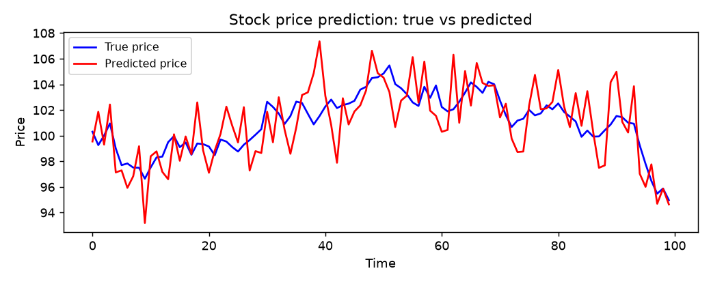

# Regression: scores for a model that answers with a number

[← Metrics](../index.md)

## The map of regression

Click a page to open it, or a job on the left (or the button at the top) to go back to the [map of the library](../../index.md#the-library-folder-by-folder).

<object type="image/svg+xml" data="../../assets/maps/regression.svg" style="width:100%"></object>

A regressor answers with a number: the price of a stock tomorrow, the torque a joint needs. After each answer the true number arrives, and a regression metric updates its score with that one pair and forgets it, so it can follow a model that keeps learning without storing the past. The metrics of this section differ in how they weigh a miss: all misses alike, large misses more, or the misses compared with always guessing the mean.

## A first example: forecasting a stock price

A trader forecasts each day with the simplest rule: tomorrow's price will be today's. Six daily prices make five pairs, and four metrics read the same five pairs.

```python
from dense_armor.core.evaluation.metrics import (
    MeanAbsoluteError,
    MeanSquaredError,
    R2Score,
    RootMeanSquaredError,
)

stock_price = [100.0, 101.0, 99.5, 102.0, 103.5, 102.5]
ms = [MeanAbsoluteError(), MeanSquaredError(), RootMeanSquaredError(), R2Score()]
for today, tomorrow in zip(stock_price[:-1], stock_price[1:]):
    for m in ms:
        m.update(tomorrow, today)
print([round(m.get(), 3) for m in ms])
```

```
[1.5, 2.55, 1.597, -0.371]
```

The five misses are 1.0, 1.5, 2.5, 1.5 and 1.0 in price units, so the MAE is their mean, 7.5 / 5 = 1.5. Their squares sum to 12.75, so the MSE is 12.75 / 5 = 2.55 and the RMSE is $\sqrt{2.55} = 1.597$. The mean of the five prices that were forecast is 101.7, and the squares of their distances from it sum to 9.3, so $R^2 = 1 - 12.75 / 9.3 = -0.371$: this forecast is worse than always guessing the mean. Each page below explains one of the metrics with the same prices.

On 100 days the same metrics follow a forecast that is not a habit but a model: a stock price that wanders, and predicted prices that are the true price plus a noise of about 0.5.

```python
import numpy as np
from dense_armor.core.evaluation.metrics import MeanAbsoluteError, RootMeanSquaredError, R2Score
rng = np.random.default_rng(42)
stock_price = 100 + np.cumsum(rng.normal(0, 1, 100))
predicted_price = stock_price + rng.normal(0, 0.5, 100)
mae, rmse, r2 = MeanAbsoluteError(), RootMeanSquaredError(), R2Score()
for p, yp in zip(stock_price, predicted_price):
    mae.update(yp, p); rmse.update(yp, p); r2.update(yp, p)
print([round(mae.get(), 3), round(rmse.get(), 3), round(r2.get(), 3)])
```

```
[0.391, 0.487, 0.954]
```

Count: MAE is the mean of $|p - \hat{p}|$, RMSE is $\sqrt{\text{mean of } (p - \hat{p})^2}$. For prices near 100 with prediction error about 0.5, MAE ≈ 0.39 and RMSE ≈ 0.49. $R^2 = 0.954$ means 95.4% of variance is explained.



## The regression metrics, one page each

| page | classes | what it is for |
|---|---|---|
| [Mean absolute error](mae.md) | `MeanAbsoluteError` | the average miss, in the units of the number |
| [MSE and RMSE](mse_rmse.md) | `MeanSquaredError`, `RootMeanSquaredError` | the average squared miss, and its square root, which punish large misses |
| [R²](r2.md) | `R2Score` | how much better the model is than always guessing the mean |

The metrics that read an interval around the number are in [Uncertainty](../uncertainty/index.md).

---

## Details

### Choices

- **The example** uses the same six prices on the three pages: each pair is the price of the next day (what happened) and the price of the day (the forecast).
- **The map** is drawn with the library by `docs/assets/maps/make_regression_map.py`.
