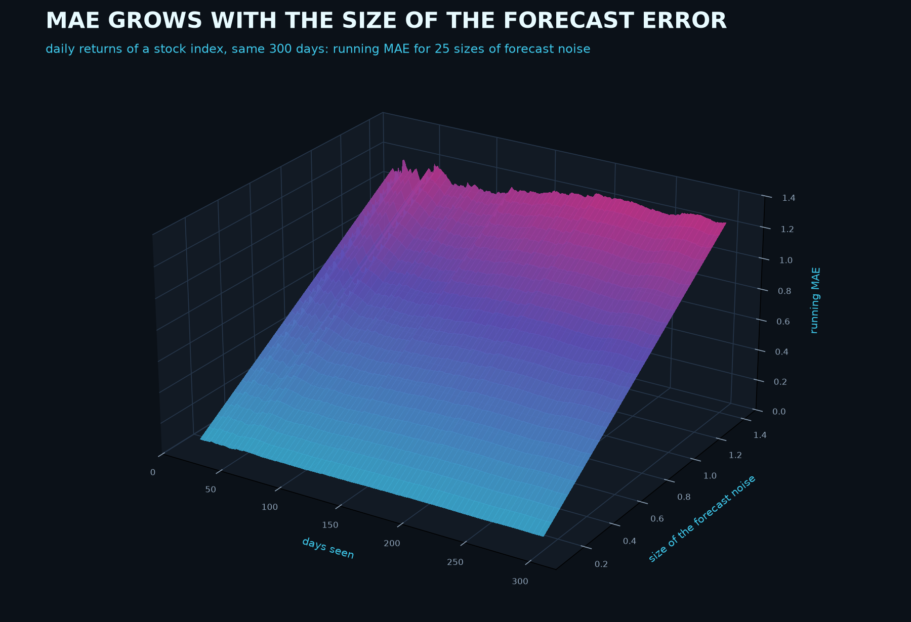
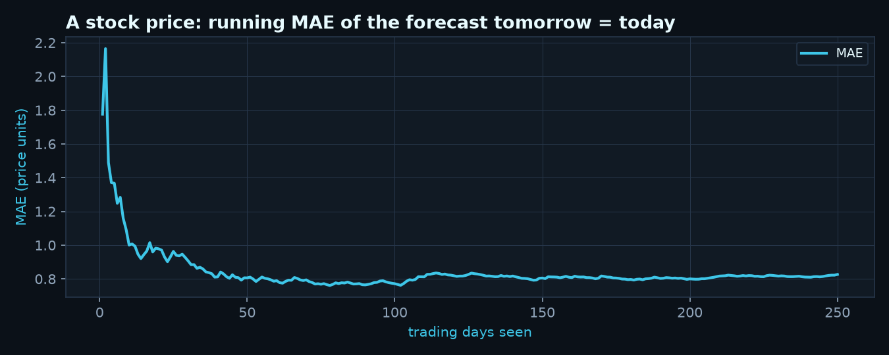

# Regression: mean absolute error (MAE)

[← Regression](index.md)

The mean absolute error is the average size of the miss, in the units of the number that is forecast. A stock price forecast that misses by 1.5 on average has an MAE of 1.5. Every miss counts for its size, so one huge miss does not dominate the score; this is why it is the natural error for a robot torque loop, where all deviations are equally bad, as in the last section.



## 1. A first example: forecasting a stock price

Six daily prices make five pairs. The forecast of each day is the price of the day before.

```python
from dense_armor.core.evaluation.metrics import MeanAbsoluteError

stock_price = [100.0, 101.0, 99.5, 102.0, 103.5, 102.5]
m = MeanAbsoluteError()
for today, tomorrow in zip(stock_price[:-1], stock_price[1:]):
    m.update(tomorrow, today)
print(round(m.get(), 3), m.n)
```

```
1.5 5
```

Count by hand. The pairs (what happened, forecast) are (101, 100), (99.5, 101), (102, 99.5), (103.5, 102) and (102.5, 103.5), so the misses are 1.0, 1.5, 2.5, 1.5 and 1.0. Their sum is 7.5 and the mean is 7.5 / 5 = 1.5.



On 250 trading days of a price that moves by about 1 each day, the same forecast reads 1.0 after 10 pairs, 0.806 after 50, 0.771 after 100 and 0.826 after 250.

The picture follows the same 300 daily returns (in percent) of a stock index for 25 forecasts, each the true return plus a noise of a different size. Each point of the surface is the `MeanAbsoluteError` after that many days. After 300 days the MAE reads 0.089 for the noise 0.1, 0.426 for 0.48, 0.908 for 1.02 and 1.245 for 1.4: it grows with the size of the noise, and it needs a few dozen days to settle.

| class | what it does |
|---|---|
| `MeanAbsoluteError` | the mean of the absolute miss, one sample at a time |

## 2. What the metric keeps

`MeanAbsoluteError` keeps the sum of the absolute misses (`sum_`) and the number of pairs (`total_`), and the score is their ratio. After a million pairs it still keeps two numbers.

$$\text{MAE} = \frac{1}{n} \sum_{i=1}^{n} |y_i - \hat{y}_i|$$

Here $y_i$ is what happened and $\hat{y}_i$ is the forecast. In the example the sum is 7.5 and $n$ is 5, so MAE = 1.5.

**Source:** the docstring of `MeanAbsoluteError` gives the formula `MAE = mean(|y - y_hat|)` and cites no paper. It says that the metric is robust to outliers compared to MSE and is the natural error for a robot torque loop, where all deviations are equally bad. The docstring of the module `dense_armor.core.evaluation.metrics.regression` has a list of references, and it does not say which metric each one belongs to.

## 3. The parameters

| Parameter | Meaning | Default |
|---|---|---|
| `feature` | key of the channel to read from dict inputs; `None` accepts a scalar or a joint vector | `None` |

A pair is added with `update(y_true, y_pred, t=None, w=1.0)`; `merge(other)` adds the sums and the counts of two metrics, so two workers that read different parts of the stream give the same MAE as one worker that reads all of it.

## 4. The same score on a robot arm

A robot arm has several joints. Pass the vector of the joints and the metric reports each joint and the mean.

```python
from dense_armor.core.evaluation.metrics import MeanAbsoluteError

m = MeanAbsoluteError()
m.update([1.0, 2.0], [1.5, 2.5])
m.update([2.0, 4.0], [2.5, 3.0])
print(m.get())
```

```
{'per_joint': [0.5, 0.75], 'mean': 0.625}
```

Joint 0 is off by 0.5 both times; joint 1 by 0.5 and then 1.0, mean 0.75. The mean of the two joints is (0.5 + 0.75) / 2 = 0.625.

## API reference

::: dense_armor.core.evaluation.metrics.regression.MeanAbsoluteError

---

## Details

### Choices

- **Base implementation:** `MeanAbsoluteError` tracks the sum of absolute errors and the count.
- **Merge:** two `MeanAbsoluteError` metrics with sums `s1, n1` and `s2, n2` merge to `s1+s2, n1+n2`.
- **Joint vectors:** the scalar metrics of the module also accept a joint vector as `y_true` / `y_pred`: the metric keeps a per-joint state next to the aggregate one, and with `feature="joint1"` only that key is scored from a dict input.
- **The figures** are drawn with the library by `docs/assets/metrics/make_regression_figures.py`. The surface uses one stream of 300 daily returns and one stream of noise, the same for the 25 sizes; the second figure follows a price that moves by about 1 each day over 250 days.
