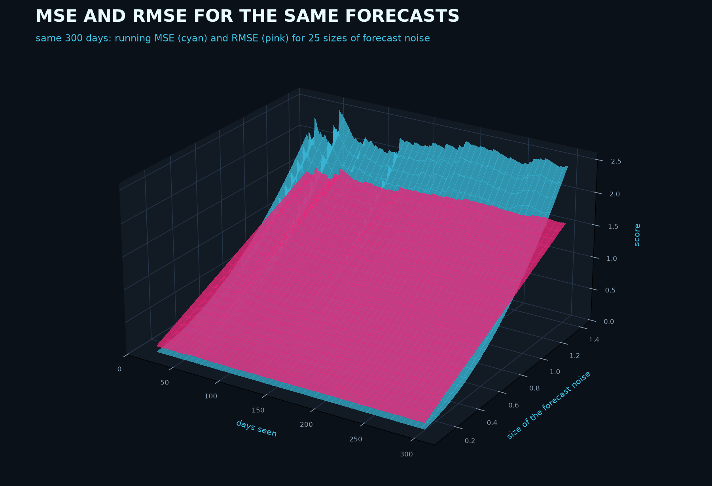
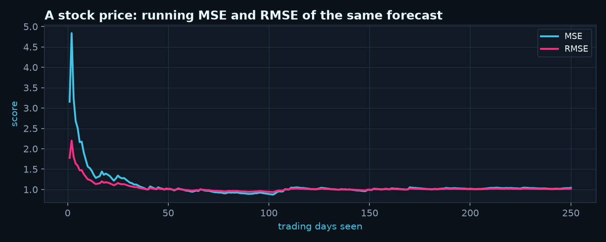

# Regression: mean squared error (MSE) and its root (RMSE)

[← Regression](index.md)

The mean squared error squares each miss before it takes the mean, so a miss of 3 counts nine times a miss of 1: large misses weigh much more than small ones. The root mean squared error is its square root, which brings the score back to the units of the number, like the MAE. A robot joint with the same kind of forecast is scored in the last section.



The picture follows the same 300 daily returns (in percent) of a stock index for 25 forecasts, each the true return plus a noise of a different size. The cyan surface is the `MeanSquaredError`, the pink one the `RootMeanSquaredError`. After 300 days the MSE reads 0.012, 0.285, 1.294 and 2.434 for the noise 0.1, 0.48, 1.02 and 1.4, and the RMSE reads 0.111, 0.534, 1.137 and 1.56. Below 1 the square makes the MSE smaller than the RMSE, above 1 larger.

| class | what it does |
|---|---|
| `MeanSquaredError` | the mean of the squared miss |
| `RootMeanSquaredError` | the square root of the mean squared error |

## 1. A first example: forecasting a stock price

Six daily prices make five pairs. The forecast of each day is the price of the day before.

```python
from dense_armor.core.evaluation.metrics import MeanSquaredError, RootMeanSquaredError

stock_price = [100.0, 101.0, 99.5, 102.0, 103.5, 102.5]
mse, rmse = MeanSquaredError(), RootMeanSquaredError()
for today, tomorrow in zip(stock_price[:-1], stock_price[1:]):
    mse.update(tomorrow, today)
    rmse.update(tomorrow, today)
print(round(mse.get(), 3), round(rmse.get(), 3))
```

```
2.55 1.597
```

Count by hand. The misses are 1.0, 1.5, 2.5, 1.5 and 1.0, so their squares are 1, 2.25, 6.25, 2.25 and 1. The sum is 12.75 and the MSE is 12.75 / 5 = 2.55. The RMSE is $\sqrt{2.55} = 1.597$. The MAE of the same pairs is 1.5: the RMSE is never smaller than the MAE, and it is larger when the misses are unequal, here because of the miss of 2.5.



On 250 trading days of a price that moves by about 1 each day, the same forecast reads MSE 1.564 and RMSE 1.251 after 10 pairs, 1.015 and 1.007 after 50, 0.891 and 0.944 after 100, and 1.042 and 1.021 after 250.

## 2. What the metric keeps

`MeanSquaredError` keeps the sum of the squared misses (`sum_`) and the number of pairs (`total_`), and the score is their ratio. `RootMeanSquaredError` takes the square root of that ratio.

$$\text{MSE} = \frac{1}{n} \sum_{i=1}^{n} (y_i - \hat{y}_i)^2 \qquad \text{RMSE} = \sqrt{\text{MSE}}$$

The **MSE** is the quantity that RMSE takes the square root of: `RMSE = sqrt(MSE)`. MSE is useful when you need the raw squared error for gradient-based optimisation or for combining with other squared-error terms.

**Source:** the docstring of `MeanSquaredError` says "Mean squared error, one sample at a time" and gives no formula; the docstring of `RootMeanSquaredError` says "Square root of the mean squared error". Neither cites a paper. The docstring of the module `dense_armor.core.evaluation.metrics.regression` has a list of references, and it does not say which metric each one belongs to.

## 3. The parameters

| Parameter | Meaning | Default |
|---|---|---|
| `feature` | key of the channel to read from dict inputs; `None` accepts a scalar or a joint vector | `None` |

Both metrics take the same parameter. `merge(other)` adds the sums and the counts of two metrics.

## 4. The same scores on a robot joint

A joint controller forecasts the torque a joint needs, and the sensor says what it was.

```python
from dense_armor.core.evaluation.metrics import MeanSquaredError, RootMeanSquaredError

mse, rmse = MeanSquaredError(), RootMeanSquaredError()
for a, b in [(1.0, 1.5), (2.0, 2.5), (3.0, 2.5)]:
    mse.update(a, b)
    rmse.update(a, b)
print(f"MSE: {mse.get()}, RMSE: {rmse.get()}")
```

```
MSE: 0.25, RMSE: 0.5
```

Count by hand:
$(1.0-1.5)^2 = 0.25$, $(2.0-2.5)^2 = 0.25$, $(3.0-2.5)^2 = 0.25$.
MSE $= (0.25+0.25+0.25)/3 = 0.25$. RMSE $= \sqrt{0.25} = 0.5$.

## API reference

::: dense_armor.core.evaluation.metrics.regression.MeanSquaredError

::: dense_armor.core.evaluation.metrics.regression.RootMeanSquaredError

---

## Details

### Choices

- **Base implementation:** `MeanSquaredError` tracks the sum of squared errors and the count; `RootMeanSquaredError` takes the square root.
- **Merge:** two `MeanSquaredError` metrics with sums `s1, n1` and `s2, n2` merge to `s1+s2, n1+n2`. Same for `RootMeanSquaredError`.
- **The figures** are drawn with the library by `docs/assets/metrics/make_regression_figures.py`. The surface uses one stream of 300 daily returns and one stream of noise, the same for the 25 sizes; the second figure follows a price that moves by about 1 each day over 250 days.
