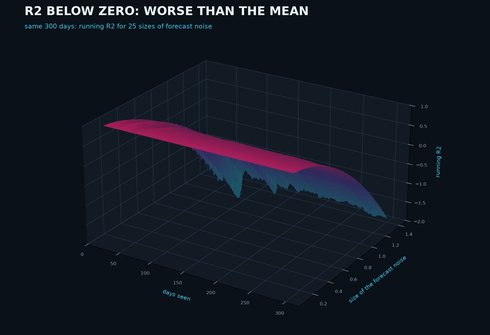
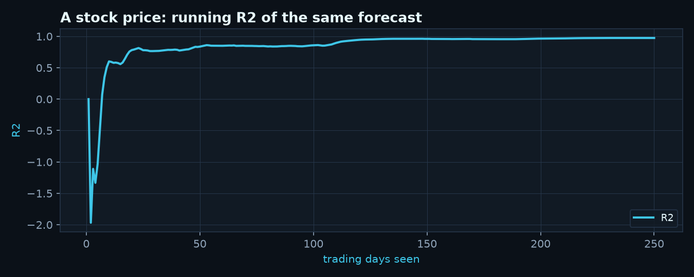

# Regression: R², how much better than the mean

[← Regression](index.md)

R² compares the model with the laziest forecast there is: always guessing the mean of what happened. A score of 1 is a perfect fit, 0 is no better than the mean, and a negative score is worse than the mean. The other regression metrics say how large the misses are; R² says whether the model is worth having. A robot joint with the same kind of model is scored in the last section.



## 1. A first example: forecasting a stock price

Six daily prices make five pairs. The forecast of each day is the price of the day before.

```python
from dense_armor.core.evaluation.metrics import R2Score

stock_price = [100.0, 101.0, 99.5, 102.0, 103.5, 102.5]
m = R2Score()
for today, tomorrow in zip(stock_price[:-1], stock_price[1:]):
    m.update(tomorrow, today)
print(round(m.get(), 3))
```

```
-0.371
```

Count by hand. The prices that were forecast are 101, 99.5, 102, 103.5 and 102.5, and their mean is 101.7. Their squared distances from the mean are 0.49, 4.84, 0.09, 3.24 and 0.64, so $SS_{tot} = 9.3$. The squared misses of the forecast are 1, 2.25, 6.25, 2.25 and 1, so $SS_{res} = 12.75$. Then $R^2 = 1 - 12.75 / 9.3 = -0.371$: the forecast "tomorrow equals today" is worse than always guessing 101.7.



On 250 trading days of a price that moves by about 1 each day, the same forecast reads 0.601 after 10 pairs, 0.836 after 50, 0.857 after 100 and 0.974 after 250. The price wanders far from its mean, so repeating the last price beats the mean easily and the R² looks excellent, although the forecast only repeats yesterday: on a price that drifts, R² flatters a forecast of the level.

The picture follows the same 300 daily returns (in percent) of a stock index for 25 forecasts, each the true return plus a noise of a different size. Each point of the surface is the `R2Score` after that many days. After 300 days the R² reads 0.985 for the noise 0.1, 0.661 for 0.48, −0.539 for 1.02 and −1.894 for 1.4: it falls below zero once the noise is as large as the returns themselves.

| class | what it does |
|---|---|
| `R2Score` | $1 - SS_{res} / SS_{tot}$: the model against the mean-only forecast |

## 2. What the metric keeps

`R2Score` keeps the sum of the squared misses (`ss_res_`) and, for the spread of what happened, the running mean (`mean_`) and the running sum of squared distances from it (`m2_`), updated one pair at a time with Welford's algorithm. The score is

$$R^2 = 1 - \frac{SS_{res}}{SS_{tot}} \qquad SS_{res} = \sum_i (y_i - \hat{y}_i)^2 \qquad SS_{tot} = \sum_i (y_i - \bar{y})^2$$

**Source:** the docstring of `R2Score` gives the formula `R^2 = 1 - SS_res / SS_tot` with `SS_tot` from Welford's `M2` accumulator (Welford 1962; Chan et al. 1979), and says that `1` is a perfect fit, `0` is the mean-only predictor and negative is worse than the mean. The references of the module `dense_armor.core.evaluation.metrics.regression` are Welford, B. P. (1962). Technometrics 4(3), 419-420, and Chan, T. F., Golub, G. H., LeVeque, R. J. (1979). In Compstat.

## 3. The parameters

| Parameter | Meaning | Default |
|---|---|---|
| `feature` | key of the channel to read from dict inputs; `None` accepts a scalar or a joint vector | `None` |
| `dtype` | numpy dtype for the accumulators | float64 |

## 4. float32

`R2Score(dtype=numpy.float32)` keeps the Welford state and the
`ss_res` sum in float32 and applies the shifted-data algorithm with
`K = y_true[0]` (Healy 2022, Algorithm 2) online: TwoSum on `s1`,
`s2` and `ss_res`, two-term formulas for the mean and for `M2`.
Relative error against the float64 reference on N(1e3, 0.01), 100,000
samples, seed 0: `M2` 1.7e-8, `ss_res` 3.7e-8. On a constant target
`get()` returns 0.0. With this mode `w` must be 1. `R2Score` is a
`Metric`, not an `Estimator`: `check_estimator` does not apply.

Cost, median of 7 runs of one update over 20,000 samples, one CPU thread: default 0.002044 ms (IQR 0.000635), float32 0.009688 ms (IQR 0.000079). The claim that the float32 path is at most as slow as the default is not met: on a scalar loop the numpy
float32 arithmetic is slower than the Python float64 arithmetic. The
float32 speed of these classes is not measured; no class in this batch
has a `learn_many` on which the float32 blocks of the T3 kernel could
be timed.

`R2Score.merge` with `dtype=numpy.float32` on either side raises
`NotImplementedError`: the pairwise formula runs on the stored
scalars, whose shift differs between the two partial states, so
the combined value would carry the accumulated float32 error
(about 5.5e-5 on a split N(1e3, 0.01) stream) instead of the
single-pass 1.7e-8. The default path merges without this limit.

**Source:** the docstring of `R2Score` does not name Healy. The reference is in the docstring of the module `dense_armor.core.online.proba.gaussian`: Healy, J. (2022). Accurate and consistent calculation of the mean and the variance in Monte-Carlo simulations. arXiv:2206.10662v7, Introduction and Algorithm 2 (PDF page 4): the shifted naive algorithm with K = x[0].

## 5. The same score on a robot joint

A regressor predicts a number, for example the torque a joint needs at a given velocity. Here a recursive least-squares model learns $\tau = 2\,\dot q$ from noisy samples, and three metrics score it.

```python
import numpy as np
from dense_armor.core.online.learn.online_dynamics import RecursiveLeastSquares
from dense_armor.core.evaluation.metrics import MeanAbsoluteError, R2Score, RootMeanSquaredError
rng = np.random.default_rng(0)
rls, ms = RecursiveLeastSquares(), [MeanAbsoluteError(), RootMeanSquaredError(), R2Score()]
for qd in rng.normal(0, 1, 500):
    tau = 2.0 * qd + rng.normal(0, 0.1)
    for m in ms: m.update(tau, rls.predict_one({"qd": qd}))
    rls.learn_one({"qd": qd}, tau)
print([round(m.get(), 3) for m in ms])
```

```
[0.077, 0.098, 0.998]
```

The **MAE** is the mean of $|\tau - \hat\tau|$, the **RMSE** the square root of the mean of
$(\tau - \hat\tau)^2$, both in the units of the torque. They sit near the noise level.
$R^2 = 1 - \sum(\tau - \hat\tau)^2 / \sum(\tau - \bar\tau)^2$ compares the model with always
predicting the mean: 0.998 means the model explains almost all the variation.

## API reference

::: dense_armor.core.evaluation.metrics.regression.R2Score

---

## Details

### Choices

- **Base implementation:** `R2Score` tracks `SS_res` and, with Welford's running mean and `M2`, `SS_tot`.
- **Merge:** the default path merges two `R2Score` metrics with the pairwise formula on the stored scalars; with float32 the merge raises `NotImplementedError`, as described above.
- **The figures** are drawn with the library by `docs/assets/metrics/make_regression_figures.py`. The surface uses one stream of 300 daily returns and one stream of noise, the same for the 25 sizes; the second figure follows a price that moves by about 1 each day over 250 days.
