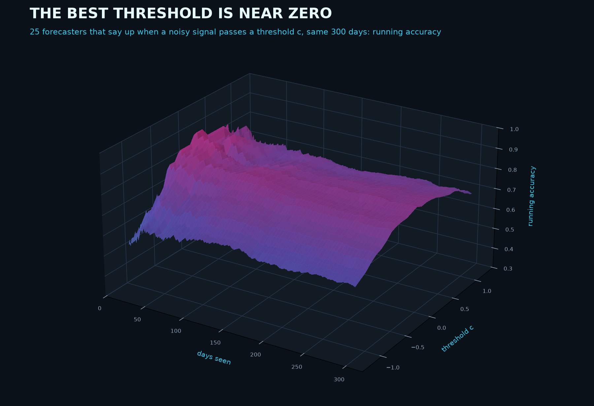
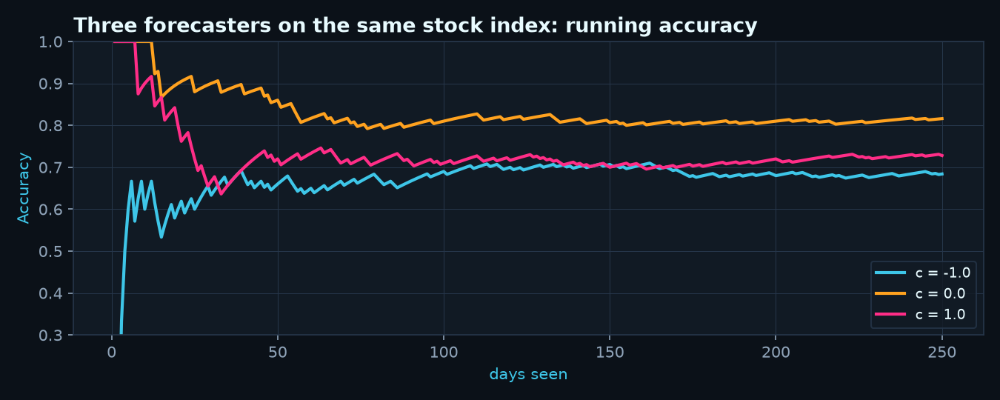

# On a stream: choosing a model

[← On a stream](index.md)

Which of several models is better today? `best_of` runs the models on the same stream with the same predict-then-learn protocol, keeps one metric per model, and tells which one is ahead; it can change its answer as the stream goes on. A robot choosing between two classifiers is in the last section.



The picture follows 300 days of a stock index. A noisy signal (the true return plus a noise of 0.7) is available each day, and 25 forecasters say "up" when the signal is above a threshold c between −1.2 and 1.2. Each point of the surface is the running accuracy of one forecaster after that many days. At day 300 the best forecaster is the one with the threshold 0.0 and it reads 0.813, while the threshold −1.2 reads 0.643 and the threshold 1.2 reads 0.683.

| class or function | what it does |
|---|---|
| `best_of` | runs several models on a stream and returns the selection |
| `OnlineModelSelection` | tracks several models on a stream and exposes the current best |

## 1. A first example: two forecasts of a stock index

Ten days of the direction of a stock index, 1 for up and 0 for down. Two models: one says the last direction it knows, the other says always up.

```python
from dense_armor.core.evaluation.evaluate import best_of
from dense_armor.core.evaluation.metrics import Accuracy


class LastValue:
    def __init__(self):
        self.last = 0

    def learn_one(self, x, y, t=None):
        self.last = y
        return self

    def predict_one(self, x, t=None):
        return self.last


class AlwaysUp:
    def learn_one(self, x, y, t=None):
        return self

    def predict_one(self, x, t=None):
        return 1


stock_up = [1, 1, 0, 1, 0, 0, 1, 1, 1, 1]
stream = [({}, y) for y in stock_up]
sel = best_of([LastValue(), AlwaysUp()], Accuracy, stream=stream)
print([round(v, 3) for v in sel.scores()], sel.current_best())
```

```
[0.5, 0.7] 1
```

Count by hand. The model that says the last direction is right on 5 days out of 10, 0.5. The model that always says up is right on the 7 up days, 0.7. So `current_best()` is the index 1, the second model. The second argument of `best_of` is the metric class: each model gets its own fresh metric.



On 250 days the forecaster with the threshold −1.0 reads 0.69 at day 100 and 0.684 at day 250, the one with the threshold 0.0 reads 0.81 and 0.816, and the one with the threshold 1.0 reads 0.71 and 0.728: the threshold 0.0 is ahead at both days.

## 2. What the selection keeps

`OnlineModelSelection` keeps the models and one fresh metric for each, built by the `metric_factory` that it is given, and feeds all of them the same stream with the same protocol as `progressive_val_score`. `scores()` returns the current score of each model, `current_best()` the index of the best one (it takes into account whether a bigger or a smaller score is better), and `best_model()` the model itself.

**Source:** the docstring of the module `dense_armor.core.evaluation.evaluate.model_selection` says that several models run on the same stream with the same prequential protocol, with one metric per model, and cites Ksieniewicz, P., Zyblewski, P. (2020). Stream-learn: open-source Python library for difficult data stream batch analysis. arXiv:2001.11077. The docstrings of `best_of` and of `OnlineModelSelection` cite no paper.

## 3. The parameters

| Parameter | Meaning | Default |
|---|---|---|
| `models` | the estimators | none |
| `metric_factory` | a callable returning a **fresh** metric: one metric per model | none |
| `stream` | (`best_of`) a stream on which the selection is run immediately | `None` |
| `delay` | label delay, as in `progressive_val_score` | `None` |
| `every` | (`OnlineModelSelection`) if given, records the trace every `every` samples | `None` |

`OnlineModelSelection` raises `ValueError` if `models` is empty.

## 4. The same choice on a robot joint

"Fast in either direction" is not a straight cut on $\dot q$, so a linear softmax model cannot learn it, while the Gaussian model, which learns a different spread per class, can.

```python
import numpy as np
from dense_armor.core.evaluation.evaluate import best_of
from dense_armor.core.online.learn.online_classifiers import OnlineGaussianNB, OnlineSoftmaxRegression
from dense_armor.core.evaluation.metrics import Accuracy

rng = np.random.default_rng(0)
s = [({"qd": v}, int(abs(v) > 0.5)) for v in rng.normal(0, 1, 2000)]
sel = best_of([OnlineGaussianNB(), OnlineSoftmaxRegression()], Accuracy, stream=s)
print([round(v, 3) for v in sel.scores()], sel.current_best())
```

```
[0.941, 0.621] 0
```

"Fast in either direction" is not a straight cut on $\dot q$, so a linear softmax model cannot
learn it (0.621), while the Gaussian model, which learns a different spread per class, can
(0.941). `current_best()` returns the index 0 and `best_model()` the model itself. The second
argument is the metric class: each model gets its own fresh metric.

## API reference

::: dense_armor.core.evaluation.evaluate.model_selection.best_of

::: dense_armor.core.evaluation.evaluate.model_selection.OnlineModelSelection

---

## Details

### Choices

- **Base implementation:** `best_of` builds an `OnlineModelSelection` and, if a stream is given, runs it immediately.
- **The figures** are drawn with the library by `docs/assets/metrics/make_stream_figures.py`. The surface uses one stream of 300 days (a true return and a signal that is the return plus a noise of 0.7), scored with `progressive_val_score(..., every=1)` for the 25 thresholds; the second figure uses the first 250 of those days.
