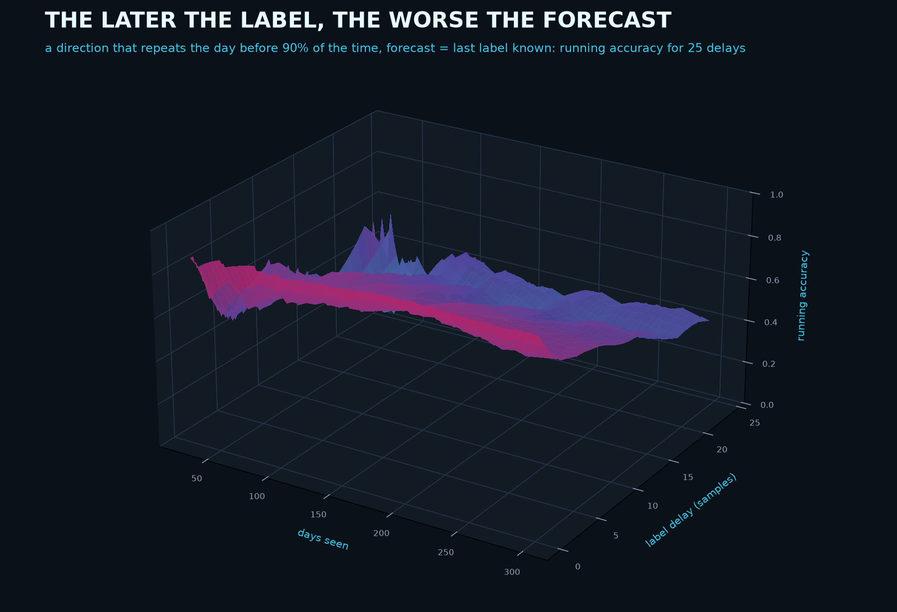
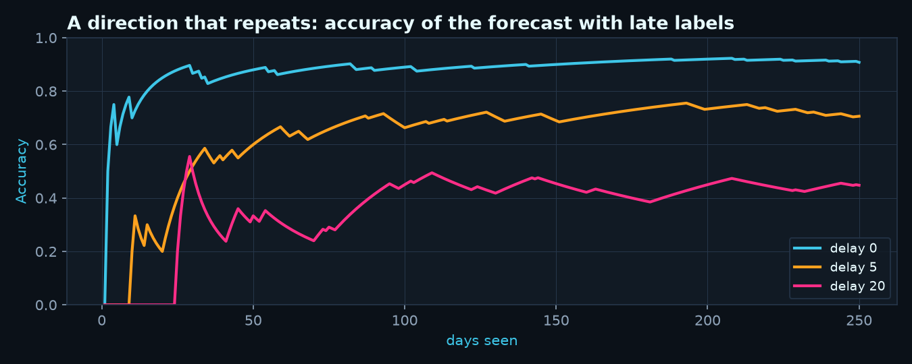

# On a stream: predict, then learn

[← On a stream](index.md)

On a stream the honest way to score a model is to ask it for its answer before it has seen the label, score the answer, and only then let it learn. `progressive_val_score` runs this protocol for you: for each sample the model predicts, the metric scores, then the model learns. Labels often arrive late (the direction of a day is known only at the close, a technician confirms a fault at the end of the shift): with `delay` the model learns each label only when it arrives. A robot with late labels and the protocol on a probability are in the last section.



## 1. A first example: the direction of a stock index

Ten days of the direction of a stock index, 1 for up and 0 for down. The model says the last direction it knows, and it starts by saying 0.

```python
from dense_armor.core.evaluation.evaluate import progressive_val_score
from dense_armor.core.evaluation.metrics import Accuracy


class LastValue:
    def __init__(self):
        self.last = 0

    def learn_one(self, x, y, t=None):
        self.last = y
        return self

    def predict_one(self, x, t=None):
        return self.last


stock_up = [1, 1, 0, 1, 0, 0, 1, 1, 1, 1]
stream = [({}, y) for y in stock_up]
for d in (None, 3):
    m = progressive_val_score(stream, LastValue(), Accuracy(), delay=d)
    print(d, m.get())
```

```
None 0.5
3 0.2
```

Count by hand. With no delay the model learns each day right after predicting it, so it says 0, 1, 1, 0, 1, 0, 0, 1, 1, 1 for the ten days: right on days 2, 6, 8, 9 and 10, so 5/10 = 0.5. With a delay of 3 the model learns the label of a day only after three more days have been predicted, so on day $j$ it knows the label of day $j - 4$: it says 0, 0, 0, 0, 1, 1, 0, 1, 0, 0. It is right only on days 3 and 8: 2/10 = 0.2.



On 250 days the forecast with no delay reads 0.89 at day 100 and 0.908 at day 250. With labels 5 samples late it reads 0.6632 and 0.7061, and with labels 20 samples late 0.45 and 0.4478.

The picture follows 300 days of a stock index whose direction repeats the day before 90% of the time, scored with a forecast that says the last direction it knows, for 25 label delays between 0 and 24 samples. Each point of the surface is the running accuracy after that many days. With no delay the accuracy reads 0.89 at day 100 and 0.9133 at day 300; with a delay of 5 samples it reads 0.6632 and 0.7017; with a delay of 24 samples it reads 0.3816 and 0.413. The later the label, the worse the forecast, and with a delay of about 20 samples the last label known no longer says anything about today: on this stream it reads below 0.5.

| function | what it does |
|---|---|
| `progressive_val_score` | scores a model on a stream, test first, then train, with an optional label delay |
| `progressive_val_proba_score` | the same, for a metric that needs a probability |

## 2. What the protocol does

For each sample of the stream, in order:

1. the model predicts (if it exposes `predict_one`);
2. the sample is buffered with its prediction;
3. the samples whose delay has expired are scored against their (now available) label and learned from.

With `delay=None` every sample is scored and learned immediately. With an integer `delay` the last `delay` samples wait in the buffer; with a float the delay is measured in seconds on the time stamps, which only a `Signal` carries: a float delay on samples without a time stamp raises `ValueError`. The trace has one value for each full block of `every` samples; the value after the last sample and the delayed samples is the returned metric. The model never sees the label at prediction time.

**Source:** the docstring of the module `dense_armor.core.evaluation.evaluate.prequential` says that the protocol is the prequential (test-then-train) evaluation with optional label delay, and that this is the delayed-label setting of Amekoe et al. (2024). Its references are Ksieniewicz, P., Zyblewski, P. (2020). Stream-learn. arXiv:2001.11077, and Amekoe, K. M., Lebbah, M., Jaffre, G., Azzag, H., Chelly Dagdia, Z. (2024). arXiv:2409.10111. The docstrings of the two functions cite no paper.

## 3. The parameters

| Parameter | Meaning | Default |
|---|---|---|
| `stream` | an iterable of `(x, y)` pairs | none |
| `model` (`classifier` for the probability version) | the estimator | none |
| `metric` | the online metric to update | none |
| `delay` | label delay in samples (int) or seconds (float) | `None` |
| `every` | if given, records the metric every `every` samples and returns `(metric, trace)` | `None` |

`progressive_val_score` raises `ValueError` if `every` is given and is not positive, if `delay` is negative, or if `delay` is in seconds and a sample has no time stamp.

## 4. The same protocol on a robot joint

The task is "is the joint moving fast?", and at sample 1000 the meaning of "fast" changes from $|\dot q| > 0.5$ to $|\dot q| > 1.5$. A technician confirms the labels late: with `delay` the model learns each label only when it arrives.

```python
import numpy as np
from dense_armor.core.evaluation.evaluate import progressive_val_score
from dense_armor.core.online.learn.online_classifiers import OnlineGaussianNB
from dense_armor.core.evaluation.metrics import Accuracy, Rolling

rng = np.random.default_rng(0)
qd = rng.normal(0, 1, 2000)
y = np.abs(qd) > np.where(np.arange(2000) < 1000, 0.5, 1.5)
s = [({"qd": a}, int(b)) for a, b in zip(qd, y)]
for d in (None, 300):
    m, tr = progressive_val_score(s, OnlineGaussianNB(), Rolling(Accuracy(), window=200), delay=d, every=200)
    print(d, [round(r, 2) for r in tr])
```

```
None [0.91, 0.94, 0.95, 0.95, 0.92, 0.54, 0.66, 0.76, 0.84, 0.84]
300 [0.0, 0.0, 0.0, 0.89, 0.95, 0.92, 0.71, 0.38, 0.59, 0.7]
```

With labels on time the rolling accuracy drops to 0.54 and
recovers to 0.84. With labels 300 samples late the drop comes later and goes deeper (0.38),
because the model keeps answering with the old rule until the new labels reach it. For `delay=300` the first
three values are 0.0 because no label has arrived yet and nothing has been scored. `every=200`
returns the trace of the metric.

For metrics that need a probability, `progressive_val_proba_score` uses `predict_proba_one`. The metric receives one number: the probability of the class `1` (or `True`), or `0.5` while the classifier gives no probability; a classifier with other class labels is not supported.

```python
import numpy as np
from dense_armor.core.evaluation.evaluate import progressive_val_proba_score
from dense_armor.core.online.learn.online_classifiers import OnlineGaussianNB
from dense_armor.core.evaluation.metrics import LogLoss

rng = np.random.default_rng(0)
s = [({"qd": v}, int(abs(v) > 0.5)) for v in rng.normal(0, 1, 2000)]
m, tr = progressive_val_proba_score(s, OnlineGaussianNB(), LogLoss(), every=500)
print([round(v, 3) for v in tr])
```

```
[0.312, 0.283, 0.264, 0.253]
```

The log-loss falls as the model sees more samples.

## API reference

::: dense_armor.core.evaluation.evaluate.prequential.progressive_val_score

::: dense_armor.core.evaluation.evaluate.prequential.progressive_val_proba_score

---

## Details

### Choices

- **Where it lives:** the two functions are in `dense_armor.core.evaluation.evaluate.prequential`; the module docstring also lists `evaluate_events`, which is on the Events page.
- **The figures** are drawn with the library by `docs/assets/metrics/make_stream_figures.py`. The surface uses one stream of 300 days in which the direction repeats the day before with probability 0.9, scored with `progressive_val_score(..., every=1)` for the 25 delays; the second figure uses the first 250 of those days.
