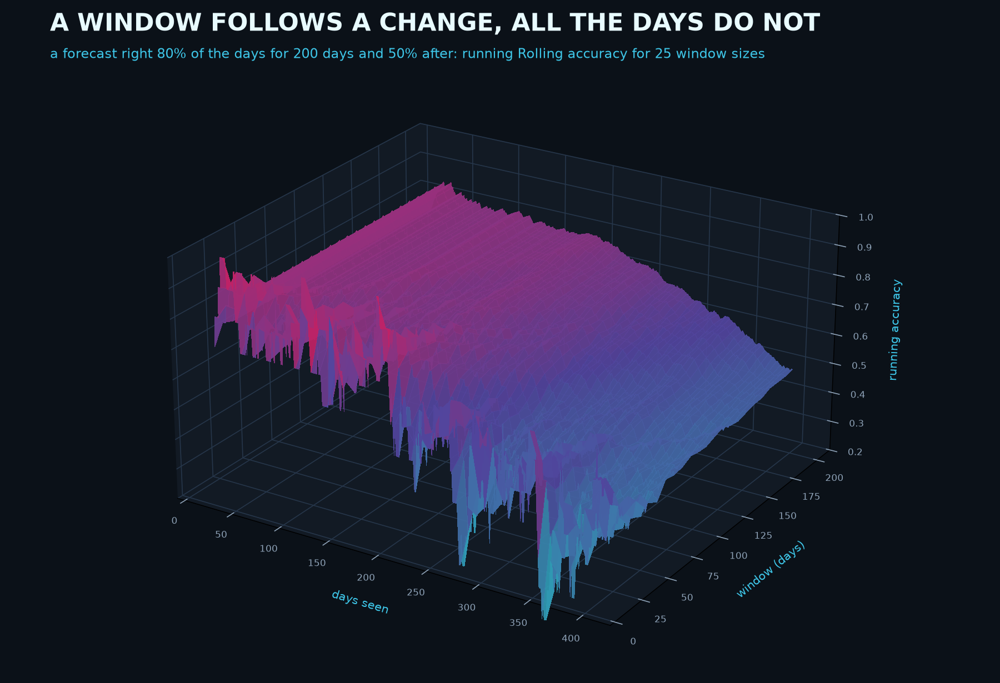
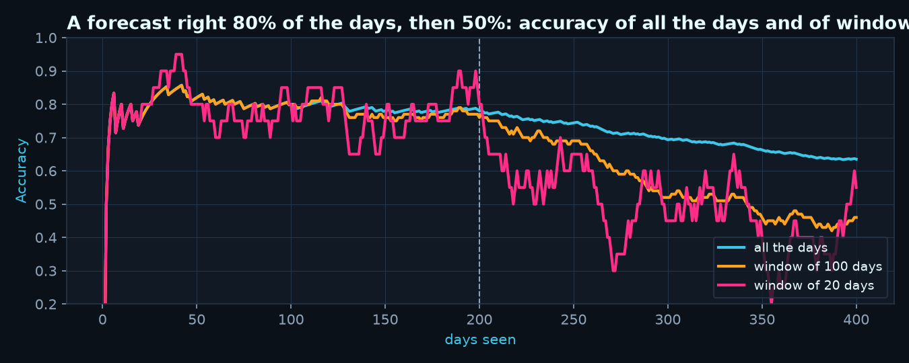

# On a stream: the rolling window

[← On a stream](index.md)

A forecast that was good last month may be bad today: the accuracy of all the days remembers everything and reacts slowly. `Rolling` keeps a metric over the last `window` samples, or the last `window_s` seconds, and forgets the rest. A small window follows a change fast but jumps around; a large window is steady but slow. A robot sampled at 100 Hz uses the window in seconds, in the last section.



The picture follows 400 days of a forecast of a stock index that is right on 80% of the days for the first 200 days and on 50% after that, for 25 window sizes. Each point of the surface is the `Rolling` accuracy after that many days. At day 400 the window of 97 days reads 0.4536 and the window of 200 days reads 0.49, both close to the 0.5 of the last 200 days, while the window of 10 days reads 0.6. At day 250, 50 days after the change, the window of 97 days has already fallen to 0.6907 and the window of 200 days is still at 0.725.

| class | what it does |
|---|---|
| `Rolling` | any metric that can undo an update, over the last samples or the last seconds |

## 1. A first example: the forecast of a stock index

Ten days of an alarm for the crash days of a stock index, scored on all the days and on a window of five.

```python
from dense_armor.core.evaluation.metrics import Accuracy, Rolling

crash = [0, 0, 1, 0, 0, 1, 0, 0, 0, 1]
alarm = [0, 1, 1, 0, 0, 1, 0, 1, 0, 0]
whole, recent = Accuracy(), Rolling(Accuracy(), window=5)
for truth, flag in zip(crash, alarm):
    whole.update(truth, flag)
    recent.update(truth, flag)
print(whole.get(), recent.get(), recent.count)
```

```
0.7 0.6 5
```

Count by hand. The alarm is right on days 1, 3, 4, 5, 6, 7 and 9, and wrong on days 2, 8 and 10: 7 of 10, so 0.7. The window holds days 6 to 10: right on 6, 7 and 9, wrong on 8 and 10, so 3 of 5 = 0.6.



On the same 400 days the accuracy of all the days reads 0.78 at day 150, 0.744 at day 250 and 0.635 at day 400. The window of 100 days reads 0.76, 0.69 and 0.46, and the window of 20 days reads 0.75, 0.65 and 0.55. The dashed line is the change at day 200: at day 400 the accuracy of all the days still says 0.635 although the forecast has been right on half the days for 200 days.

## 2. What the metric keeps

`Rolling` wraps another metric and keeps the pairs that are in the window. When a new pair comes in and the window is full, it asks the wrapped metric to undo the oldest pair (`revert`) and then adds the new one, so the wrapped metric always holds exactly the window. This is why any metric with `revert` can be rolled, and why `R2Score` and `RollingAUC`, which cannot undo an update, are refused.

With `window_s` the window holds the pairs with $t_\text{now} - t < \text{window\_s}$ on the time stamps: at 100 Hz a window of 0.05 s holds 5 samples. A dropped sample does not stretch the window, because it slides on the stamps and not on the count.

**Source:** the docstrings of the module `dense_armor.core.evaluation.metrics.rolling` and of `Rolling` describe the mechanism and cite no paper.

## 3. The parameters

| Parameter | Meaning | Default |
|---|---|---|
| `metric` | the underlying metric; it must implement `revert` | none |
| `window` | window length in samples | `None` |
| `window_s` | window length in seconds, on the time stamps `t` of the pairs | `None` |

Exactly one of `window` and `window_s` must be given. `Rolling` raises `ValueError` if neither or both are given, if `window < 1`, if `window_s <= 0`, or if the metric cannot undo an update.

## 4. The same window on a robot joint

A robot changes over time; the accuracy of last week says little about now. At 100 Hz a window of 0.05 s holds 5 samples.

```python
from dense_armor.core.evaluation.metrics import Accuracy, Rolling

m = Rolling(Accuracy(), window_s=0.05)
for i in range(20):
    m.update(1 if i < 17 else 0, 1, t=i * 0.01)
print(m.count, m.get())
```

```
5 0.4
```

At 100 Hz a window of 0.05 s holds 5 samples: the window keeps the samples with
$t_\text{now} - t < 0.05$. The last three predictions are wrong, so the accuracy over the
window is 2/5. The window uses the timestamps, not the sample count, so a dropped sample does
not stretch it. Any metric with `revert` can be rolled.

## API reference

::: dense_armor.core.evaluation.metrics.rolling.Rolling

---

## Details

### Choices

- **Base implementation:** `Rolling` inherits from `Metric` and delegates to the wrapped metric.
- **The figures** are drawn with the library by `docs/assets/metrics/make_stream_figures.py`. The surface uses one stream of 400 days, the same random draws for the 25 window sizes (10, 17, 25, ... up to 200 days, the whole numbers below a grid of 25 steps); the second figure uses the same 400 days.
