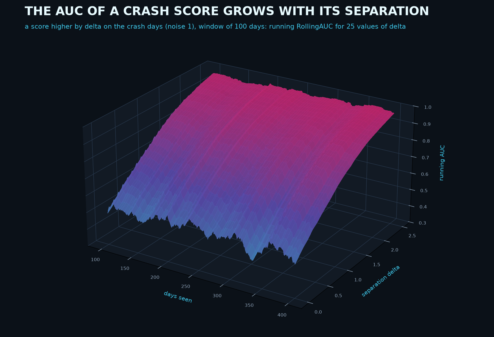
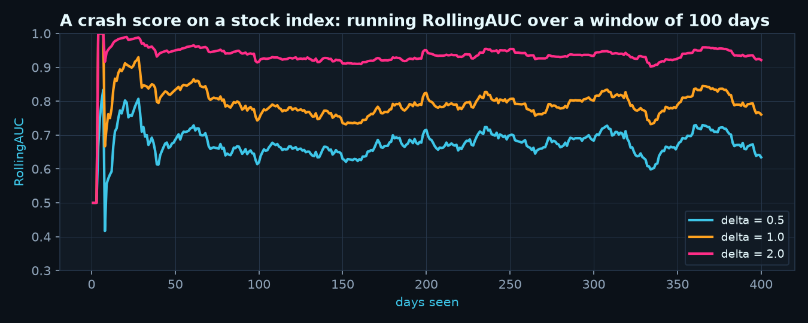

# On a stream: the rolling ROC-AUC

[← On a stream](index.md)

A crash alarm gives a score each day, and the trader chooses a threshold later. The ROC-AUC says how well the score separates the crash days from the normal days, whatever the threshold: it is the probability that a random crash day has a higher score than a random normal day. 1 is a perfect separation and 0.5 is a coin toss. `RollingAUC` computes it exactly on the last `window` days, so it follows a score that gets better or worse. A robot fault score is judged the same way, in the last section.



## 1. A first example: a crash score on a stock index

Ten days: 1 is a crash day and 0 a normal day, and the alarm gives a score each day.

```python
from dense_armor.core.evaluation.metrics import RollingAUC

crash = [0, 0, 1, 0, 0, 1, 0, 0, 0, 1]
score = [0.2, 0.7, 0.9, 0.1, 0.3, 0.8, 0.2, 0.6, 0.1, 0.4]
m = RollingAUC(window=10)
for y, s in zip(crash, score):
    m.update(y, s)
print(round(m.get(), 3))
```

```
0.905
```

Count by hand. The three crash days score 0.9, 0.8 and 0.4, and the seven normal days score 0.2, 0.7, 0.1, 0.3, 0.2, 0.6 and 0.1: 3 × 7 = 21 pairs. The score 0.9 is higher than all 7 normal scores, 0.8 is higher than all 7, and 0.4 is higher than 5 of them (not than 0.7 and 0.6). So the AUC is (7 + 7 + 5) / 21 = 19/21 = 0.905.



On 400 days the score with delta 0.5 reads 0.6293 at day 150, 0.6995 at day 250 and 0.6343 at day 400; delta 1.0 reads 0.7352, 0.8065 and 0.7605; delta 2.0 reads 0.9113, 0.9542 and 0.9214. The long-run values are 0.638, 0.760 and 0.921, and a window of 100 days jumps around them by a few hundredths.

The picture follows 400 days with a crash on 30% of the days and a score that is higher by delta on the crash days, with noise of size 1, over a window of 100 days, for 25 values of delta between 0 and 2.5. Each point of the surface is the `RollingAUC` after that many days. At day 400 the AUC reads 0.495 for delta 0, 0.772 for delta 1.04 and 0.92 for delta 1.98, close to the long-run values 0.5, 0.769 and 0.919, which are $\Phi(\delta/\sqrt{2})$.

| class | what it does |
|---|---|
| `RollingAUC` | the exact ROC-AUC over the last `window` pairs |

## 2. What the metric keeps

`RollingAUC` keeps the last `window` pairs `(y_true, y_score)` and recomputes the sum on demand, so its cost is $O(n_+ n_-)$ per query, negligible for a window of a few hundred samples. The weight `w` of `update` is not used: every pair in the window counts once.

$$\mathrm{AUC} = \frac{1}{n_+ n_-}\sum_{i \in +}\sum_{j \in -}
\begin{cases} 1 & s_i > s_j \\ \tfrac12 & s_i = s_j \\ 0 & \text{otherwise} \end{cases}$$

The result equals the ROC-AUC of a general-purpose machine-learning library on the same window, including ties.

**Source:** the docstring of the module `dense_armor.core.evaluation.metrics.roc_auc` says that the AUC is the probability that a randomly chosen positive is scored higher than a randomly chosen negative, with ties counted as half (Mann and Whitney 1947; Bamber 1975). Its references are Mann, H. B., Whitney, D. R. (1947). On a test of whether one of two random variables is stochastically larger than the other. Annals of Mathematical Statistics 18(1), 50-60, and Bamber, D. (1975). The area above the ordinal dominance graph and the area below the receiver operating characteristic graph. Journal of Mathematical Psychology 12(4), 387-415. The docstring of `RollingAUC` cites no paper.

## 3. The parameters

| Parameter | Meaning | Default |
|---|---|---|
| `window` | window size in samples | 200 |

`RollingAUC` cannot undo one update, so it cannot be wrapped in a `Rolling`: it is already a rolling metric.

## 4. The same score on a robot joint

A fault score is higher by one unit on the faulty samples, with noise of size 1, and 30% of the samples are faulty.

```python
import numpy as np
from dense_armor.core.evaluation.metrics import RollingAUC

rng = np.random.default_rng(0)
m = RollingAUC(window=200)
for _ in range(1000):
    y = int(rng.random() < 0.3)
    m.update(y, y + rng.normal(0, 1.0))
print(round(m.get(), 3))
```

```
0.712
```

Here positives score one unit higher than negatives with unit noise, so the long-run value is
$\Phi(1/\sqrt2) = 0.760$; a window of 200 pairs gives 0.712.

## API reference

::: dense_armor.core.evaluation.metrics.roc_auc.RollingAUC

---

## Details

### Choices

- **Base implementation:** `RollingAUC` inherits from `Metric`, keeps a sliding window of pairs and recomputes the Mann-Whitney sum on demand.
- **The figures** are drawn with the library by `docs/assets/metrics/make_stream_figures.py`. The surface uses one stream of 400 days with a window of 100 days, the same random draws for the 25 values of delta; the second figure uses the same stream.
