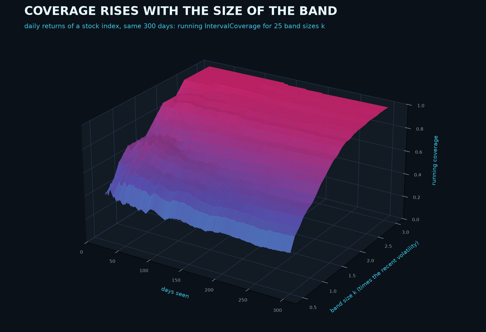
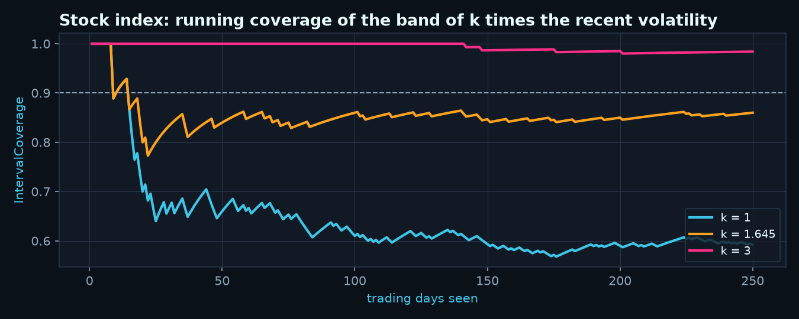

# Uncertainty: interval coverage

[← Uncertainty](index.md)

An interval is a promise: "the truth will be in here". Coverage is how often the promise is kept. A 90% interval should cover the truth on 90% of the days: much less and it is overconfident, much more and it is wider than it needs to be. A robot joint that quotes a torque interval is judged the same way, in the last section.



The picture follows the same 300 days of returns of a stock index, 140 calm days and then 160 stormy ones, for 25 bands. The band of each day goes from −k to +k times the standard deviation s of the 20 days before. Each point of the surface is the `IntervalCoverage` after that many days. After 300 days the coverage reads 0.62 for k = 1.02, 0.87 for k = 1.65 and 0.9867 for k = 3.0: it grows with the size of the band.

| class | what it does |
|---|---|
| `IntervalCoverage` | the share of days when the true value is inside the interval |

## 1. A first example: the daily return of a stock index

A risk desk quotes the band from −0.015 to 0.015 for six days, and then the true returns are known.

```python
from dense_armor.core.evaluation.metrics import IntervalCoverage

stock_return = [0.004, -0.012, 0.008, 0.021, -0.003, -0.018]
cov = IntervalCoverage()
for r in stock_return:
    cov.update(r, (-0.015, 0.015))
print(round(cov.get(), 3), cov.n)
```

```
0.667 6
```

Count by hand. The returns 0.004, −0.012, 0.008 and −0.003 are between −0.015 and 0.015, and 0.021 and −0.018 are not: four hits out of six, 4/6 = 0.667.



On the first 250 of the 300 days the band k = 1 reads 0.9 after 10 days, 0.66 after 50, 0.61 after 100 and 0.592 after 250. The band k = 1.645, which would cover 90% of the days if the returns were Gaussian with the volatility of the day before, reads 0.9, 0.84, 0.86 and 0.86: below the dashed target of 0.9 because the volatility changes after day 140. The band k = 3 reads 1.0 after 100 days and 0.984 after 250.

## 2. What the metric keeps

`IntervalCoverage` keeps the number of days when the truth was inside (`hits_`) and the number of days (`total_`), and the score is their ratio. The interval is closed: a truth equal to the lower or upper end is a hit.

$$\text{coverage} = \frac{1}{n} \sum_{i=1}^{n} [\,lo_i \le y_i \le hi_i\,]$$

**Source:** the docstring of `IntervalCoverage` says "Fraction of true labels inside a prediction interval" and cites no paper. The docstring of the module `dense_armor.core.evaluation.metrics.regression` has a list of references (among them Vovk, V., Gammerman, A., Shafer, G. (2005). Algorithmic Learning in a Random World. Springer), and it does not say which metric each one belongs to.

## 3. The parameters

`IntervalCoverage()` takes no parameters. An interval is added as the prediction of a pair: `update(y_true, (lo, hi), t=None, w=1.0)`. `merge(other)` adds the hits and the counts of two metrics.

## 4. The same score on a robot joint

A joint controller learns the torque $\tau = 2\,\dot q$ from noisy samples and quotes, for each sample, an interval that is meant to hold 90% of the torques (`alpha=0.1`). Coverage and width are scored on 30 samples.

```python
import numpy as np
from dense_armor.roles import AdaptiveConformalRegressor
from dense_armor.core.online.learn.online_dynamics import RecursiveLeastSquares
from dense_armor.core.evaluation.metrics import IntervalCoverage, MeanIntervalWidth
rng = np.random.default_rng(0)
acr, cov, wid = AdaptiveConformalRegressor(RecursiveLeastSquares(), alpha=0.1), IntervalCoverage(), MeanIntervalWidth()
for qd in rng.normal(0, 1, 30):
    x, tau = {"qd": qd}, 2.0 * qd + rng.normal(0, 0.1)
    cov.update(tau, acr.predict_interval(x))
    wid.update(tau, acr.predict_interval(x))
    acr.learn_one(x, tau)
print(round(cov.get(), 3), round(wid.get(), 3))
```

```
0.8 0.326
```

The interval was asked for 90% coverage (alpha=0.1) and on these 30 samples it covers 80% of the torques, 24 of 30: with so few samples the coverage is still far from settled. Its mean width 0.326 is close to the narrowest honest 90% interval for Gaussian noise of standard deviation 0.1, which is $2 \cdot 1.645 \cdot 0.1 = 0.329$.

## API reference

::: dense_armor.core.evaluation.metrics.regression.IntervalCoverage

---

## Details

### Choices

- **Base implementation:** `IntervalCoverage` inherits from `Metric` and tracks the hits and the count.
- **Merge:** two `IntervalCoverage` metrics merge by adding their counts.
- **The figures** are drawn with the library by `docs/assets/metrics/make_uncertainty_figures.py`. The surface uses one stream of 300 days (140 with a standard deviation of 0.5% and 160 with 1.5%) and the same bands for the three pages; the second figure uses the first 250 of those days.
