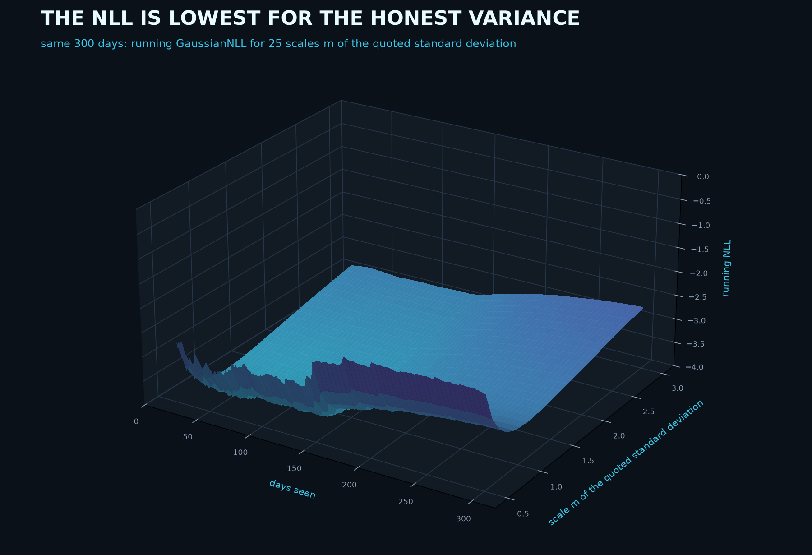
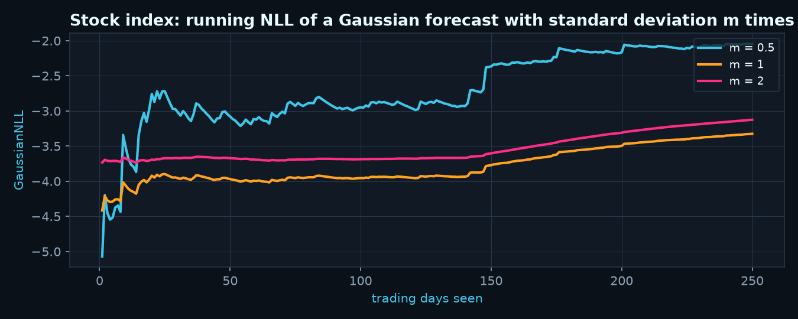

# Uncertainty: Gaussian negative log-likelihood

[← Uncertainty](index.md)

When a model says "tomorrow's return will be 0%, give or take 1%" it gives a mean and a variance. The Gaussian negative log-likelihood scores both at once: it is low when the truth is near the mean and the variance is neither too small, which punishes a sure mistake very hard, nor too large, which wastes the forecast. A robot joint with the same kind of forecast is scored in the last section.



## 1. A first example: the daily return of a stock index

Six days of returns are scored against a forecast with mean 0 and variance 0.0001, a standard deviation of 1%.

```python
from dense_armor.core.evaluation.metrics import GaussianNLL

stock_return = [0.004, -0.012, 0.008, 0.021, -0.003, -0.018]
nll = GaussianNLL()
for r in stock_return:
    nll.update(r, (0.0, 0.0001))
print(round(nll.get(), 4))
```

```
-2.8546
```

Count by hand. For every day the first term of $\tfrac12 \ln(2\pi\sigma^2) + (y-\mu)^2 / (2\sigma^2)$ is $\tfrac12 \ln(2\pi \cdot 0.0001) = -3.6862$. The second terms are 0.08, 0.72, 0.32, 2.205, 0.045 and 1.62, and their mean is 4.99 / 6 = 0.8317. So the score is −3.6862 + 0.8317 = −2.8546. Lower is better, and it can be negative because it is the log of a density.

With the same returns, a forecast that is too sure (variance 0.000004, a standard deviation of 0.2%) scores 15.496, and a forecast that is too vague (variance 0.0025, a standard deviation of 5%) scores −2.0435: both are worse than −2.8546.



On the first 250 of the 300 days the forecast m = 1 reads −4.0611 after 10 days, −3.9691 after 50, −3.9548 after 100 and −3.3252 after 250. The forecast m = 0.5 (too sure) reads −3.5179, −3.0797, −2.9474 and −2.0446, and the forecast m = 2 (too vague) reads −3.6771, −3.6716, −3.6868 and −3.1254. All three get worse when the stormy days start, but the honest one stays the lowest.

The picture follows the same 300 days of returns of a stock index, 140 calm days and then 160 stormy ones, for 25 forecasts with mean 0 and a standard deviation of m times the standard deviation of the 20 days before. Each point of the surface is the `GaussianNLL` after that many days. After 300 days the score reads −3.2568 for m = 1.02, −3.1462 for m = 1.65 and −2.7063 for m = 3.0, and the lowest of the 25 is −3.265 for m = 1.125: a forecast that quotes about the real volatility scores best.

| class | what it does |
|---|---|
| `GaussianNLL` | the mean of the negative log of the Gaussian density at the true value |

## 2. What the metric keeps

`GaussianNLL` keeps the sum of the scores (`sum_`) and the number of pairs (`total_`), and the score is their ratio. The prediction is a pair `(mean, variance)` or an object with the attributes `mean` and `var`. The variance is kept at least `eps`, so that a variance of zero never divides by zero.

$$\mathrm{NLL} = \frac{1}{2} \ln(2\pi\sigma^2) + \frac{(y - \mu)^2}{2\sigma^2}$$

**Source:** the docstring of `GaussianNLL` says "Gaussian negative log-likelihood", gives an example and cites no paper. The docstring of the module `dense_armor.core.evaluation.metrics.regression` has a list of references, and it does not say which metric each one belongs to.

## 3. The parameters

| Parameter | Meaning | Default |
|---|---|---|
| `eps` | the smallest variance used | 1e-12 |

`merge(other)` adds the sums and the counts of two metrics with the same `eps`.

## 4. The same score on a robot joint

A joint controller quotes a torque as a mean and a variance, and the sensor says what the torque was.

```python
from dense_armor.roles import Estimate
from dense_armor.core.evaluation.metrics import GaussianNLL
m = GaussianNLL()
m.update(0.1, Estimate(mean=0.0, var=0.01))
print(round(m.get(), 4))
```

```
-0.8836
```

For one pair with $\mu = 0$, $\sigma^2 = 0.01$ and $y = 0.1$ the first term is $\tfrac12 \ln(2\pi \cdot 0.01) = -1.3836$ and the second is $0.1^2 / (2 \cdot 0.01) = 0.5$, so the score is −0.8836.

## API reference

::: dense_armor.core.evaluation.metrics.regression.GaussianNLL

---

## Details

### Choices

- **Base implementation:** `GaussianNLL` inherits from `Metric` and tracks the sum of the scores and the count.
- **Merge:** two `GaussianNLL` metrics merge by adding their sums and their counts.
- **The figures** are drawn with the library by `docs/assets/metrics/make_uncertainty_figures.py`. The surface uses one stream of 300 days (140 with a standard deviation of 0.5% and 160 with 1.5%) and the same forecasts for the three pages; the second figure uses the first 250 of those days.
