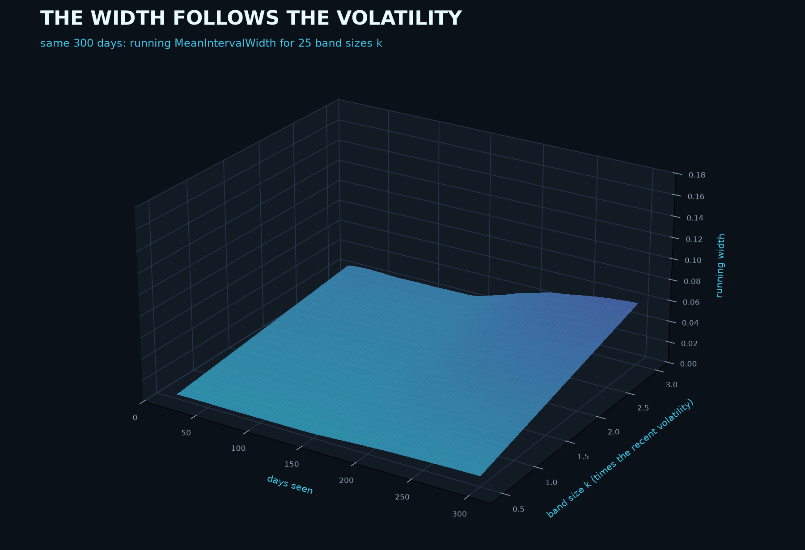
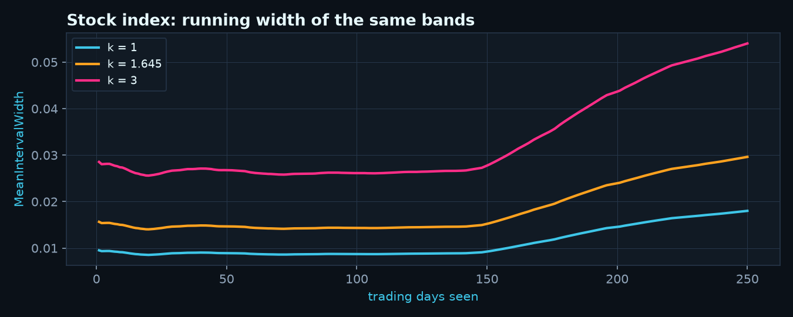

# Uncertainty: interval width

[← Uncertainty](index.md)

Coverage alone can be cheated: an interval from minus infinity to plus infinity covers everything. The mean width says how much the interval costs, in the units of the number. A good interval is as narrow as it can be while its coverage stays at the promised level, so the width is always read together with the [coverage](coverage.md). A robot joint that quotes a torque interval is judged the same way, in the last section.



## 1. A first example: the daily return of a stock index

A risk desk quotes the band from −0.015 to 0.015 for six days.

```python
from dense_armor.core.evaluation.metrics import MeanIntervalWidth

stock_return = [0.004, -0.012, 0.008, 0.021, -0.003, -0.018]
wid = MeanIntervalWidth()
for r in stock_return:
    wid.update(r, (-0.015, 0.015))
print(round(wid.get(), 3), wid.n)
```

```
0.03 6
```

Count by hand. Every day the width is 0.015 − (−0.015) = 0.03, so the mean of six equal widths is 0.03.



On the first 250 of the 300 days the band k = 1 reads 0.0091 after 10 days, 0.0089 after 50, 0.0087 after 100 and 0.018 after 250. The band k = 1.645 reads 0.015, 0.0147, 0.0143 and 0.0296, and the band k = 3 reads 0.0273, 0.0268, 0.0261 and 0.054. The width doubles once the stormy days start, because the bands follow the recent volatility.

The picture follows the same 300 days of returns of a stock index, 140 calm days and then 160 stormy ones, for 25 bands from −k to +k times the standard deviation s of the 20 days before. Each point of the surface is the `MeanIntervalWidth` after that many days. After 300 days the width reads 0.0202 for k = 1.02, 0.0326 for k = 1.65 and 0.0594 for k = 3.0: it grows with k, and it jumps when the stormy days start.

| class | what it does |
|---|---|
| `MeanIntervalWidth` | the mean of the width `hi - lo` of the interval |

## 2. What the metric keeps

`MeanIntervalWidth` keeps the sum of the widths (`sum_`) and the number of pairs (`total_`), and the score is their ratio.

$$\bar{w} = \frac{1}{n} \sum_{i=1}^{n} (hi_i - lo_i)$$

**Source:** the docstring of `MeanIntervalWidth` says "Mean width of a prediction interval" and cites no paper. The docstring of the module `dense_armor.core.evaluation.metrics.regression` has a list of references, and it does not say which metric each one belongs to.

## 3. The parameters

`MeanIntervalWidth()` takes no parameters. An interval is added as the prediction of a pair: `update(y_true, (lo, hi), t=None, w=1.0)`. `merge(other)` adds the sums and the counts of two metrics.

## 4. The same score on a robot joint

A joint controller quotes a torque interval for each sample, and the sensor says what the torque was.

```python
from dense_armor.core.evaluation.metrics import MeanIntervalWidth

m = MeanIntervalWidth()
for y, lo, hi in [(0.5, 0.0, 1.0), (1.0, 0.0, 2.0)]:
    m.update(y, (lo, hi))
print(m.get())
```

```
1.5
```

The first interval is 1.0 wide and the second is 2.0 wide, so the mean width is (1.0 + 2.0) / 2 = 1.5. The robot example of the [coverage page](coverage.md) scores the same intervals for coverage and width.

## API reference

::: dense_armor.core.evaluation.metrics.regression.MeanIntervalWidth

---

## Details

### Choices

- **Base implementation:** `MeanIntervalWidth` inherits from `Metric` and tracks the sum of the widths and the count.
- **Merge:** two `MeanIntervalWidth` metrics merge by adding their sums and their counts.
- **The figures** are drawn with the library by `docs/assets/metrics/make_uncertainty_figures.py`. The surface uses one stream of 300 days (140 with a standard deviation of 0.5% and 160 with 1.5%) and the same bands for the three pages; the second figure uses the first 250 of those days.
