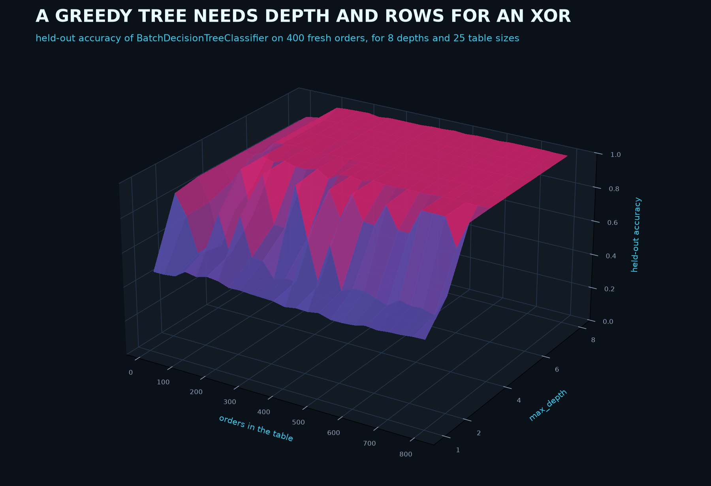
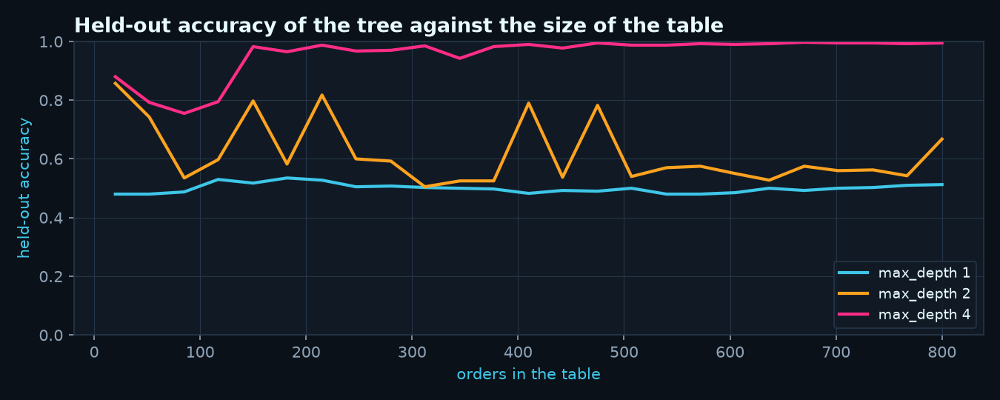

# Algorithms that work on the whole table by nature

[← Machine learning](index.md)

A desk keeps a table of orders and wants to know, from the size and the depth of the book, if a fill will be good. For some questions the answer is not a line: the fill is good when the size and the depth are on opposite sides of zero. A decision tree answers this by cutting the table in pieces, and it needs the whole table to choose its cuts. Three pieces of the library learn from the whole table in one call, the classic way, and sit next to their online counterparts so that the two ways can be run on the same data. A robot that must tell a stable run from an unstable one has the same kind of table.



## 1. A first example: a tree on 400 orders

The fill is good when the size and the depth have opposite signs, which no single cut and no line can tell. The tree is fitted on 400 orders and judged on 400 fresh ones. The first number is the depth allowed to the tree, the second is the accuracy.

```python
import numpy as np
from dense_armor.core.online.tree.batch import BatchDecisionTreeClassifier

rng = np.random.default_rng(0)
A = rng.normal(size=(800, 2))
X = [{"size": float(u), "depth": float(v)} for u, v in A]
y = [int((u > 0) != (v > 0)) for u, v in A]
for depth in (1, 4):
    m = BatchDecisionTreeClassifier(max_depth=depth).fit(X[:400], y[:400])
    hits = [m.predict_one(x) == t for x, t in zip(X[400:], y[400:])]
    print(depth, round(float(np.mean(hits)), 3))
```

```
1 0.463
4 0.973
```

A tree of depth 1 makes one cut on one feature, and no single cut tells the pair: it is at chance. A tree of depth 4 cuts twice and more and learns the rule.



Over 5 tables, the median held-out accuracy reads 0.487 and 0.512 for a depth of 1 on tables of 85 and 800 orders, 0.535 and 0.667 for a depth of 2, 0.755 and 0.995 for a depth of 4, and 0.897 and 0.995 for a depth of 8. A greedy tree needs depth and rows for this kind of rule: with a depth of 2 it is still at 0.667 on 800 orders.

| class or function | what it does |
|---|---|
| `BatchDecisionTreeClassifier` | a CART tree built from all the rows at once |
| `OnlineBaggingClassifier.fit_batch` | fits each member of the ensemble on a bootstrap of the table |
| `TextVectorizer` | builds the vocabulary and the document frequencies from a list of documents |

## 2. What it does

`BatchDecisionTreeClassifier` builds a CART tree from all the rows at once. The sections below keep the three examples of the page as they were.

**Source:** Breiman, L., Friedman, J., Olshen, R., Stone, C. (1984). Classification and Regression Trees, chapter 2 (the gini impurity); Oza, N., Russell, S. (2001), section 2, page 2 (the batch protocol of bagging).

## 3. A decision tree on the whole training set

`BatchDecisionTreeClassifier` builds a CART tree from all the rows at once.

```python
from dense_armor.core.online.tree.batch import BatchDecisionTreeClassifier

X = [{"x": 0.0}, {"x": 1.0}, {"x": 2.0}, {"x": 3.0}]
y = [0, 0, 1, 1]
clf = BatchDecisionTreeClassifier(max_depth=2).fit(X, y)
print(clf.predict_one({"x": 0.5}), clf.predict_one({"x": 2.5}))
```

```
0 1
```

At each node the tree takes the feature and the threshold with the lowest weighted gini impurity (Breiman, Friedman, Olshen and Stone, 1984, chapter 2). The tree is frozen when `fit` returns: `learn_one` after the fit leaves it unchanged. Its online counterpart is `HoeffdingTreeClassifier`, and [Static vs online](../drones/static_vs_online.md) runs the two on the same stream with accuracy, time and memory.

## 4. Bagging fitted on bootstrap samples

`OnlineBaggingClassifier.fit_batch` fits each member on a bootstrap of the dataset, the same size with replacement, as in the batch protocol of Oza and Russell (2001), section 2, page 2.

```python
from dense_armor.core.online.ensemble.bagging import OnlineBaggingClassifier
from dense_armor.core.online.tree.batch import BatchDecisionTreeClassifier

X = [{"x": float(i)} for i in range(8)]
y = [0, 0, 0, 0, 1, 1, 1, 1]
bag = OnlineBaggingClassifier(BatchDecisionTreeClassifier(max_depth=2), n_models=5, seed=0)
bag.fit_batch(X, y, seed=0)
print(bag.predict_one({"x": 1.0}), bag.predict_one({"x": 6.0}), len(bag.members_))
```

```
0 1 5
```

The row with `x = 1.0` gets the class 0, the row with `x = 6.0` the class 1, and the ensemble has five members. The online protocol, `learn_one`, gives each member a number of copies of each row drawn from a Poisson law with mean 1; the two protocols reach the same limit as the number of rows grows and differ on a finite sample. Each member is any estimator with a `fit`; with the batch tree as above, the whole ensemble works on the whole dataset.

## 5. Text: a vocabulary fitted on a list of documents

`TextVectorizer.fit` builds the vocabulary and the document frequencies from a list of documents; `learn_one` builds the same state one document at a time.

```python
from dense_armor.core.signals.preprocessing.vectorizer import TextVectorizer

docs = ["the quick brown fox", "a quick brown dog", "the fox and the dog"]
a = TextVectorizer().fit(docs)
b = TextVectorizer()
for d in docs:
    b.learn_one(d)
print(a.tfidf_.n_docs_, a.tfidf_.df_ == b.tfidf_.df_)
```

```
3 True
```

The three documents, fitted in one call or learned one at a time, give the same number of documents and the same document frequency table. `transform_matrix(docs)` turns a list of documents into a sparse matrix of TF-IDF scores in one pass. The cosine ranking and the comparison with the batch library are on the page [Text vectorizer](../preprocessing/text_vectorizer.md).

## 6. The same on a robot

A robot has logged runs, each with a speed and a load, and a run is stable when the two are on opposite sides of their usual values.

```python
import numpy as np
from dense_armor.core.online.tree.batch import BatchDecisionTreeClassifier

rng = np.random.default_rng(1)
A = rng.normal(size=(800, 2))
X = [{"speed": float(u), "load": float(v)} for u, v in A]
y = [int((u > 0) != (v > 0)) for u, v in A]
for depth in (1, 4):
    m = BatchDecisionTreeClassifier(max_depth=depth).fit(X[:400], y[:400])
    hits = [m.predict_one(x) == t for x, t in zip(X[400:], y[400:])]
    print(depth, round(float(np.mean(hits)), 3))
```

```
1 0.487
4 0.998
```

Again the tree of depth 1 is at chance and the deeper one learns the rule.

## API reference

::: dense_armor.core.online.tree.batch.BatchDecisionTreeClassifier

---

## Details

### Choices

- **The figures** are drawn with the library by `docs/assets/fit/make_fit_figures.py`: tables of 20 to 800 orders and 400 fresh orders for the accuracy, the fill good when `(size > 0) != (depth > 0)`, median over 5 seeds.
