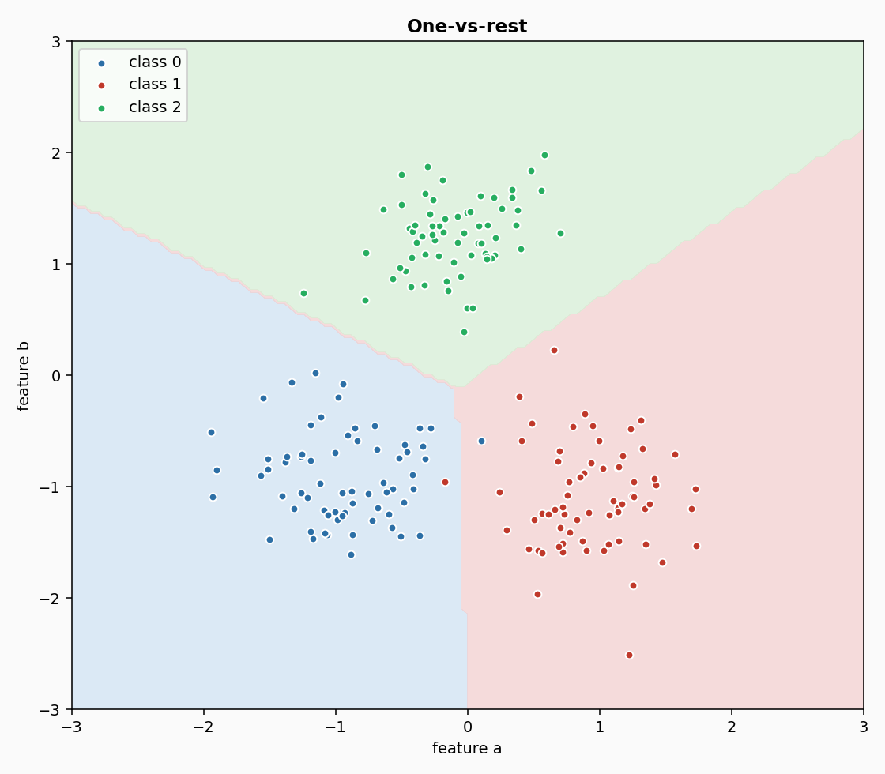
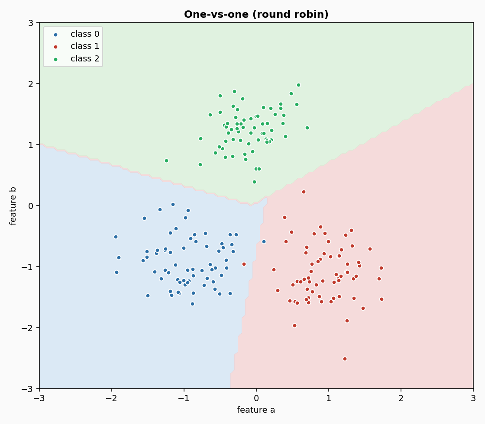
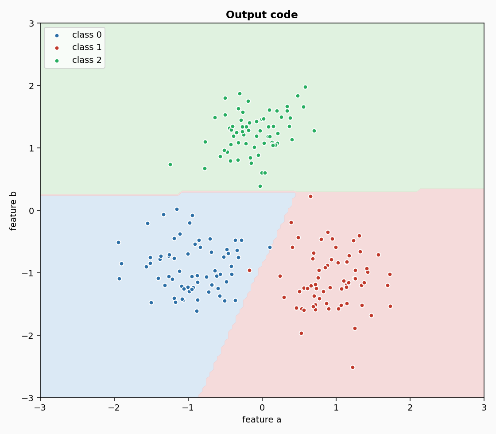

# Multiclass from binary classifiers

**In plain words:** Three ways to make a two-class classifier answer a three-class question. One trains a classifier per class, one trains a classifier per pair of classes and lets them vote, one gives every class a binary code and reads the answer off the closest code. You pass in the binary classifier, the wrapper handles the rest.

## 1. What they are

Many learners only know how to answer a yes-or-no question. A logistic regression separates two classes; a perceptron draws one line; a support-vector machine builds one hyperplane. Yet a robot has to choose among many states at once, an agent among many intents, a document among many topics. The question is how to reuse the binary learner you already have.

There are three classical answers, and all three are wrappers. You give them a callable that returns a fresh binary classifier, they train as many classifiers as they need, and they combine their votes into one label.

- **OneVsRestClassifier**: one classifier per class. The classifier for class `c` is trained on the samples of `c` as positive, everything else negative. At prediction, each classifier gives a score, and the class with the highest score wins. This is Definition 2 (unordered, one-against-all) of Fuerkranz (2002).

- **OneVsOneClassifier**: one classifier per pair of classes. For three classes there are `3 * 2 / 2 = 3` classifiers, one for each pair. At prediction, every classifier votes for one of its two classes, and the class with the most votes wins. Fuerkranz (2002), Definition 4 (round robin, pairwise).

- **OutputCodeClassifier**: every class gets a codeword of `+1` and `-1` bits. One classifier is trained per *column*: the classes whose bit is `+1` are positive, the classes whose bit is `-1` are negative. At prediction, the bit predictions form a binary string, and the class whose codeword has the smallest Hamming distance from that string wins. Dietterich and Bakiri (1995), Section 2.

## 2. How they work

All three share the same interface and the same bookkeeping. The `binary_factory` argument is a callable with no arguments; it is called once per internal binary problem, and must return a *fresh* classifier, because each internal problem is independent. If you pass a classifier instance instead, all the internal problems would share their weights, and the wrapper would not work.

The wrapper adds new classes on the fly. The first sample fixes the feature order (sorted keys); when a new label appears, a new internal classifier is created and trained from scratch on that sample. The `predict_proba_one` returns a distribution over the classes seen so far, normalised to sum to 1; the `predict_one` returns the class with the highest score.

For **OneVsRest**, at prediction time each internal classifier is queried and its probability for the positive class is read. The scores are normalised across classes.

For **OneVsOne**, each internal classifier is queried and its probability for its first class decides which of the two classes gets a vote. The votes are then normalised across classes. When two classes have the same number of votes, the one whose pair was trained first wins; on a tie it is the class seen earlier in the training stream.

For **OutputCode**, the internal classifiers return bit predictions (either `+1` or `-1`). The distance to each class codeword is the number of positions where the bits differ. The class with the smallest distance wins; the probability returned is a softmax over the negative distances.

## 3. Smallest example

Three classes, two features, a logistic regression as the binary learner.

```python
from dense_armor.utility.linear.glm import LogisticRegression
from dense_armor.utility.multiclass import OneVsOneClassifier
from dense_armor.utility.optim import SGD

def factory():
    return LogisticRegression(optimizer=SGD(lr=0.5))

clf = OneVsOneClassifier(binary_factory=factory)
for _ in range(30):
    clf.learn_one({"x": 0.0, "y": 0.0}, "A")
    clf.learn_one({"x": 1.0, "y": 1.0}, "B")
    clf.learn_one({"x": -1.0, "y": 1.0}, "C")

print(clf.predict_one({"x": 0.05, "y": 0.05}))
print(clf.predict_one({"x": 1.05, "y": 0.95}))
print(clf.predict_one({"x": -0.95, "y": 0.95}))
```

```
A
B
C
```

The same pattern works with `OneVsRestClassifier` and `OutputCodeClassifier`. The three give the same answer on this easy problem. The figures below show each strategy on the same designed stream; because the classes are well separated, the three regions are close to each other, and the differences appear only on harder data.

## 4. The three strategies, seen



One-vs-rest with three classes. Each class has its own region, and the boundaries are the lines where two internal classifiers disagree. The regions are large and simple; a class that is rarely seen may get a small region and lose a lot of its own samples to the others, which is the classic weakness of one-vs-rest on imbalanced data.



One-vs-one with three classes. The pairwise boundaries cross and form a more irregular partition. Each classifier only sees the two classes of its pair, so the boundary between two classes is drawn without interference from the third. This is why the pairwise strategy is often the most accurate of the three, at the cost of training `c (c - 1) / 2` classifiers instead of `c`.



Error-correcting output codes with the default code matrix of size 6. The regions are again irregular, but they come from a different mechanism: every column of the code matrix is a binary problem, and the answer is the class whose codeword is closest to the bits the columns predict. The redundancy of the code lets the method correct a wrong bit: if one column misclassifies, the Hamming distance to the correct class is still the smallest among all the rows, provided the other columns vote consistently. This is the meaning of the word error-correcting.

## 5. Numbers

On `DriftStream` sudden drift, 2000 samples, 4 features, median of 5 seeds, p99 of one `learn_one` + `predict_one` over 3000 samples on one CPU thread, the base classifier is LogisticRegression with SGD:

| wrapper | accuracy | accuracy IQR | p99 | state |
|---|---|---|---|---|
| OneVsRestClassifier | 0.994 | 0.001 | 0.116 ms | 704 B |
| OneVsOneClassifier | 0.998 | 0.000 | 0.049 ms | 562 B |
| OutputCodeClassifier | 0.991 | 0.001 | 0.357 ms | 1 462 B |

All three reach an accuracy above 0.99 on this easy binary stream. One-vs-one is both the most accurate and the fastest, because the stream has two classes, so there is a single pair and one logistic regression is trained (two for one-vs-rest), and the vote is a simple count. Output-code is the slowest, because it trains six binary problems (the default `code_size = 6`) instead of one or two, and every prediction queries all six. The wrappers are cheap in memory: under 1.5 KB of state, independent of the stream length.

## Details

### References

- Fuerkranz, J. (2002). Round Robin Classification. Journal of Machine Learning Research 2, 721-747. Definition 2 (unordered, one-against-all binarization) and Definition 4 (round robin, pairwise binarization), both on printed page 723; the simple voting technique for the pairwise case is described in Section 3, Round Robin Classification (printed pages 723-726).
- Dietterich, T. G., Bakiri, G. (1995). Solving multiclass learning problems via error-correcting output codes. Journal of Artificial Intelligence Research 2, 263-286. Section 2 (the distributed output code).

### Choices stated explicitly

- **`binary_factory` is a callable.** The wrapper calls it once per internal problem, expecting a fresh classifier each time. A single shared instance would share weights, which is never what you want. The parameter is typed as a `Callable[[], Classifier]`.
- **`OutputCodeClassifier` softmax.** The paper only defines a hard decision (Hamming distance, smallest wins). This implementation returns a distribution over classes (a softmax over the negative distances) so that the interface stays the same as the other wrappers and of the rest of the library. The `predict_one` follows the paper's decision exactly.
- **`code_size`.** `code_size=6` by default. With `c` classes and `code_size` bits, a good code has enough columns so that every row is distinct and every pair of rows differs in more than one position (the paper's row and column separation property). The random code generated here uses a `numpy.Generator` with the given `seed`; pass `seed=None` for a fresh draw each run.
- **Order of classes in OneVsOne.** The pairs are always trained in the order `(class_i, class_j)` with `str(class_i) <= str(class_j)`, so the internal problems are deterministic regardless of the order the classes were first seen.
- **Feature keys.** `feature_keys=None` takes the sorted keys of the first sample seen. A missing key or a NaN value is counted in `n_missing`.
- **New classes on the fly.** The wrapper adds a new internal problem when a new class appears. It does not retrain the existing ones.

### Measured cost

p99 of one `learn_one` plus one `predict_one` over 3000 samples, 4 features, one CPU thread: 0.116 ms (OneVsRest), 0.049 ms (OneVsOne), 0.357 ms (OutputCode). `budget_s` is 0.005 s, 0.01 s, 0.01 s. The state is `O(c)` for the first two and `O(c * code_size)` for the third, independent of the stream length.

### No pure form

None of the three provides an `init_state` / `step` pair. The state is a dict or a list of independent classifiers, each with its own weights and its own update rule; it is not a fixed-size array and would not survive `jax.lax.scan`. `check_estimator` runs `check_step_is_pure` and `check_step_is_jittable` on them with no check skipped, and both pass.

### Development diary

The three wrappers were written after `neighbors/` and before `multioutput/`, because a classifier chain needs a binary classifier and the multiclass wrappers provide one. The interfaces are consistent: every wrapper takes a callable, exposes `predict_proba_one` and `predict_one`, and counts missing samples in `n_missing`. The output-code wrapper's softmax over negative Hamming distances is a choice, not a paper result: the paper's decision is hard, and the softmax is added so that `predict_proba_one` behaves like every other classifier in the library.
