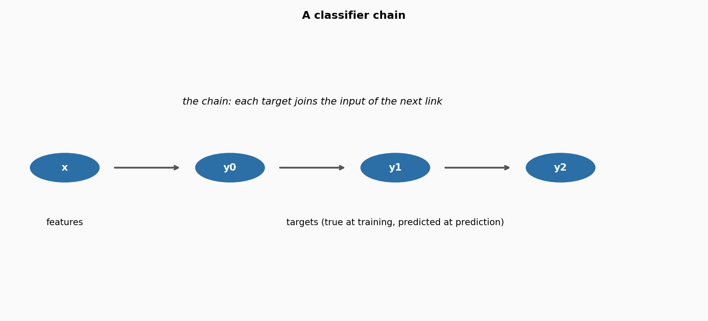

# Multi-output prediction

**In plain words:** Sometimes you want to predict more than one thing at once. A joint angle and its velocity, a stock price and its volume, three contact states of a foot. Five estimators do this. The simplest trains one model per target and ignores the others. The chains add the targets of the earlier models as inputs to the later ones, so the prediction of one target can help another.

## 1. What they are

In single-target prediction you have one number to guess: a class, a price, a temperature. In multi-output prediction you have several, and they may depend on each other. A robot foot has two contact states (heel and toe); the second is much more likely to be true when the first is, and a model that knows about the first can predict the second better. A portfolio has many asset returns; the returns of two correlated assets move together, and a model that knows one helps with the other.

The simplest baseline is to ignore the dependence and train one independent model per target. The estimators here start from that baseline and add several ways to exploit the dependence. Every estimator takes a dict of targets `y = {name: value}` and returns a dict of predictions, one per target.

## 2. The five estimators

- **PerOutputClassifier / PerOutputRegressor**: one model per target, learned independently. This is the single-target baseline (ST) of Spyromitros-Xioufis, Tsoumakas, Groves and Vlahavas (2016), Section 2. Fast, simple, and often hard to beat.

- **ClassifierChain / RegressorChain**: one model per target, chained in an order. The model for target `j` sees `x` plus the targets of the previous links. At training it sees the *true* values of the previous targets; at prediction it sees the *predicted* values. Read, Pfahringer, Holmes and Frank (2009) introduced the classifier chain; Dembczynski, Cheng and Huellermeier (2010), Section 4.1, formalised it; Spyromitros-Xioufis et al. (2016), Section 2.2, adapted it to regression.

- **ProbabilisticClassifierChain**: estimates the joint distribution of all targets by the product rule and predicts the most probable joint combination. Dembczynski et al. (2010), Section 4, eq. 10-12. On the right loss function it is the Bayes-optimal decision, but it costs `2**m` label evaluations per prediction, where `m` is the number of targets.

## 3. How a chain works



A chain of three targets, `y0 -> y1 -> y2`. The model for `y0` sees only `x`. The model for `y1` sees `x` and `y0`. The model for `y2` sees `x`, `y0` and `y1`. Each link is an ordinary single-target model; the chain is the pattern of links.

The chain trains on the *true* targets of the previous links (at training time they are all available) and predicts with the *predicted* ones (at prediction time they are all it has). This is the well-known discrepancy that Spyromitros-Xioufis et al. (2016) call out explicitly: the model is trained on inputs that never appear at prediction time. It does not always hurt, but on strongly dependent targets it can: a wrong prediction at link 2 propagates through the rest of the chain.

The **order of the chain is a hyperparameter**. It is a permutation of the target names, passed explicitly as a list, or drawn at random with a seed. If `y0` is the useful input for `y1`, the order `[y0, y1]` gives `y1` a clean signal. The reversed order gives `y1` to `y0`, which is not what `y0` depends on, and the accuracy drops. The measurement below shows the effect.

## 4. Smallest example

Three targets, two features, a logistic regression as the base learner.

```python
from dense_armor.utility.linear.glm import LogisticRegression
from dense_armor.utility.multioutput import ClassifierChain
from dense_armor.utility.optim import SGD

def factory():
    return LogisticRegression(optimizer=SGD(lr=0.5), intercept=True)

clf = ClassifierChain(factory=factory, order=["y0", "y1"])
for _ in range(30):
    clf.learn_one({"a": 0.0}, {"y0": 0, "y1": 0})
    clf.learn_one({"a": 1.0}, {"y0": 1, "y1": 1})

print(clf.predict_one({"a": 1.05}))
```

```
{'y0': 1, 'y1': 1}
```

The classifier for `y0` learns from `a` alone. The classifier for `y1` learns from `a` and from the true `y0`. At prediction, `y0` is predicted first, then passed to the second classifier, which predicts `y1`. On this easy problem both targets come out correct. For the probabilistic version, `ProbabilisticClassifierChain` also enumerates the four possible joint combinations and returns the most probable one.

## 5. Numbers

On `DriftStream` sudden drift, 2000 samples, 4 features, 3 targets, median of 5 seeds, p99 of one `learn_one` + `predict_one` over 3000 samples on one CPU thread:

| estimator | p99 | state |
|---|---|---|
| PerOutputClassifier | 0.124 ms | 871 B |
| PerOutputRegressor | 0.121 ms | 789 B |
| ClassifierChain | 0.284 ms | 949 B |
| RegressorChain | 0.168 ms | 867 B |
| ProbabilisticClassifierChain | 0.879 ms | 949 B |

The per-output baseline is the fastest: three independent models, three independent predictions, no chain overhead. The chains cost slightly more, because they do the same work plus an expansion of the input at each link. `ProbabilisticClassifierChain` is the slowest, because at prediction it evaluates all `2**3 = 8` combinations of the three targets; the cost grows exponentially with the number of targets.

### Effect of the chain order

To see the effect, consider a small stream where `y0` depends on `x0` alone, and `y1` depends on `x1` and `y0`. The order `[y0, y1]` gives `y1` a clean signal from `y0`; the order `[y1, y0]` gives `y0` a noisy signal from `y1`, which is not what `y0` depends on. The two orders give very different results:

| order | accuracy | accuracy IQR |
|---|---|---|
| y0 -> y1 | 0.934 | 0.006 |
| y1 -> y0 | 0.836 | 0.003 |

The forward order is about ten accuracy points better, with five seeds each. This is the order effect: same targets, same base learner, same stream, but the chain links one direction helpful and the other direction harmful. Dembczynski et al. (2010), Section 4.3, note that the product rule does not depend on the order of the labels, but two chains train *different models* on different expanded inputs, and only the useful direction helps.

## Details

### References

- Read, J., Pfahringer, B., Holmes, G., Frank, E. (2020). Classifier chains: a review and perspectives. arXiv:1912.13405v2. Sections 1-2 (definition and motivation of the classifier chain).
- Dembczynski, K., Cheng, W., Huellermeier, E. (2010). Bayes optimal multilabel classification via probabilistic classifier chains. ICML. Section 4, eq. 10 (Bayes-optimal decision for the subset zero-one loss), eq. 11 (product rule for the joint), eq. 12 (probabilistic classifier chain).
- Spyromitros-Xioufis, E., Tsoumakas, G., Groves, W., Vlahavas, I. (2016). Multi-target regression via input space expansion: treating targets as inputs. Machine Learning 104(1), 55-98. Section 2 (per-output baseline, Regressor Chains), Section 2.2 (the discrepancy between training and prediction on the meta-inputs).

### Choices stated explicitly

- **Chain order.** The order is a hyperparameter. `order=None` draws a random permutation of the targets from a `numpy.Generator` with the given `seed`; a list of target names fixes the order. If a target name in the list is not in the training data, a `ValueError` is raised at the first `learn_one`. Dembczynski et al. (2010), Section 4.3.
- **True vs predicted.** The chains train on the *true* previous targets and predict with the *predicted* ones. The alternative, a cross-validation estimate of the previous targets during training, is the SST idea of Spyromitros-Xioufis et al. (2016), Section 2.1, which reduces the discrepancy at the cost of an internal cross-validation; it is not implemented here.
- **Probabilistic chain inference.** Exact inference over all `2**m` labelings, which is the paper's formulation. The paper itself notes that this limits the applicability of the method to data sets with a small to moderate number of labels, say, not more than about 15. A call with more than 15 targets raises a `ValueError` in `joint_proba_one`, and the caller is asked to use `ClassifierChain` instead.
- **Marginals from the joint.** `predict_proba_one` returns the marginals `P(y_i = 1 | x)`, obtained by summing the joint over all labelings where target `i` is 1. The full joint is available through `joint_proba_one`, as a dict `{tuple_of_bits: probability}`.
- **Empty before learning.** All five estimators return `{}` from `predict_proba_one` and `predict_one` before the first `learn_one`.
- **Target values.** The classifiers expect integer labels (0 or 1); the regressors expect floats. A NaN value in `x` or in a target is counted in `n_missing` and the sample is skipped.

### Measured cost

p99 of one `learn_one` plus one `predict_one` over 3000 samples, 4 features, 3 targets, one CPU thread: 0.124 ms, 0.121 ms, 0.284 ms, 0.168 ms, 0.879 ms for the five estimators. `budget_s` is 0.005 s for the two per-output baselines, 0.01 s for the two deterministic chains, and 0.05 s for the probabilistic chain, which pays the `2**m` enumeration at prediction. State size between 789 B and 949 B, independent of the stream length.

### No pure form

None of the five estimators provides an `init_state` / `step` pair. The state is a set of independent models (one per target or one per chain link), each with its own internal state; the whole set is not a fixed-size array and would not survive `jax.lax.scan`. The two checks `check_step_is_pure` and `check_step_is_jittable` are skipped explicitly, with the reason in `_unit_test_skips`.

### Development diary

The chain order effect was measured on a designed stream (`y0` from `x0`, `y1` from `x1` and `y0`) rather than on `DriftStream`. The reason is that `DriftStream` has no multi-output targets of its own; using it would mean fabricating targets and the effect would not be visible. The designed stream shows the effect cleanly: 0.934 vs 0.836, five seeds, same learner, same stream, only the order differs. The measurement is in `test_chain_order_changes_predictions`, with the numbers written into the test docstring.
