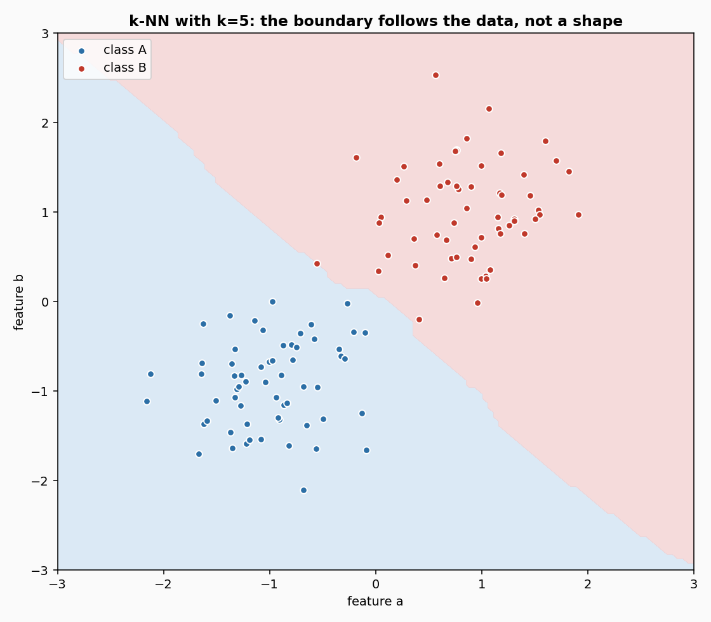
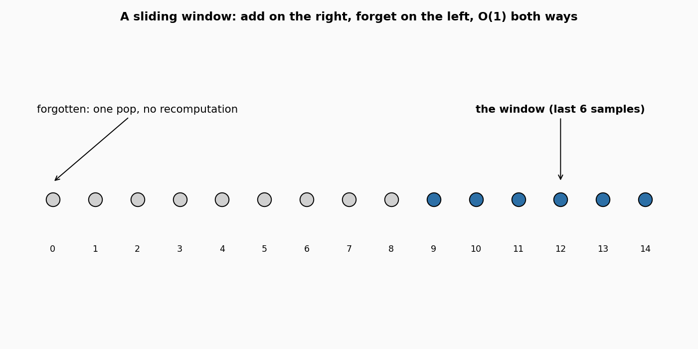

# Nearest neighbours

**In plain words:** Two estimators that answer a new sample by looking at the most similar samples they have seen. A classifier returns the most common label among the closest neighbours; a regressor returns their average. They keep only the last few hundred samples, so they are fast and cheap, and old samples drop out on their own.

## 1. What they are

Imagine you are standing in a crowd and want to guess the mood of the room. Instead of a model with weights and gradients, you ask the five people nearest to you how they feel, and take the majority answer. That is the entire idea of the k-nearest-neighbour rule, and it has not changed since the 1950s.

The rule is stated in words, not with an equation, because no paper in this folder defines it. The definition is:

    For a new sample x, find the k samples of the training set
    closest to x, under a chosen distance. The classifier returns
    the majority label among them; the regressor returns their
    mean (or a weighted mean).

Two flavours are provided. `KNNClassifier` returns the most frequent class, optionally weighted by `1 / distance` so that a very close neighbour counts more. `KNNRegressor` returns the (optionally weighted) average of the target values. Both use the same `LazySearch` internally, which is the piece that keeps the sliding window and does the exact scan.

## 2. How the window works

The training set is a *sliding window*: the `window_size` most recent samples, no more. When a new sample arrives:

    learn_one(x, y)   append (x, y) to the right of the deque
                      if the deque is full, the oldest sample drops
                      automatically (deque maxlen)

    predict_one(x)    scan every sample in the window, compute its
                      distance to x, take the k smallest, and
                      combine their labels

The `forget()` method on `LazySearch` pops the oldest sample from the left and returns its label. It is exact: no recomputation, no reindexing, just a `popleft`. This is what lets a caller hold a fixed-size memory of the recent stream without ever growing.

## 3. The distance

By default, the distance is the Euclidean distance between the two feature vectors. The parameter `p` chooses the Minkowski norm: `p = 2` is Euclidean, `p = 1` is Manhattan (sum of absolute differences), any `p >= 1` is allowed. A larger `p` weights the largest difference more; a smaller `p` treats all differences more evenly.

A learned metric can be passed in with the `metric` parameter. Any object that exposes `distance(x, x2) -> float` works, which is the interface of `MetricLearner` (see `learn/metric_learning.md`). When a metric is given, `p` is ignored and the metric decides the distance. This is how the OASIS or LEGO metric learners of the library can be plugged into a k-NN classifier without touching the window or the vote logic.



Sixty samples per class, drawn from two Gaussian blobs. The shaded regions are the k-NN prediction: blue for class A, red for class B. With `k = 5` the boundary is a piecewise-linear curve that follows the actual data, not a straight line or a circle. In regions where the classes overlap, the boundary is irregular; a very small `k` would make it more irregular, a very large `k` would smooth it out toward the mean of the two blobs.

## 4. The window, seen



Fifteen samples arrive in order. The blue dots are the six most recent; the gray dots are older and have already dropped out of the window. Adding a new sample on the right and dropping the oldest on the left are both constant-time operations. The window size is the only memory the estimator uses, independent of how long the stream has been running.

## 5. Smallest example

```python
from dense_armor.utility.neighbors import KNNClassifier

clf = KNNClassifier(window_size=20, n_neighbors=3)
for _ in range(5):
    clf.learn_one({"a": 0.0, "b": 0.0}, "A")
    clf.learn_one({"a": 1.0, "b": 1.0}, "B")

print(clf.predict_one({"a": 0.05, "b": 0.05}))
print(clf.predict_one({"a": 0.95, "b": 0.95}))
```

```
A
B
```

The window holds ten samples: five near `(0, 0)` labelled A and five near `(1, 1)` labelled B. A query at `(0.05, 0.05)` has all three nearest neighbours in the A group, and returns A. A query at `(0.95, 0.95)` does the opposite. No training step happened: the two `learn_one` calls simply appended to the window.

For a regressor, the same window returns a number instead of a label:

```python
from dense_armor.utility.neighbors import KNNRegressor

reg = KNNRegressor(window_size=10, n_neighbors=3)
for i in range(10):
    reg.learn_one({"x": float(i)}, float(i))

print(round(reg.predict_one({"x": 4.4}), 2))
```

```
4.0
```

The three nearest samples to `4.4` are at `4`, `5` and `3`, whose targets are 4, 5 and 3. Their mean is 4.0.

## 6. Numbers

On `DriftStream` sudden drift, 2000 samples, 4 continuous features, median of 5 seeds, p99 of one `learn_one` + `predict_one` over 3000 samples on one CPU thread, window_size=200, n_neighbors=5:

| estimator | accuracy | accuracy IQR | p99 | state |
|---|---|---|---|---|
| KNNClassifier | 0.996 | 0.002 | 0.164 ms | 13 224 B |
| KNNRegressor | -- | -- | 0.142 ms | 14 600 B |

On this stream the k-NN classifier is the most accurate of the eight learners compared (see the `multioutput` page for the full table), and it is the second fastest of the strong ones, after `OneVsOne`. The price is memory: 13 KB against the few hundred bytes of the naive Bayes classifiers. The window keeps 200 samples of 4 features; the same sample count in higher dimension would scale linearly.

## Details

### References

No paper in this folder defines the k-nearest-neighbour rule. The definition in section 1 is the standard one, stated in words with no equation number, as the task asks. The rule appears in the classical literature (Fix and Hodges 1951, Cover and Hart 1967) but neither PDF is here, so no page or equation number is cited.

### Choices stated explicitly

- **Exact search.** Every query scans the whole window. This is `O(window_size)` distance computations per query, which for a few hundred samples is faster than maintaining a spatial tree and easier to keep exact. The task explicitly requests exact search (`LazySearch`).
- **Window size.** `window_size=100` by default. The window is bounded; `memory_class = "O(window_size * d)"`. Every `forget()` is exact and constant time.
- **Ties.** When two neighbours are at the same distance, the order in the window breaks the tie: the one added earlier wins. `np.argsort(..., kind='stable')` makes this deterministic.
- **Missing features.** `feature_keys=None` takes the sorted keys of the first sample seen. A key that is not in a later sample counts as 0; a value that cannot be cast to float (or is NaN) is treated as a missing sample and counted in `n_missing`.
- **Weights.** `weights="uniform"` counts each neighbour equally. `weights="distance"` weights each neighbour by `1 / max(distance, eps)`, so a very close neighbour dominates. `eps = 1e-9` prevents a division by zero when a query coincides with a training sample.
- **Regressor variance.** `predict_one(x, return_std=True)` returns the (weighted or unweighted) mean and its standard deviation, useful for a quick uncertainty estimate.
- **Learned metric.** When `metric` is given, `p` is ignored and the metric provides the distance. This lets a `MetricLearner` of the library drive the search.

### Measured cost

p99 of one `learn_one` plus one `predict_one` over 3000 samples, window_size=200, n_neighbors=5, 4 features, one CPU thread: 0.164 ms for the classifier, 0.142 ms for the regressor. The state is 13 224 B and 14 600 B respectively, which is `window_size * d * 8` plus the label buffer. `budget_s` is 0.001 s for both. The cost per query is `O(window_size * d)` for the distances plus `O(window_size log window_size)` for the sort.

### No pure form

Neither class provides an `init_state` / `step` pair. The state is the sliding window itself, a deque of variable length and dict keys, which is not a fixed-size array and would not survive `jax.lax.scan`. The two checks `check_step_is_pure` and `check_step_is_jittable` are skipped explicitly, with the reason stated in `_unit_test_skips`.

### Development diary

The first version of the Minkowski distance had a subtle mistake in the `p = 1` branch: the code summed absolute differences and then took a square root, which silently returned the Euclidean norm divided by `sqrt(d)`. The test `test_minkowski_p1_vs_p2` caught it by checking that the two distances to `(3, 4)` from `(6, 8)` are 5 (Euclidean) and 7 (Manhattan), not the same number. The two branches now compute the two norms directly.
