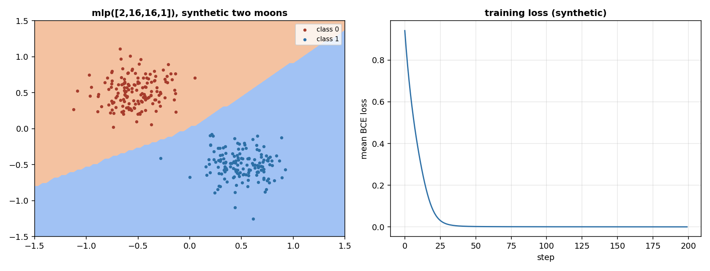

# Chains: how do I join layers into a network and train it one sample at a time or on a batch?

A layer takes a vector and returns a vector. A network is layers joined end to end: the output of one is the input of the next. This page builds the two containers that do the joining, a chain and a branching, and two classic networks from them, the MLP and the residual MLP. Every container is itself a layer, with `forward`, `backward` and `params()`, so a container goes inside another container, inside a `Residual`, and inside the streaming interface of the library. The same code trains on a batch of joint states and on one state at a time.

The layers are the ones of the page `neural/layers.md`, on a synthetic stream of joint states: positions `q`, velocities `qd`, torques `tau`, at a fixed rate, labelled `synthetic`.

## 1. A chain of layers

A chain applies its layers in order. The forward pass runs from the first layer to the last, the backward pass from the last to the first, and the gradient of a layer is the gradient the next layer sends back.

~~~python
import jax
import jax.numpy as jnp
from dense_armor.utility.neural.chain import Sequential
from dense_armor.utility.neural.layers import Dense
from dense_armor.utility.neural.activations import Relu

s = Sequential([Dense(3, 4, jax.random.PRNGKey(0)), Relu(),
                Dense(4, 2, jax.random.PRNGKey(1))])
x = jnp.ones(3)
print(s.forward(x).shape, len(s))
~~~

~~~
(2,) 3
~~~

A chain of three layers takes a vector of length 3 and returns a vector of length 2. `params()` returns the parameters of every layer in order, `zero_grad()` sets their gradients to zero, and `backward(g)` returns the gradient of the input.

## 2. The same code, on a batch and on one sample

A chain works on a batch and on a single sample with the same `forward` and `backward`. A vector of length `n_in` gives a vector of length `n_out`; a batch of shape `(m, n_in)` gives a batch of shape `(m, n_out)`. The single sample is the matching row of the batch.

~~~python
import numpy as np
import jax
import jax.numpy as jnp
from dense_armor.utility.neural.chain import Sequential
from dense_armor.utility.neural.layers import Dense

s = Sequential([Dense(3, 2, jax.random.PRNGKey(0))])
xb = jnp.array([[1.0, 2.0, 3.0], [4.0, 5.0, 6.0]])
yb = s.forward(xb)
y1 = s.forward(xb[0])
print(np.allclose(np.asarray(y1), np.asarray(yb[0])))
~~~

~~~
True
~~~

The batch and the single sample give the same output. The gradient has the same property: the gradient of a mean loss on a batch is the sum of the gradients of the samples, taken one at a time and divided by the batch size.

~~~python
import numpy as np
import jax
import jax.numpy as jnp
from dense_armor.utility.neural.chain import Sequential
from dense_armor.utility.neural.layers import Dense

s = Sequential([Dense(3, 2, jax.random.PRNGKey(0))])
xb = jnp.ones((4, 3))
s.zero_grad()
yb = s.forward(xb)
s.backward(jnp.ones_like(yb) / 4.0)
g_batch = [np.array(p.grad) for p in s.params()]

s.zero_grad()
for row in xb:
    y = s.forward(row)
    s.backward(jnp.ones_like(y) / 4.0)
g_online = [np.array(p.grad) for p in s.params()]
print(all(np.allclose(a, b, atol=1e-5) for a, b in zip(g_batch, g_online)))
~~~

~~~
True
~~~

This is why the same training loop works on a batch and on a stream: the gradient of the mean loss is the average of the per-sample gradients, and the two ways of taking it agree to `1e-5`.

## 3. Branches that merge

A branching sends the same input to several branches and merges the outputs. With `merge="add"` the outputs are summed, so every branch must return the same shape. With `merge="concat"` the outputs are concatenated on the last axis, so the branches can return different widths.

~~~python
import jax
import jax.numpy as jnp
from dense_armor.utility.neural.chain import Parallel
from dense_armor.utility.neural.layers import Dense

d1 = Dense(3, 4, jax.random.PRNGKey(0))
d2 = Dense(3, 4, jax.random.PRNGKey(1))
p = Parallel([d1, d2], "add")
x = jnp.ones(3)
print(p.forward(x).shape)
~~~

~~~
(4,)
~~~

Two branches of width 4, summed, still give a vector of width 4. With `concat` the widths add up.

~~~python
import jax
import jax.numpy as jnp
from dense_armor.utility.neural.chain import Parallel
from dense_armor.utility.neural.layers import Dense

p = Parallel([Dense(3, 4, jax.random.PRNGKey(0)),
              Dense(3, 2, jax.random.PRNGKey(1))], "concat")
print(p.forward(jnp.ones(3)).shape)
~~~

~~~
(6,)
~~~

The backward pass of `"add"` passes the same `g` to every branch and sums the gradients of the input; the backward pass of `"concat"` splits `g` by the width of each branch. A branch of a different width with `"add"` raises `ValueError`, because the sum is not defined.

A chain and a branching are layers, so they combine: a `Parallel` inside a `Sequential`, a `Sequential` inside a `Parallel`, a `Parallel` inside a `Residual`.

## 4. The MLP

An MLP is a chain of dense layers with an activation between them. The function builds it from a list of widths, from the input to the output; the last dense layer has no activation after it, because the activation is the job of the loss.

~~~python
import jax
from dense_armor.utility.neural.models import mlp

m = mlp([2, 8, 1], jax.random.PRNGKey(0))
print([p.value.shape for p in m.params()])
~~~

~~~
[(2, 8), (8,), (8, 1), (1,)]
~~~

The chain has two dense layers (the `(2, 8)` and the `(8, 1)` with their biases) and one activation between them, which has no parameters. The activation is `"relu"` by default; `"tanh"` and `"sigmoid"` are also accepted. A list of one width, or an activation that is not one of the three names, raises `ValueError`.

The initialisation follows the activation. He et al. 2015 (Eqn.(15), page 5) derive the variance for the rectifier and name the linear case as Xavier. The dense layers use `"he"` with `relu` and `"xavier"` with `tanh` and `sigmoid`. This is our choice, stated in the docstring of `mlp`.

## 5. The residual MLP

A residual MLP is a chain of blocks. Each block is a chain of a `Residual` around two dense layers with a rectifier between them, followed by a rectifier: the block of Figure 2, page 2 of He et al. 2016 with the addition `y = F(x) + x` of Eqn.(1), page 3.

~~~python
import jax
from dense_armor.utility.neural.models import resnet_mlp

r = resnet_mlp(8, 2, 3, 2, jax.random.PRNGKey(0))
print(len(r.params()))
~~~

~~~
12
~~~

A network with two blocks has 12 parameters: a `Dense(3, 8)` and its bias (2), two blocks with two dense layers each (4 parameters per block, 8), and a final `Dense(8, 2)` and its bias (2). The blocks have no normalisation: the block of the figure is written for convolutions, and this is the dense form. This is our choice, stated in the docstring.

The left panel is the decision boundary of `mlp([2, 16, 16, 1])` after 200 steps of Adam on a synthetic two-moons set; the right panel is the mean binary cross-entropy against the step, from the same run, with final loss `0.0003`. The set is made by the script, labelled `synthetic` in the title of both panels.

## Details

### References

- He, K., Zhang, X., Ren, S., Sun, J. (2016). *Deep Residual Learning for Image Recognition.* arXiv:1512.03385. Page 2, Figure 2: the residual building block. Page 3, Eqn.(1): `y = F(x, {W_i}) + x`, with the note that the dimensions of `x` and `F` must be equal.
- He, K., Zhang, X., Ren, S., Sun, J. (2015). *Delving Deep into Rectifiers.* arXiv:1502.01852. Page 5, Eqn.(15): `(1/2)(1 + a**2) n_l Var[w_l] = 1`, with `a = 0` the rectifier case and `a = 1` the linear case named Xavier.
- The chain rule applied in reverse order, the sum of the gradients of the samples of a batch, the XOR problem and the two-moons set are textbook definitions and carry no citation.

### Choices stated explicitly

- `Sequential` tests once, when it is built, whether a layer's `forward` accepts `training`, and calls it either as `forward(x, training=training)` or as `forward(x)`. The test is made with `inspect.signature`, and a layer whose `forward` has a `**kwargs` also receives `training`.
- `Parallel` is the only branching form. A general graph with shared nodes, where the same layer is reachable from more than one path, is not built: a shared layer would accumulate its gradient twice in a naive sum, and a correct shared-node backward needs an explicit graph traversal that this page does not have.
- `mlp` uses `"he"` with `relu` and `"xavier"` with `tanh` and `sigmoid`. The reason is in section 4: He et al. 2015 derive the variance for the rectifier and name the linear case as Xavier.
- The block of `resnet_mlp` has no normalisation. The block of Figure 2 of He et al. 2016 is written for convolutions; this is the dense form, and adding a normalisation layer would be our choice, not the paper's.
- The two-moons set in `benchmarks/neural/chains_figure.py` is made by a function of the script, with a fixed seed, labelled `synthetic`.

### Development diary

The delivery leaves out the convolutional network, the recurrent network and the transformer block, which need the layers of N02b and the attention of N07: task N03b. A general graph with shared nodes is also left out, as stated in the Choices.
